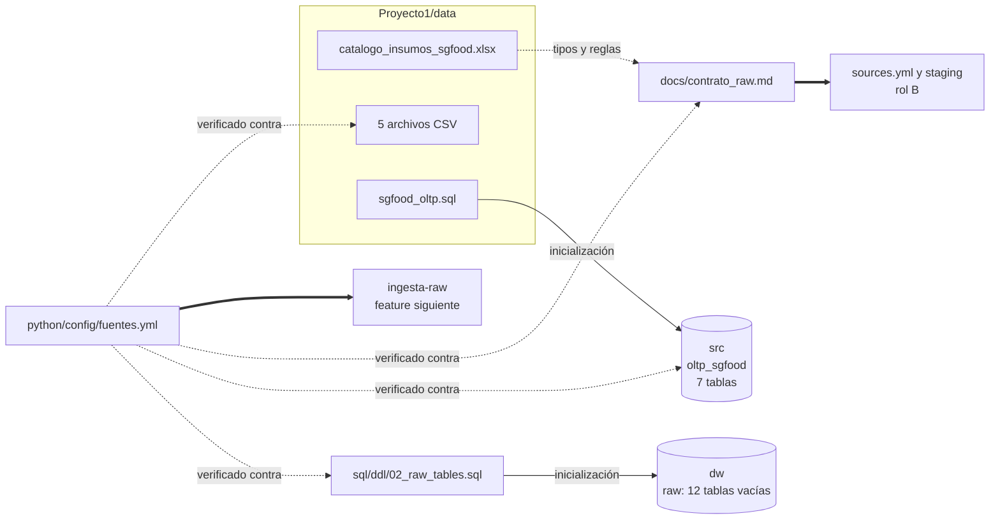

# Diseño — `contrato-raw`

La configuración de fuentes (`fuentes.yml`) es la fuente de verdad legible por máquina. De ella dependen el DDL de `raw`, el documento de contrato y, más adelante, el código de carga. Las pruebas verifican que los tres coincidan entre sí y con los datos oficiales.

- **Requisitos:** [requirements.md](requirements.md)
- **Tareas:** [tasks.md](tasks.md)
- **Steering:** [architecture.md](../../steering/architecture.md)

## Decisiones de diseño

| # | Decisión | Alternativa descartada | Motivo |
|---|----------|------------------------|--------|
| K1 | `fuentes.yml` como fuente de verdad del contrato | Solo un documento Markdown | Lo consumen las pruebas ahora y el código de carga después; un solo lugar que mantener |
| K2 | DDL de `raw` escrito a mano y verificado contra `fuentes.yml` | Generar el DDL desde el YAML | El enunciado pide un script DDL entregable; escrito a mano es legible y revisable |
| K3 | Tablas `raw` con el mismo nombre que la fuente, sin prefijo | Prefijos `oltp_` y `csv_` | No hay colisiones entre las 12 tablas; dbt puede separar las fuentes en `sources.yml` |
| K4 | `sgfood_oltp.sql` montado directamente en la inicialización de `src` | Copiarlo a `sql/` o cargarlo con Python | No se duplica ni se modifica el archivo oficial |
| K5 | Datos oficiales versionados con `-text` en `.gitattributes` | Dejarlos fuera del repositorio | `docker compose up` debe reproducir el entorno; son sintéticos y pesan menos de 500 KB |
| K6 | Extracción con conversión a texto en el origen | Convertir tipos en Python | Representación única y predecible para B; ver "Representación de valores" |
| K7 | Columnas de auditoría al final de cada tabla | Al inicio | Las columnas de negocio conservan el orden de la fuente |

## Flujo



## Tablas de `raw`

| Tabla `raw` | Tipo | Origen | Granularidad | Filas esperadas |
|-------------|------|--------|--------------|----------------:|
| `sucursal` | postgres | `oltp_sgfood.sucursal` | Una fila por sucursal | 6 |
| `categoria` | postgres | `oltp_sgfood.categoria` | Una fila por categoría | 8 |
| `marca` | postgres | `oltp_sgfood.marca` | Una fila por marca | 10 |
| `producto` | postgres | `oltp_sgfood.producto` | Una fila por producto | 80 |
| `cliente` | postgres | `oltp_sgfood.cliente` | Una fila por cliente | 250 |
| `venta` | postgres | `oltp_sgfood.venta` | Una fila por venta | 1200 |
| `venta_detalle` | postgres | `oltp_sgfood.venta_detalle` | Una fila por línea de venta | 3209 |
| `inventario_bodega` | csv | `inventario_bodega.csv` | Una fila por fecha de corte, sucursal y producto | 3840 |
| `proveedores_precios` | csv | `proveedores_precios.csv` | Una fila por proveedor, producto y fecha de vigencia | 103 |
| `devoluciones` | csv | `devoluciones.csv` | Una fila por devolución | 80 |
| `metas_ventas` | csv | `metas_ventas.csv` | Una fila por periodo y sucursal | 48 |
| `promociones` | csv | `promociones.csv` | Una fila por promoción | 30 |

Total: 8.864 filas. Los conteos se obtuvieron al perfilar los archivos oficiales; las pruebas los confirman contra la base fuente y los CSV.

### Columnas por tabla

Todas las columnas de negocio son `TEXT` en `raw`. El tipo esperado y la regla provienen del diccionario oficial y guían el trabajo de `staging`.

**Fuente transaccional (`oltp_sgfood`)**

| Tabla | Columnas en orden (tipo esperado, regla) |
|-------|------------------------------------------|
| `sucursal` | `id_sucursal` (INTEGER, PK) · `nombre` (VARCHAR) · `ciudad` (VARCHAR) · `departamento` (VARCHAR) |
| `categoria` | `id_categoria` (INTEGER, PK) · `nombre` (VARCHAR, UQ) |
| `marca` | `id_marca` (INTEGER, PK) · `nombre` (VARCHAR, UQ) |
| `producto` | `id_producto` (INTEGER, PK) · `sku` (VARCHAR, UQ) · `nombre` (VARCHAR) · `id_categoria` (INTEGER, FK categoria) · `id_marca` (INTEGER, FK marca) · `unidad_medida` (VARCHAR) · `costo_base` (NUMERIC(12,2)) · `precio_lista` (NUMERIC(12,2)) · `activo` (BOOLEAN) |
| `cliente` | `id_cliente` (INTEGER, PK) · `nit` (VARCHAR) · `nombre` (VARCHAR) · `tipo_cliente` (VARCHAR) · `municipio` (VARCHAR, admite nulos) · `departamento` (VARCHAR, admite nulos) · `fecha_alta` (DATE) |
| `venta` | `id_venta` (BIGINT, PK) · `fecha` (DATE) · `id_cliente` (INTEGER, FK cliente) · `id_sucursal` (INTEGER, FK sucursal) · `canal` (VARCHAR) · `metodo_pago` (VARCHAR) · `estado` (VARCHAR) |
| `venta_detalle` | `id_detalle` (BIGINT, PK) · `id_venta` (BIGINT, FK venta) · `id_producto` (INTEGER, FK producto) · `cantidad` (INTEGER, > 0) · `precio_unitario` (NUMERIC(12,2), ≥ 0) · `descuento` (NUMERIC(5,4), 0 a 1) · `subtotal` (NUMERIC(14,2), ≥ 0) |

**Archivos CSV**

| Tabla | Columnas en orden (tipo esperado, regla) |
|-------|------------------------------------------|
| `inventario_bodega` | `fecha_corte` (DATE) · `id_sucursal` (INTEGER, FK lógica) · `id_producto` (INTEGER, FK lógica) · `stock_disponible` (INTEGER) · `stock_minimo` (INTEGER) · `stock_maximo` (INTEGER) · `lote` (VARCHAR) · `fecha_vencimiento` (DATE) |
| `proveedores_precios` | `id_proveedor` (INTEGER) · `proveedor` (VARCHAR) · `id_producto` (INTEGER, FK lógica) · `costo_proveedor` (NUMERIC(12,2)) · `plazo_dias` (INTEGER) · `fecha_vigencia` (DATE) |
| `devoluciones` | `id_devolucion` (INTEGER, PK lógica) · `fecha` (DATE) · `id_venta` (BIGINT, FK lógica) · `id_producto` (INTEGER, FK lógica) · `cantidad` (INTEGER) · `motivo` (VARCHAR) |
| `metas_ventas` | `periodo` (VARCHAR(7), formato `YYYY-MM`) · `id_sucursal` (INTEGER, FK lógica) · `meta_ventas` (NUMERIC(14,2)) · `meta_unidades` (INTEGER) |
| `promociones` | `id_promocion` (INTEGER, PK lógica) · `nombre` (VARCHAR) · `fecha_inicio` (DATE) · `fecha_fin` (DATE) · `id_categoria` (INTEGER, FK lógica) · `porcentaje_descuento` (NUMERIC(5,4), 0 a 1) |

"FK lógica" y "PK lógica" significan que la relación existe en el negocio pero ningún motor la impone: debe validarse con pruebas dbt.

### Columnas de auditoría

| Columna | Tipo | Valor |
|---------|------|-------|
| `_loaded_at` | `TIMESTAMPTZ NOT NULL DEFAULT now()` | Momento de la carga; el mismo para todas las filas de una ejecución |
| `_source` | `TEXT NOT NULL` | `oltp_sgfood.<tabla>` o el nombre del archivo CSV |

## Representación de valores

Reglas que B puede dar por ciertas al escribir `staging`.

| Caso | Cómo llega a `raw` |
|------|--------------------|
| Nulo en la base fuente | `NULL` |
| Campo vacío en un CSV | `NULL` |
| Texto | Tal como está en la fuente, sin recortar ni cambiar mayúsculas |
| Entero | Dígitos sin separadores: `1200` |
| Decimal de la base fuente | Con la escala de la columna: `35.47`, `0.1500` |
| Decimal de un CSV | Tal como está en el archivo; puede variar la cantidad de decimales: `144615.3` |
| Fecha | ISO `YYYY-MM-DD` |
| Booleano | `true` o `false` |
| `periodo` de `metas_ventas` | `YYYY-MM`, sin día |

Para la base fuente, la extracción convierte cada columna a texto en la propia consulta, de modo que el formato lo define PostgreSQL y no el driver. Los CSV se leen como texto, sin inferencia de tipos, con codificación `utf-8-sig`.

## Contrato de la configuración de fuentes

Archivo: `Proyecto1/python/config/fuentes.yml`.

```yaml
version: 1
fuentes:
  - tabla_raw: venta
    tipo: postgres            # postgres | csv
    origen: oltp_sgfood.venta # tabla calificada, o nombre de archivo en data/
    columnas:
      - id_venta
      - fecha
      - id_cliente
      - id_sucursal
      - canal
      - metodo_pago
      - estado
  - tabla_raw: inventario_bodega
    tipo: csv
    origen: inventario_bodega.csv
    columnas: [fecha_corte, id_sucursal, id_producto, stock_disponible,
               stock_minimo, stock_maximo, lote, fecha_vencimiento]
```

| Campo | Regla |
|-------|-------|
| `version` | Entero; coincide con la versión del documento de contrato |
| `tabla_raw` | Único, `snake_case`; nombre de la tabla en el schema `raw` |
| `tipo` | `postgres` o `csv` |
| `origen` | Para `postgres`, `schema.tabla`; para `csv`, nombre de archivo relativo a `data/` |
| `columnas` | Lista ordenada y sin duplicados; no incluye las columnas de auditoría |

El archivo no contiene credenciales, rutas absolutas ni parámetros de conexión.

## Cambios al entorno

| Archivo | Cambio |
|---------|--------|
| `docker-compose.yml` | Servicio `src`: montar `./data/sgfood_oltp.sql` como script de inicialización de solo lectura |
| `sql/ddl/02_raw_tables.sql` | Nuevo. Se ejecuta después de `01_schemas.sql` por orden alfabético |
| `.gitattributes` | Nuevo, en `Proyecto1/`: `data/* -text` |
| `tests/entorno/test_schemas.py` | La prueba que exige `raw` sin tablas pasa a exigir solo `staging` y `marts` sin tablas |

`sgfood_oltp.sql` fija `search_path` solo para su propia sesión. Todo acceso posterior a la fuente debe calificar las tablas con `oltp_sgfood.`.

Los scripts de inicialización solo se ejecutan con volúmenes vacíos. En un entorno ya creado hay que reiniciar con `docker compose down -v` o aplicar los scripts a mano; `sgfood_oltp.sql` borra y recrea su schema, así que no se aplica a mano sobre datos que deban conservarse.

## Documento de contrato

`Proyecto1/docs/contrato_raw.md`, dirigido a B. Estructura:

1. Versión, fecha y procedimiento de cambio.
2. Resumen de las 12 tablas: fuente, granularidad y filas esperadas.
3. Reglas de representación de valores.
4. Columnas de auditoría.
5. Detalle por tabla: columna, tipo esperado, clave o regla, descripción del diccionario oficial.
6. Lo que el contrato no garantiza: integridad referencial, unicidad y rangos válidos en `raw`.

**Procedimiento de cambio:** quien necesite un cambio lo propone al otro integrante; al acordarlo se actualizan en el mismo commit `fuentes.yml`, el DDL y el documento, y se incrementa la versión.

## Archivos de la feature

```
Proyecto1/
├── .gitattributes                      nuevo
├── docker-compose.yml                  montaje en src
├── data/                               archivos oficiales, ahora versionados
├── docs/contrato_raw.md                nuevo
├── python/config/fuentes.yml           nuevo
├── sql/ddl/02_raw_tables.sql           nuevo
├── README.md                           sección de datos y contrato
└── tests/
    ├── entorno/test_schemas.py         ajuste
    └── contrato/                       nuevo
        ├── test_datos_oficiales.py
        ├── test_fuentes_config.py
        ├── test_base_fuente.py
        ├── test_tablas_raw.py
        └── test_documento_contrato.py
```

## Estrategia de pruebas

| Tipo | Qué verifica | Necesita el entorno |
|------|-------------|:-------------------:|
| Estática | Archivos oficiales presentes; encabezados de CSV iguales a `fuentes.yml`; conteo de filas de cada CSV; estructura válida del YAML; 12 fuentes; nombres únicos; casos de calidad ausentes; documento alineado con el YAML | No |
| Integración | `oltp_sgfood` con 7 tablas y sus conteos; columnas de la fuente iguales al YAML; 12 tablas en `raw`; columnas, orden y tipos; columnas de auditoría; sin restricciones; tablas vacías; DDL reejecutable | Sí |

- Las pruebas leen los nombres esperados desde `fuentes.yml`; no los repiten escritos a mano.
- Los conteos esperados viven en un único lugar del código de pruebas y coinciden con el documento.
- Ciclo TDD por tarea: prueba en rojo, implementación mínima, prueba en verde.

## Puntos abiertos

- [x] Validar con B los seis puntos de "Dependencias con el rol B" de [requirements.md](requirements.md): aceptados sin cambios el 2026-10-09.

Ninguno pendiente.
