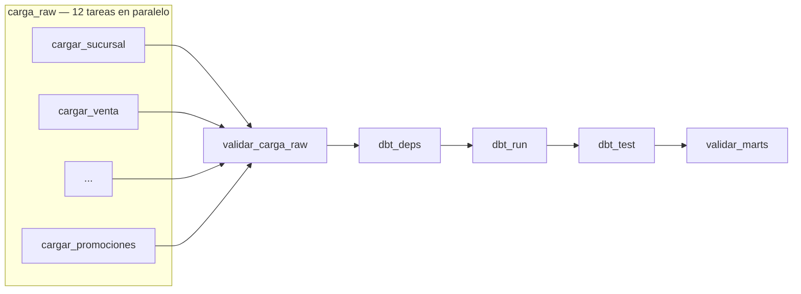
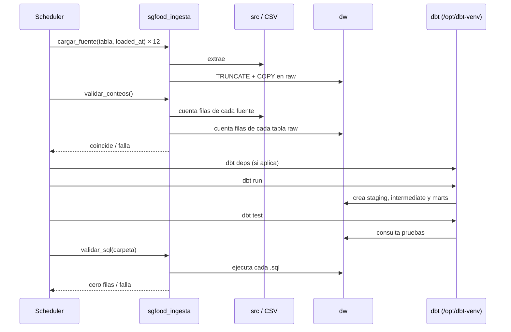

# Diseño — `dag-orquestacion`

Un DAG delgado, `sgfood_elt`, que solo declara tareas y dependencias. Las cargas llaman a `sgfood_ingesta`; dbt se invoca con `BashOperator`; las validaciones viven en un módulo nuevo del paquete. Lo que B puede cambiar (proyecto dbt y validaciones SQL) se descubre en tiempo de ejecución, sin tocar el DAG.

- **Requisitos:** [requirements.md](requirements.md)
- **Tareas:** [tasks.md](tasks.md)
- **Interfaz que consume:** `listar_fuentes` y `cargar_fuente` de [ingesta-raw](../ingesta-raw/design.md)

## Decisiones de diseño

| # | Decisión | Alternativa descartada | Motivo |
|---|----------|------------------------|--------|
| G1 | Una tarea de carga por fuente, generada desde `fuentes.yml` | Una sola tarea que carga todo | Reintento y registro por tabla; el grafo muestra las 12 fuentes |
| G2 | Cargas en paralelo, con límite de tareas activas | Cargas en serie | Son independientes entre sí; el límite protege la memoria |
| G3 | `_loaded_at` tomado del inicio de la ejecución del DAG | Instante de cada tarea | Todas las tablas de una ejecución comparten el valor, también tras un reintento |
| G4 | `dbt run` y `dbt test` como dos tareas | `dbt build` en una | El enunciado nombra ambas; un fallo de modelo y uno de prueba quedan distinguidos |
| G5 | `BashOperator` para dbt (decisión D6) | Cosmos | Ya acordado; sin dependencias adicionales |
| G6 | Validaciones finales como archivos `.sql` que pasan si devuelven cero filas | Consultas escritas en el DAG | B agrega validaciones sin tocar el DAG; misma convención que las pruebas singulares de dbt |
| G7 | Lógica de validación en `sgfood_ingesta.validacion` | Lógica dentro del DAG | Regla 10 del steering; se prueba sin Airflow |
| G8 | Parámetros de ejecución para el proyecto dbt y la carpeta de validaciones | Solo variables de entorno | Permite probar el DAG con un proyecto de prueba sin cambiar el entorno |
| G9 | Una sola ejecución activa | Sin límite | El truncado y recarga no admite solapamiento |
| G10 | DAG creado en pausa | Activo al crearse | Levantar el entorno no debe ejecutar el pipeline por sorpresa |
| G11 | Sin reintentos en `dbt_test` ni en validaciones | Reintentar todo | Un fallo ahí es de datos; reintentar solo demora el diagnóstico |

## Grafo



| Tarea | Operador | Qué hace | Reintentos | Tiempo límite |
|-------|----------|----------|:----------:|:-------------:|
| `carga_raw.cargar_<tabla>` | Tarea Python | `cargar_fuente(tabla, loaded_at)` | 2, cada 1 min | 10 min |
| `validar_carga_raw` | Tarea Python | Compara filas de cada fuente con su tabla en `raw` | 0 | 5 min |
| `dbt_deps` | `BashOperator` | `dbt deps` si existe `packages.yml`; si no, lo registra y termina bien | 2, cada 1 min | 10 min |
| `dbt_run` | `BashOperator` | `dbt run` | 1, cada 1 min | 20 min |
| `dbt_test` | `BashOperator` | `dbt test` | 0 | 20 min |
| `validar_marts` | Tarea Python | Ejecuta cada `.sql` de la carpeta de validaciones | 0 | 10 min |

Todas las dependencias usan la regla por defecto: una tarea corre solo si todas las anteriores terminaron bien.

## Secuencia de una ejecución



## Configuración del DAG

| Parámetro | Valor | Motivo |
|-----------|-------|--------|
| Identificador | `sgfood_elt` | Convención del steering |
| Programación | Diaria | Requisito opcional del enunciado |
| Fecha de inicio | Fija, en UTC | Evita fechas dinámicas |
| Ejecución de periodos anteriores | Desactivada | Regla del steering |
| Ejecuciones activas simultáneas | 1 | Decisión G9 |
| Tareas activas simultáneas | 4 | Decisión G2 |
| En pausa al crearse | Sí | Decisión G10 |
| Etiquetas | `sgfood`, `elt` | Filtro en la interfaz |

### Parámetros de ejecución

Se pueden indicar al disparar una ejecución; si no se indican, se usan los predeterminados.

| Parámetro | Predeterminado | Uso |
|-----------|----------------|-----|
| `dbt_project_dir` | Variable de entorno `DBT_PROJECT_DIR` | Proyecto dbt a ejecutar |
| `dbt_profiles_dir` | Variable de entorno `DBT_PROFILES_DIR` | Carpeta de `profiles.yml` |
| `validaciones_dir` | `/opt/airflow/sql/validaciones/dag` | Carpeta de validaciones finales |

Los valores se pasan a los comandos como variables de entorno de la tarea, no interpolados en el texto del comando.

### Comandos de dbt

```
dbt deps  --project-dir "$DBT_PROJECT_DIR" --profiles-dir "$DBT_PROFILES_DIR"
dbt run   --project-dir "$DBT_PROJECT_DIR" --profiles-dir "$DBT_PROFILES_DIR"
dbt test  --project-dir "$DBT_PROJECT_DIR" --profiles-dir "$DBT_PROFILES_DIR"
```

- Se usa la ruta completa `/opt/dbt-venv/bin/dbt`, para no depender del orden del `PATH`.
- Sin selectores: el proyecto completo. Si B necesita otros argumentos, se agregan como un parámetro de ejecución más, no como texto fijo en el DAG.
- Cada comando termina con el código de salida de dbt; no se encadenan con `||` ni se ignoran errores.

## Módulo `sgfood_ingesta.validacion`

```python
@dataclass(frozen=True)
class ConteoTabla:
    tabla_raw: str
    origen: str
    filas_fuente: int
    filas_raw: int

@dataclass(frozen=True)
class ResultadoValidacionSql:
    archivo: str
    filas_devueltas: int
    muestra: tuple[tuple, ...]   # primeras filas, para el registro

def contar_fuentes_y_raw() -> list[ConteoTabla]: ...

def validar_conteos() -> list[ConteoTabla]: ...

def validar_sql(carpeta: str) -> list[ResultadoValidacionSql]: ...
```

| Función | Comportamiento |
|---------|---------------|
| `contar_fuentes_y_raw` | Cuenta las filas de cada fuente en ese momento (consulta a `oltp_sgfood` o filas del CSV) y las de su tabla en `raw` |
| `validar_conteos` | Registra el conteo por tabla y el total. Lanza `ValidacionFallida` si alguna tabla no coincide, nombrando cada una |
| `validar_sql` | Ejecuta en el DW cada archivo `.sql` de la carpeta, en orden alfabético, en modo de solo lectura. Lanza `ValidacionFallida` si alguno devuelve filas. Carpeta inexistente o vacía: advertencia y lista vacía |

- `ValidacionFallida` hereda de `ErrorIngesta`.
- El conteo de un CSV reutiliza la lectura de `extraccion`, de modo que cuenta lo mismo que se carga.
- `validar_sql` ejecuta todas las consultas antes de fallar, para reportar todos los problemas de una vez.
- Las consultas de validación se ejecutan tal cual; son código del repositorio, escrito por B.

### Convención de las validaciones finales

Contrato con B.

| Regla | Detalle |
|-------|---------|
| Ubicación | `Proyecto1/sql/validaciones/dag/` |
| Formato | Un archivo `.sql` por validación, con una sola sentencia `SELECT` |
| Resultado | Pasa si devuelve cero filas; cada fila devuelta es un incumplimiento |
| Nombre | Descriptivo, con prefijo numérico si importa el orden: `01_ventas_sin_cliente.sql` |
| Comentario | La primera línea explica qué valida |
| Alcance | Solo lectura sobre `raw`, `staging` y `marts` |

Las consultas analíticas de negocio no van en esta carpeta: no son validaciones que deban pasar o fallar.

## Archivo del DAG

`Proyecto1/airflow/dags/sgfood_elt.py`. Contiene únicamente:

1. Importaciones.
2. Argumentos por defecto y parámetros.
3. La definición del DAG.
4. Las tareas y sus dependencias.

Reglas:

- Las tareas Python son envoltorios de una línea sobre `sgfood_ingesta`.
- La lista de fuentes se obtiene con `listar_fuentes()` al analizar el archivo. Si `fuentes.yml` es inválido, el DAG debe fallar al importarse, con el error visible en Airflow.
- Sin conexiones a bases de datos ni lectura de datos al analizar el archivo.
- `loaded_at` se obtiene del contexto de la ejecución dentro de la tarea (`context["dag_run"].start_date or context["logical_date"]`).
- Las importaciones de Airflow siguen la API confirmada de la versión 3.3.2 (Task SDK):
  - `from airflow.sdk import DAG, task, TaskGroup, Param, get_current_context`
  - `from airflow.providers.standard.operators.bash import BashOperator`
  - Parámetros del DAG: `dag_id="sgfood_elt"`, `schedule="@daily"`, `start_date=datetime(2026, 1, 1, tzinfo=timezone.utc)`, `catchup=False`, `max_active_runs=1`, `max_active_tasks=4`, `is_paused_upon_creation=True`, `tags=["sgfood", "elt"]`, `default_args=...`.

## Cambios al entorno

| Archivo | Cambio |
|---------|--------|
| `docker-compose.yml` | Montar `./sql` en `/opt/airflow/sql` como solo lectura en los servicios de Airflow |
| `sql/validaciones/dag/.gitkeep` | Carpeta acordada con B, vacía hasta que B agregue validaciones |
| `tests/entorno/test_airflow.py` | La lista de DAGs ya no está vacía: pasa a exigir que solo exista `sgfood_elt` |
| `tests/entorno/test_ejecucion_tareas.py` | Ajustar la comprobación final para tolerar `sgfood_elt` |

`sql/validaciones/` y `dbt_project/` son rutas de B. Esta feature crea la subcarpeta `dag/` vacía y el esqueleto dbt, según las decisiones D10 y D11.

## Estrategia de pruebas

```
Proyecto1/tests/dag/
├── fixtures/
│   ├── dbt_ok/            proyecto mínimo: un modelo sobre raw.sucursal y una prueba que pasa
│   ├── dbt_modelo_roto/   un modelo con SQL inválido
│   ├── dbt_prueba_falla/  un modelo válido y una prueba que no se cumple
│   ├── validaciones_ok/   una consulta que devuelve cero filas
│   └── validaciones_falla/ una consulta que devuelve filas
├── test_validacion.py     unitaria e integración del módulo
├── test_estructura_dag.py estructura del DAG
├── test_ejecucion_dag.py  ejecución completa
└── test_fallos_dag.py     fallos de dbt y de validaciones
```

| Tipo | Cómo se ejecuta | Qué cubre |
|------|----------------|-----------|
| Unitaria | En el host | `validar_sql` con carpeta vacía, inexistente y con archivos; armado de resultados |
| Estructura | Un script dentro del contenedor carga el DAG y devuelve tareas y dependencias; la prueba las compara | R1, R6, R7 |
| Ejecución | La prueba copia un proyecto de `fixtures/` al contenedor, dispara el DAG con parámetros y espera el resultado | R2 a R5, R8 |

Reglas:

- Los proyectos dbt de prueba escriben en un schema propio, `dag_test`, que la prueba elimina al terminar. No escriben en `staging` ni `marts`.
- Los proyectos de prueba incluyen su propio `profiles.yml`, que lee las variables `DW_*` del entorno.
- Los nombres de tareas de carga esperados se derivan de `fuentes.yml`.
- Cada prueba de ejecución espera el estado final consultando la ejecución concreta que disparó, por su identificador.
- Las pruebas despausan el DAG al empezar y lo dejan en pausa y sin ejecuciones de prueba al terminar.
- El estado de cada tarea se comprueba de forma individual; no basta con el estado de la ejecución.

## Esqueleto del proyecto dbt

Lo arma A a pedido de B (decisión D11). Es el proyecto real, en `Proyecto1/dbt_project/`, reducido a lo mecánico: configuración, conexión, fuentes y un ejemplo. Al entregarse pasa a ser propiedad de B.

```
Proyecto1/dbt_project/
├── dbt_project.yml
├── profiles.yml
├── README.md                          qué es de ejemplo y qué decide B
├── macros/
│   └── generate_schema_name.sql
└── models/
    ├── staging/
    │   ├── _fuentes.yml               las 12 tablas de raw
    │   ├── _staging.yml               descripción y pruebas del modelo de ejemplo
    │   └── stg_oltp__sucursal.sql     único modelo de ejemplo
    ├── intermediate/.gitkeep
    └── marts/.gitkeep
```

| Archivo | Contenido | Decisión que deja abierta para B |
|---------|-----------|----------------------------------|
| `dbt_project.yml` | Nombre del proyecto, perfil, rutas y materialización por carpeta: `staging` como vista, `intermediate` como vista, `marts` como tabla | Cambiar materializaciones; decidir el schema de `intermediate` |
| `profiles.yml` | Un objetivo `dev` de PostgreSQL que lee `DW_HOST`, `DW_PORT`, `DW_DB`, `DW_USER` y `DW_PASSWORD` con `env_var` | Agregar objetivos o hilos |
| `generate_schema_name.sql` | Usa el schema configurado tal cual, sin anteponer el schema del perfil | — |
| `_fuentes.yml` | Dos fuentes sobre el schema `raw`: `oltp` (7 tablas) y `archivos` (5 tablas), con las columnas del contrato | Agregar descripciones, pruebas y frescura |
| `stg_oltp__sucursal.sql` | Selecciona de `source()`, convierte `id_sucursal` desde `TEXT` y deja el resto como texto | Conservarlo, cambiarlo o borrarlo |
| `_staging.yml` | `unique` y `not_null` sobre la clave del ejemplo | El resto de las pruebas |

**Por qué el macro de schema.** Por defecto dbt concatena el schema del perfil con el configurado y crearía `staging_staging`. El DDL del entorno ya creó `staging` y `marts`; el macro hace que dbt escriba exactamente ahí.

**Por qué un solo modelo de ejemplo.** Muestra el patrón completo que pide el contrato (leer con `source()`, convertir desde `TEXT`, probar la clave) y permite que el pipeline corra de punta a punta. `sucursal` es la tabla más chica y no compromete ninguna decisión del modelo dimensional.

**Límites del esqueleto.** No contiene modelos de `intermediate` ni de `marts`, ni hechos, ni dimensiones, ni paquetes. No fija dónde se materializa `intermediate`: queda con el valor por defecto y un comentario.

**Fuentes y contrato.** `_fuentes.yml` se escribe una sola vez a partir de `fuentes.yml`. Una prueba comprueba que toda tabla de `raw` declarada como fuente en el proyecto dbt exista en `fuentes.yml`; no exige que estén todas ni cómo se organizan los archivos, para no atar las manos de B.

### Uso en esta feature

- **Pruebas automáticas:** no usan el esqueleto. Siguen con los proyectos de `tests/dag/fixtures/`, que escriben en `dag_test`.
- **Ejecución de evidencia:** `sgfood_elt` con los parámetros predeterminados corre el esqueleto y deja el modelo de ejemplo en `staging`.

## Guía de arranque para B

`Proyecto1/docs/guia_rol_b.md`. Su objetivo es que B pueda empezar sin preguntar y sepa qué puede cambiar solo.

1. Qué está hecho: entorno, datos oficiales, contrato, carga a `raw` y DAG.
2. Arranque en cinco pasos: clonar, crear `.env`, levantar, cargar `raw`, ejecutar dbt.
3. Cómo ejecutar dbt: dentro del contenedor y desde el equipo propio.
4. Qué hay en `raw`: enlace al contrato y reglas de representación que afectan a `staging`.
5. El esqueleto: qué es configuración, qué es ejemplo y qué decisiones quedan abiertas.
6. Cómo corre el DAG su proyecto y cómo agregar una validación final.
7. Qué puede cambiar sin avisar y qué requiere acuerdo, según la sección "Interfaz entre A y B" de [architecture.md](../../steering/architecture.md).
8. Qué le toca entregar según la rúbrica y los puntos de integración.

Los comandos de la guía se ejecutan uno por uno antes de darla por terminada.

## Evidencia

| Evidencia | Quién la produce |
|-----------|------------------|
| Listado de tareas y dependencias del DAG | Agente, por línea de comandos |
| Estado de cada tarea de una ejecución exitosa | Agente, por línea de comandos |
| Registro de `dbt_run`, `dbt_test` y de las validaciones | Agente |
| Captura del grafo y de la ejecución en la interfaz de Airflow | **Integrante, a mano** |

Los archivos de texto se guardan con extensión `.txt`: el repositorio ignora `*.log`.

## Archivos de la feature

```
Proyecto1/
├── airflow/dags/sgfood_elt.py              nuevo
├── python/sgfood_ingesta/validacion.py     nuevo
├── python/sgfood_ingesta/errores.py        agrega ValidacionFallida
├── python/sgfood_ingesta/__init__.py       expone las funciones de validación
├── sql/validaciones/dag/.gitkeep           nuevo
├── dbt_project/                            esqueleto (pasa a B al entregarse)
├── docs/guia_rol_b.md                      nuevo
├── docker-compose.yml                      montaje de sql/
├── tests/dag/                              nuevo
├── tests/entorno/test_airflow.py           ajuste
├── tests/entorno/test_ejecucion_tareas.py  ajuste
├── evidencia/                              salidas de la ejecución
└── README.md                               sección del DAG
```

## Puntos abiertos

- [x] Puntos de "Dependencias con el rol B": definidos por A el 2026-10-10 (decisiones D9, D10 y D11).
- [ ] Confirmar contra la documentación de dbt 1.12 la forma del macro `generate_schema_name` y de `env_var` en `profiles.yml`.
- [x] Confirmar contra la documentación de Airflow 3.3.2 las importaciones del DAG, del operador de Bash y la forma de leer el inicio de la ejecución desde el contexto (Fuente: Airflow 3.3.2 Task SDK: `airflow.sdk.DAG`, `airflow.sdk.task`, `airflow.providers.standard.operators.bash.BashOperator`, context `dag_run.start_date` o `logical_date`).
- [x] Confirmar cómo se crea un DAG en pausa en Airflow 3.3.2 (Fuente: `DAG(is_paused_upon_creation=True)` en `airflow.sdk.DAG`).
- [x] Proyecto dbt para la integración: se usa el esqueleto que arma esta feature.
