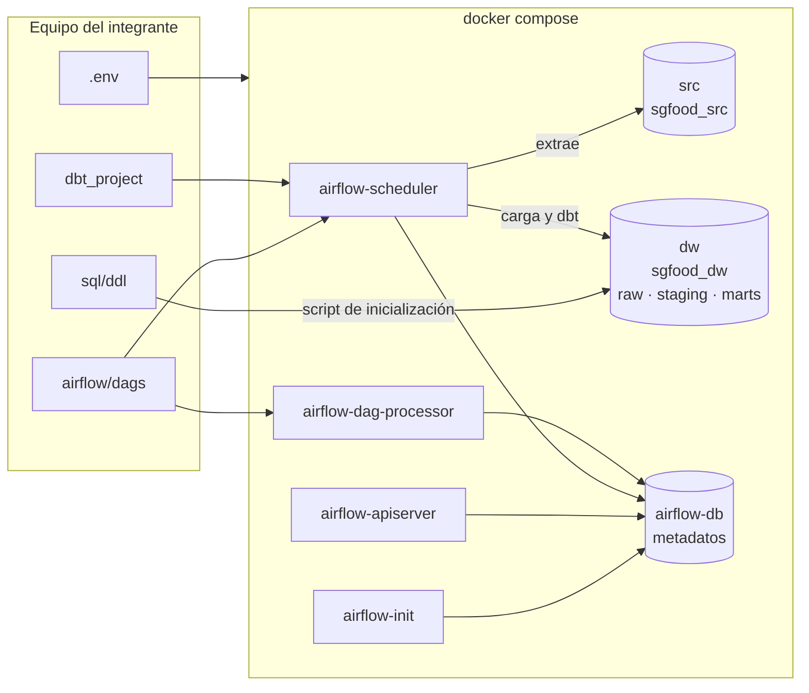
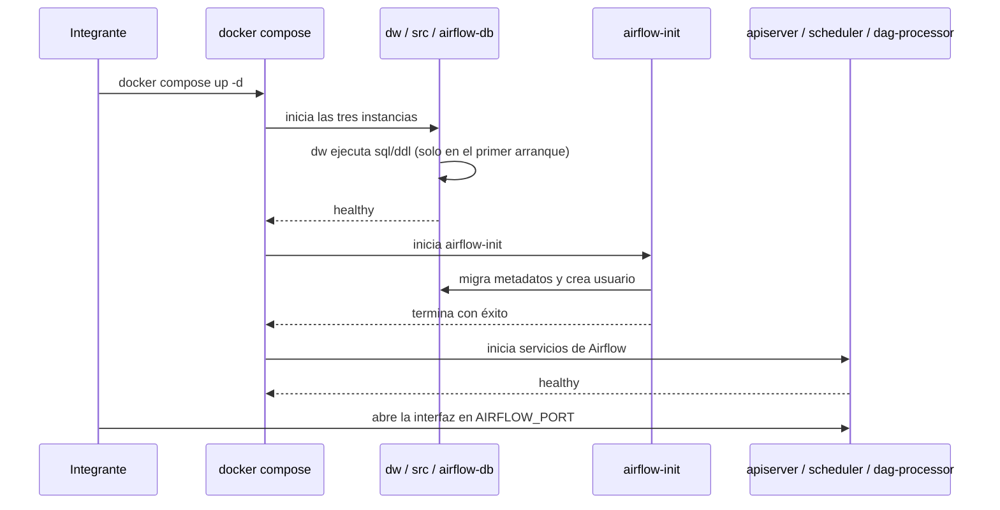

# Diseño — `entorno-base`

Un `docker-compose.yml` con tres instancias PostgreSQL y Airflow en modo de ejecutor local, sobre una imagen propia que agrega dbt en un entorno virtual aislado. Toda la configuración entra por `.env`.

- **Requisitos:** [requirements.md](requirements.md)
- **Tareas:** [tasks.md](tasks.md)
- **Steering:** [architecture.md](../../steering/architecture.md) · [tech-stack.md](../../steering/tech-stack.md)

## Decisiones de diseño

| # | Decisión | Alternativa descartada | Motivo |
|---|----------|------------------------|--------|
| E1 | Airflow 3.3.2 con `LocalExecutor` | `CeleryExecutor` del compose oficial | Elimina Redis, worker y Flower; menos memoria y menos piezas que depurar |
| E2 | Imagen propia a partir de la imagen oficial de Airflow | `_PIP_ADDITIONAL_REQUIREMENTS` | La documentación oficial lo reserva para pruebas rápidas; la imagen propia es reproducible |
| E3 | dbt en un entorno virtual separado dentro de la imagen | Instalar dbt junto a Airflow | Evita conflictos de dependencias (regla de [tech-stack.md](../../steering/tech-stack.md)) |
| E4 | Base de metadatos de Airflow en su propia instancia | Compartir la instancia del DW | El DW queda limpio y se reinicia sin afectar a Airflow |
| E5 | Schemas creados por el script de inicialización de PostgreSQL | Crearlos desde una tarea de Airflow | Existen antes de que arranque cualquier otro servicio; B puede usar dbt sin Airflow |
| E6 | Conexiones de Airflow por variables `AIRFLOW_CONN_*` | Crearlas en la interfaz o con un script | Sin pasos manuales y sin estado fuera del repositorio |
| E7 | Pruebas con `pytest` que invocan `docker compose` | Verificación manual | Permite trabajar con TDD y deja evidencia repetible |
| E8 | Sin `airflow-triggerer` | Incluirlo como en el compose oficial | El proyecto no usa operadores diferibles |

## Versiones

Verificadas el 2026-10-07.

| Componente | Versión | Fuente | Estado |
|------------|---------|--------|--------|
| Apache Airflow | 3.3.2 | Guía oficial de Docker Compose; PyPI | Verificada |
| Imagen base | `apache/airflow:3.3.2-python3.12` | Docker Hub (revisión de la pareja) | Verificada |
| Python | 3.12 | Airflow 3.3.2 soporta 3.10 a 3.14; dbt Core 1.12 soporta 3.10 a 3.14 | Verificada |
| PostgreSQL | 16 | Airflow 3.3.2 soporta 14 a 18; es la que usa el compose oficial | Verificada |
| dbt Core | 1.12.5 | PyPI (revisión de la pareja) | Verificada |
| `dbt-postgres` | 1.11.0 | PyPI (revisión de la pareja); registro de versiones compatibles de dbt | Verificada |

Se eligió Python 3.12 por ser una versión intermedia soportada por todas las herramientas, en lugar de la más reciente.

**dbt Core y `dbt-postgres` no comparten número de versión.** No existe una serie 1.12 de `dbt-postgres`: la última publicada es la 1.11.0. La combinación es válida porque el registro oficial de versiones compatibles de dbt (entrega de agosto de 2026) publica juntas dbt Core 1.12.0 y `dbt-postgres` 1.11.0. Consecuencias:

- `requirements-dbt.txt` fija los dos paquetes por separado: `dbt-core==1.12.5` y `dbt-postgres==1.11.0`.
- Las pruebas comparan cada versión con su propio valor fijado, no entre sí.
- Antes de cerrar T2 se confirma con `pip install --dry-run` dentro de la imagen base que ambas versiones se resuelven juntas en Python 3.12.

## Componentes



| Servicio | Imagen | Función | Puerto del host | Volumen |
|----------|--------|---------|-----------------|---------|
| `dw` | `postgres:16` | Data Warehouse | `DW_PORT` (5433) | `dw_data` |
| `src` | `postgres:16` | BD transaccional fuente | `SRC_PORT` (5434) | `src_data` |
| `airflow-db` | `postgres:16` | Metadatos de Airflow | no expuesto | `airflow_db_data` |
| `airflow-init` | imagen propia | Migra la base de metadatos y crea el usuario; termina al completar | — | — |
| `airflow-apiserver` | imagen propia | Interfaz y API | `AIRFLOW_PORT` (8080) | — |
| `airflow-scheduler` | imagen propia | Planifica y ejecuta tareas (`LocalExecutor`) | — | — |
| `airflow-dag-processor` | imagen propia | Analiza los archivos de DAGs | — | — |

Los nombres de servicios y la lista exacta de componentes de Airflow 3 se contrastan con el `docker-compose.yaml` oficial de la versión 3.3.2 antes de escribirlos.

## Secuencia de arranque



Reglas de dependencia: los servicios de Airflow esperan a `airflow-db` saludable y a `airflow-init` completado con éxito. El scheduler además espera a `dw` y `src` saludables.

## Contrato de configuración

Interfaz entre el entorno (rol A) y sus consumidores: scripts Python, DAGs y `profiles.yml` de dbt (rol B). Los nombres son **propuesta pendiente de validar con B**.

### Variables de `.env`

| Variable | Ejemplo | Obligatoria | Uso |
|----------|---------|:-----------:|-----|
| `DW_DB` | `sgfood_dw` | Sí | Nombre de la base del DW |
| `DW_USER` | `dw_user` | Sí | Usuario del DW |
| `DW_PASSWORD` | `cambiar` | Sí | Contraseña del DW |
| `DW_PORT` | `5433` | Sí | Puerto del DW en el host |
| `SRC_DB` | `sgfood_src` | Sí | Nombre de la base fuente |
| `SRC_USER` | `src_user` | Sí | Usuario de la base fuente |
| `SRC_PASSWORD` | `cambiar` | Sí | Contraseña de la base fuente |
| `SRC_PORT` | `5434` | Sí | Puerto de la base fuente en el host |
| `AIRFLOW_DB_USER` | `airflow` | Sí | Usuario de la base de metadatos |
| `AIRFLOW_DB_PASSWORD` | `cambiar` | Sí | Contraseña de la base de metadatos |
| `AIRFLOW_ADMIN_USER` | `admin` | Sí | Usuario de la interfaz |
| `AIRFLOW_ADMIN_PASSWORD` | `cambiar` | Sí | Contraseña de la interfaz |
| `AIRFLOW_PORT` | `8080` | Sí | Puerto de la interfaz en el host |
| `AIRFLOW_UID` | `50000` | No | Usuario del sistema dentro del contenedor |

Las variables obligatorias se declaran en el compose con la sintaxis `${VAR:?mensaje}` para que su ausencia detenga el arranque (requisito R1.3).

### Variables visibles dentro de los contenedores de Airflow

| Variable | Valor | Consumidor |
|----------|-------|-----------|
| `DW_HOST` | `dw` | Python, `profiles.yml` |
| `DW_PORT` | `5432` (puerto interno) | Python, `profiles.yml` |
| `DW_DB`, `DW_USER`, `DW_PASSWORD` | desde `.env` | Python, `profiles.yml` |
| `SRC_HOST` | `src` | Python |
| `SRC_PORT` | `5432` (puerto interno) | Python |
| `SRC_DB`, `SRC_USER`, `SRC_PASSWORD` | desde `.env` | Python |
| `AIRFLOW_CONN_SGFOOD_DW` | URI de conexión al DW | DAGs (conexión `sgfood_dw`) |
| `AIRFLOW_CONN_SGFOOD_SRC` | URI de conexión a la fuente | DAGs (conexión `sgfood_src`) |
| `DBT_PROJECT_DIR` | `/opt/airflow/dbt_project` | Tareas de dbt |
| `DBT_PROFILES_DIR` | `/opt/airflow/dbt_project` | Tareas de dbt |

Dentro de la red de Docker el puerto es siempre `5432`; `DW_PORT` y `SRC_PORT` del `.env` solo aplican al acceso desde el host. Quien ejecute dbt desde su equipo, fuera de Docker, usa `localhost` y el puerto del host.

### Montajes en los contenedores de Airflow

| Ruta en el host | Ruta en el contenedor | Dueño del contenido |
|-----------------|----------------------|---------------------|
| `Proyecto1/airflow/dags/` | `/opt/airflow/dags` | A |
| `Proyecto1/python/` | `/opt/airflow/python` | A |
| `Proyecto1/dbt_project/` | `/opt/airflow/dbt_project` | B |
| `Proyecto1/data/` | `/opt/airflow/data` | A |

Esta feature solo crea las carpetas de A, vacías. El contenido de `dbt_project/` es de B.

## Imagen de Airflow

```
FROM apache/airflow:3.3.2-python3.12
  ├─ dependencias de ingesta (requirements.txt, versiones exactas)
  └─ entorno virtual /opt/dbt-venv con dbt-core 1.12.5 y dbt-postgres 1.11.0
       └─ /opt/dbt-venv/bin agregado al PATH
```

- `requirements.txt` contiene solo dependencias de los scripts de A y no reinstala `apache-airflow`.
- `dbt-core` y `dbt-postgres` se instalan únicamente en `/opt/dbt-venv`; sus versiones viven en `requirements-dbt.txt`.

## Modelo de datos

Esta feature solo crea contenedores lógicos, sin tablas.

| Base | Schema | Lo crea | Contenido futuro |
|------|--------|---------|------------------|
| `sgfood_dw` | `raw` | `sql/ddl/01_schemas.sql` | Tablas cargadas por Python |
| `sgfood_dw` | `staging` | `sql/ddl/01_schemas.sql` | Modelos dbt |
| `sgfood_dw` | `marts` | `sql/ddl/01_schemas.sql` | Dimensiones y hechos |
| `sgfood_src` | `public` | PostgreSQL | Tablas transaccionales (otra feature) |

El script usa `CREATE SCHEMA IF NOT EXISTS` y otorga al usuario del DW permisos sobre los tres schemas. Se monta en `/docker-entrypoint-initdb.d/`, por lo que PostgreSQL lo ejecuta solo cuando el volumen de datos está vacío.

## Archivos de la feature

```
Proyecto1/
├── docker-compose.yml
├── .env.example
├── .gitignore
├── README.md                       sección "Manual de implementación"
├── airflow/
│   ├── Dockerfile
│   ├── requirements.txt
│   ├── requirements-dbt.txt
│   └── dags/.gitkeep
├── python/.gitkeep
├── data/.gitkeep
├── sql/ddl/01_schemas.sql
└── tests/                          nueva carpeta (zona amarilla)
    ├── requirements-dev.txt
    ├── conftest.py
    └── entorno/
        ├── test_config_estatica.py
        ├── test_bases_de_datos.py
        ├── test_airflow.py
        └── test_reinicio.py
```

Fuera de `Proyecto1/` solo se edita [tech-stack.md](../../steering/tech-stack.md) para registrar las versiones.

## Estrategia de pruebas

| Tipo | Qué verifica | Cómo | Necesita el entorno arriba |
|------|-------------|------|:--------------------------:|
| Estática | Servicios declarados, imágenes fijadas, sin `latest`, sin contraseñas literales, variables de `.env.example` completas, `.env` ignorado | Lee `docker compose config` y los archivos | No |
| Integración | Salud de servicios, schemas, DDL reejecutable, `dbt --version`, conexiones desde Airflow, interfaz accesible | `docker compose exec` y peticiones HTTP | Sí |
| Reinicio | Estado idéntico tras `down -v` y `up -d` | Ciclo completo | Sí (lenta) |

- Las pruebas se ejecutan desde el host con `pytest`; las de integración y reinicio llevan marcadores para poder excluirlas.
- Dependencias de prueba mínimas en el host: `pytest` y `PyYAML`. Las consultas a las bases se hacen con `docker compose exec`, sin instalar drivers en el host.
- Ciclo TDD por tarea: escribir la prueba, verla fallar, implementar, verla pasar.

## Manejo de errores

| Situación | Comportamiento esperado |
|-----------|------------------------|
| Falta una variable obligatoria | `docker compose` se detiene nombrando la variable |
| Una base no alcanza el estado saludable | Los servicios dependientes no inician |
| `airflow-init` falla | Los servicios de Airflow no inician; el error queda en sus logs |
| Puerto del host ocupado | Se cambia el puerto en `.env`; no se edita el compose |
| El DDL cambió y el volumen ya existe | El script no se reejecuta solo; se aplica a mano o se reinicia con `down -v` (documentado en el README) |

## Puntos abiertos

- [ ] Validar con B las versiones, los nombres de bases y variables, la carpeta `tests/` y la ruta de montaje de dbt.
- [x] Confirmar la versión de parche de dbt Core y `dbt-postgres`: 1.12.5 y 1.11.0.
- [x] Confirmar la etiqueta exacta de la imagen base: `apache/airflow:3.3.2-python3.12`.
- [x] Confirmar que `dbt-core==1.12.5` y `dbt-postgres==1.11.0` se resuelven juntas en la imagen base.
- [x] Confirmar la ruta del endpoint de salud contra el compose oficial de Airflow 3.3.2 (`/health`).
