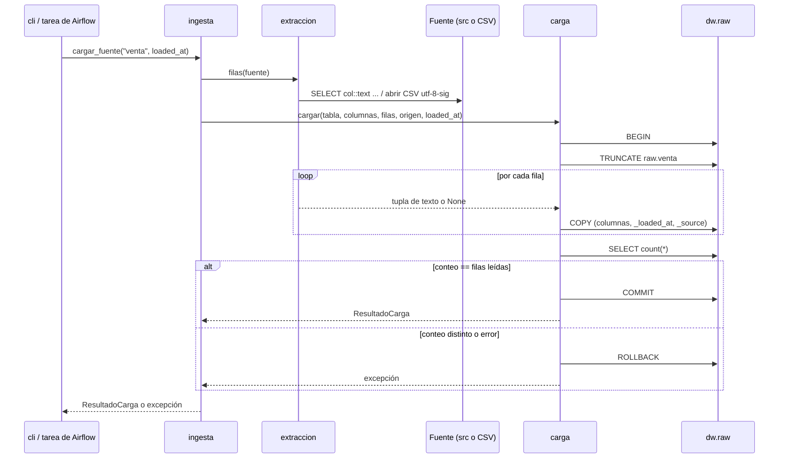

# Diseño — `ingesta-raw`

Un paquete Python pequeño, `sgfood_ingesta`, con un módulo por responsabilidad. Lee `fuentes.yml`, produce filas de texto desde cada fuente y las carga con `COPY` dentro de una transacción por tabla. Se ejecuta igual por línea de comandos que desde una tarea de Airflow.

- **Requisitos:** [requirements.md](requirements.md)
- **Tareas:** [tasks.md](tasks.md)
- **Contrato:** `Proyecto1/docs/contrato_raw.md` · **Configuración:** `Proyecto1/python/config/fuentes.yml`

## Decisiones de diseño

| # | Decisión | Alternativa descartada | Motivo |
|---|----------|------------------------|--------|
| I1 | Paquete `sgfood_ingesta` con módulos separados | Un script por fuente | Las 12 tablas comparten la misma lógica; solo cambia la configuración |
| I2 | CSV con el módulo `csv` de la biblioteca estándar | `pandas` | El contrato pide texto sin inferencia; `pandas` convierte vacíos en `NaN` e infiere tipos salvo que se le indique lo contrario |
| I3 | Conversión a texto en la consulta (`columna::text`) | Convertir en Python | El formato lo define PostgreSQL: `0.1500`, `true`, fechas ISO |
| I4 | Carga con `COPY ... FROM STDIN` | `INSERT` por lotes | Es el mecanismo de carga masiva de PostgreSQL y lo soporta `psycopg` |
| I5 | Una transacción por tabla | Una transacción para las 12 | Permite reintentar una tabla sin recargar las demás; cada tabla queda consistente por sí sola |
| I6 | Verificación de conteo antes de confirmar | Verificar después | Un conteo incorrecto revierte la carga en lugar de dejar datos malos |
| I7 | Un único `_loaded_at` por ejecución, calculado en Python | `DEFAULT now()` por fila | El contrato pide el mismo instante para toda la ejecución; `now()` cambia entre transacciones |
| I8 | Filas en flujo, sin cargar la tabla entera en memoria | Leer todo y luego cargar | Mismo código para cualquier volumen |
| I9 | Pruebas unitarias en el host e integración ejecutando el paquete dentro del contenedor | Todo en el host | La integración prueba el entorno real donde correrá el DAG |

**Sobre `pandas`:** [tech-stack.md](../../steering/tech-stack.md) lo listaba para leer CSV. La decisión I2 lo reemplaza por la biblioteca estándar y fue aprobada el 2026-10-09. `pandas` se retira de `airflow/requirements.txt` y `tech-stack.md` se actualiza en la tarea de documentación.

## Estructura

```
Proyecto1/python/
├── config/fuentes.yml          ya existe
└── sgfood_ingesta/
    ├── __init__.py             expone cargar_fuente, cargar_todas, listar_fuentes
    ├── __main__.py             permite python -m sgfood_ingesta
    ├── cli.py                  argumentos, registro, código de salida
    ├── config.py               lectura y validación de fuentes.yml
    ├── conexiones.py           parámetros de conexión desde el entorno
    ├── extraccion.py           filas de texto desde postgres o csv
    ├── carga.py                truncado, COPY y verificación en una transacción
    ├── ingesta.py              une extracción y carga por tabla
    └── errores.py              excepciones del paquete
```

| Módulo | Depende de | No conoce |
|--------|-----------|-----------|
| `config` | PyYAML | Bases de datos |
| `conexiones` | Variables de entorno | Fuentes |
| `extraccion` | `config`, `psycopg`, `csv` | El DW |
| `carga` | `psycopg` | De dónde vienen las filas |
| `ingesta` | Todos los anteriores | Airflow |
| `cli` | `ingesta` | SQL |

Ningún módulo importa Airflow. Airflow importará `sgfood_ingesta`, nunca al revés.

## Flujo de una tabla



## Modelos de dominio

```python
@dataclass(frozen=True)
class Fuente:
    tabla_raw: str            # tabla destino en el schema raw
    tipo: Literal["postgres", "csv"]
    origen: str               # "oltp_sgfood.venta" o "devoluciones.csv"
    columnas: tuple[str, ...] # columnas de negocio, en orden

@dataclass(frozen=True)
class ResultadoCarga:
    tabla_raw: str
    origen: str
    filas_leidas: int
    filas_cargadas: int
    duracion_segundos: float
    loaded_at: datetime
```

Una fila es una `tuple[str | None, ...]` con tantos elementos como columnas declaradas.

## Interfaz pública

Es el contrato con la feature `dag-orquestacion`.

```python
def listar_fuentes() -> list[Fuente]: ...

def cargar_fuente(tabla_raw: str, loaded_at: datetime | None = None) -> ResultadoCarga: ...

def cargar_todas(loaded_at: datetime | None = None) -> list[ResultadoCarga]: ...
```

| Función | Comportamiento |
|---------|---------------|
| `listar_fuentes` | Devuelve las fuentes de `fuentes.yml` en el orden declarado |
| `cargar_fuente` | Carga una tabla. Si `loaded_at` es `None`, usa el instante actual en UTC. Lanza excepción ante cualquier fallo |
| `cargar_todas` | Carga las 12 tablas en orden con un mismo `loaded_at`. Se detiene en el primer fallo; las tablas ya confirmadas quedan cargadas |

El DAG podrá pasar un mismo `loaded_at` a todas sus tareas para que una ejecución completa comparta el instante.

### Línea de comandos

```
python -m sgfood_ingesta                 carga las 12 tablas
python -m sgfood_ingesta --tabla venta   carga solo esa tabla
python -m sgfood_ingesta --listar        muestra las fuentes configuradas
```

| Código de salida | Significado |
|:----------------:|-------------|
| 0 | Todas las cargas solicitadas terminaron bien |
| 1 | Falló una carga |
| 2 | Argumentos o configuración inválidos |

### Excepciones

| Excepción | Cuándo |
|-----------|--------|
| `ConfiguracionInvalida` | `fuentes.yml` ausente o mal formado; variable de entorno faltante |
| `FuenteDesconocida` | La tabla pedida no está en la configuración |
| `EncabezadoInvalido` | El encabezado del CSV no coincide con las columnas declaradas |
| `FilaInvalida` | Una fila del CSV tiene una cantidad de campos distinta; incluye el número de línea |
| `ConteoInconsistente` | Las filas en `raw` no coinciden con las leídas |

Todas heredan de `ErrorIngesta`. Los errores de `psycopg` se propagan sin envolver.

## Configuración por entorno

| Variable | Valor por defecto | Uso |
|----------|-------------------|-----|
| `DW_HOST`, `DW_PORT`, `DW_DB`, `DW_USER`, `DW_PASSWORD` | Sin valor por defecto | Conexión al DW; definidas en `entorno-base` |
| `SRC_HOST`, `SRC_PORT`, `SRC_DB`, `SRC_USER`, `SRC_PASSWORD` | Sin valor por defecto | Conexión a la fuente |
| `SGFOOD_FUENTES_PATH` | `/opt/airflow/python/config/fuentes.yml` | Ruta de la configuración de fuentes |
| `SGFOOD_DATA_DIR` | `/opt/airflow/data` | Carpeta de los CSV |

Las dos variables `SGFOOD_` existen para poder apuntar a archivos de prueba; en la operación normal no se definen.

## Reglas de implementación

**Extracción desde PostgreSQL**

- La consulta se arma con `psycopg.sql`: `Identifier` para schema, tabla y columnas. Ningún nombre se concatena como texto.
- Forma: `SELECT "col1"::text, "col2"::text FROM "oltp_sgfood"."venta"`.
- La conexión a la fuente se abre en modo de solo lectura.
- Sin `ORDER BY`: el orden de las filas no forma parte del contrato.

**Extracción desde CSV**

- `open(ruta, encoding="utf-8-sig", newline="")` y `csv.reader` con coma como separador.
- La primera línea debe ser igual a las columnas declaradas; si no, `EncabezadoInvalido`.
- Una línea sin ningún campo se omite. Una línea con campos pero en cantidad distinta produce `FilaInvalida`.
- Cadena vacía se convierte en `None`. Es la única transformación de valores.

**Carga**

- Conexión al DW con `autocommit` desactivado; todo dentro de un bloque de transacción.
- `TRUNCATE` y `COPY` sobre `raw.<tabla>`, con identificadores escapados.
- `COPY` recibe las columnas de negocio más `_loaded_at` y `_source`, en ese orden.
- Antes de confirmar: `SELECT count(*)` debe ser igual a las filas enviadas.

**Registro**

- Módulo `logging`, un registrador por módulo. El nivel y el formato se configuran en `cli.py`, no al importar el paquete.
- Una línea al iniciar y una al terminar cada tabla, con origen, destino, filas y duración.
- Nunca se registran contraseñas ni cadenas de conexión completas.

## Cambios al entorno

| Archivo | Cambio |
|---------|--------|
| `docker-compose.yml` | Agregar `PYTHONPATH: /opt/airflow/python` a los servicios de Airflow |
| `docker-compose.yml` | El healthcheck de `src` comprueba además que `oltp_sgfood.venta_detalle` tiene filas |
| `pytest.ini` | `pythonpath = python` para importar el paquete en las pruebas unitarias |
| `tests/requirements-dev.txt` | Agregar `psycopg[binary]` con la misma versión que `airflow/requirements.txt` |
| `tests/contrato/test_tablas_raw.py` | Retirar la comprobación de tablas vacías |
| `airflow/requirements.txt` | Retirar `pandas` |

PyYAML ya está en la imagen de Airflow como dependencia del propio Airflow; no se agrega a `requirements.txt` para no entrar en conflicto con la versión que Airflow fija.

## Estrategia de pruebas

```
Proyecto1/tests/ingesta/
├── fixtures/                       CSV pequeños: válido, encabezado malo, fila corta, con vacíos, con BOM
├── test_config.py                  unitaria
├── test_extraccion_csv.py          unitaria
├── test_extraccion_postgres.py     unitaria: solo la consulta generada
├── test_conexiones.py              unitaria
├── test_carga_tabla.py             integración
├── test_carga_completa.py          integración
├── test_fidelidad.py               integración
├── test_idempotencia.py            integración
└── test_fallos.py                  integración
```

| Tipo | Cómo se ejecuta | Qué cubre |
|------|----------------|-----------|
| Unitaria | En el host, sin contenedores | Validación de la configuración, lectura de CSV, consulta generada, parámetros de conexión, códigos de salida |
| Integración | La prueba ejecuta `python -m sgfood_ingesta` dentro de `airflow-scheduler` y consulta el resultado con `psql` | Requisitos R4 a R8 de punta a punta |

Reglas para las pruebas de integración:

- Cada prueba deja preparado el estado que necesita; ninguna depende del orden de ejecución.
- Los nombres de tablas, columnas y orígenes se leen de `fuentes.yml`. Los conteos esperados se toman del mismo lugar que usan las pruebas de `contrato-raw`.
- La fidelidad con la base transaccional se comprueba comparando cada tabla fuente convertida a texto con su tabla en `raw`, en ambos sentidos.
- La fidelidad con los CSV se comprueba leyendo el archivo en la prueba y comparando con `raw` como conjuntos de filas con su multiplicidad.
- Los casos de fallo usan archivos de `fixtures/` copiados a una carpeta temporal del contenedor y apuntados con `SGFOOD_DATA_DIR`. No se modifica ningún archivo de `data/`.
- Toda ejecución de `psql -f` o `-c` usa `ON_ERROR_STOP=1`.

## Evidencia

Al terminar, se guarda en `Proyecto1/evidencia/` el registro de una carga completa ejecutada desde un entorno limpio y una consulta con el conteo por tabla. Son las primeras cifras reales del proyecto.

## Archivos de la feature

```
Proyecto1/
├── docker-compose.yml                 PYTHONPATH y healthcheck de src
├── pytest.ini                         pythonpath
├── airflow/requirements.txt           retiro de pandas
├── python/sgfood_ingesta/             nuevo
├── tests/requirements-dev.txt         psycopg
├── tests/contrato/test_tablas_raw.py  ajuste
├── tests/ingesta/                     nuevo
├── evidencia/                         registro de carga y conteos
└── README.md                          sección de scripts Python
```

Fuera de `Proyecto1/` solo se editan [tech-stack.md](../../steering/tech-stack.md) y [architecture.md](../../steering/architecture.md) para reflejar lo hecho.

## Puntos abiertos

- [x] Retiro de `pandas`: aprobado el 2026-10-09.
- [x] Confirmar la forma exacta de `COPY` con `psycopg` 3 para valores `None`: verificado con `cur.copy()` y `copy.write_row()`, serializa automáticamente `None` como `NULL` (`\N`) en formato de texto.
