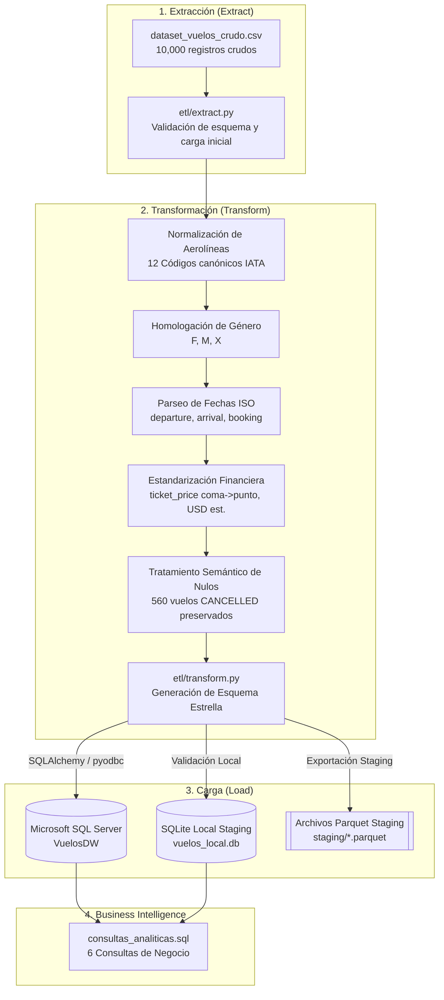
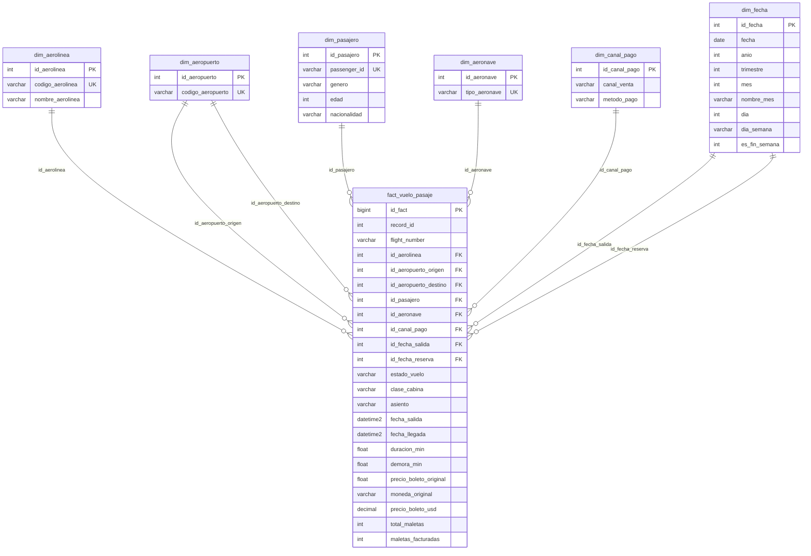

# Práctica 1: Proceso ETL con Python y Modelo Multidimensional en Microsoft SQL Server

**Seminario de Sistemas 2 — 2do Semestre 2026**  
**Facultad de Ingeniería, Escuela de Ciencias y Sistemas**  
**Universidad de San Carlos de Guatemala**  
**Grupo 16**

## Integrantes
| Nombre | Carnet | Especialidad Técnica en la Práctica |
|---|---|---|
| **César Rolando Hernández Palacios** | 202000806 | Persona B — SQL Server / Modelo Multidimensional + Carga |
| **Keneth Willard Lopez Ovalle** | 202100106 | Persona A — Python / ETL (Extracción y Transformación) |

---

## 1. Descripción del Proyecto

El objetivo de esta práctica es diseñar, implementar y documentar un proceso integral de **Extracción, Transformación y Carga (ETL)** que procesa **10,000 registros transaccionales crudos de vuelos** (`dataset_vuelos_crudo.csv`), sanea las anomalías y discrepancias de calidad de datos, y los estructura en un **Modelo Multidimensional en Esquema Estrella (Star Schema)** sobre **Microsoft SQL Server**, habilitando la ejecución de consultas analíticas de Business Intelligence (BI).

---

## 2. Arquitectura del Proceso ETL

El flujo de procesamiento sigue una arquitectura modular y desacoplada en tres fases principales:



### 2.1 Fase 1: Extracción (`etl/extract.py`)
- Lectura robusta del archivo CSV con validación de existencia de rutas absolutas y relativas.
- Comprobación de dimensiones mínimas requeridas (10,000 filas $\times$ 26 atributos).

### 2.2 Fase 2: Transformación (`etl/transform.py`)
1. **Normalización de Aerolíneas:** Se homologaron nombres comerciales con variaciones de mayúsculas/minúsculas (`'AMERICAN AIRLINES'`, `'American Airlines'`, `'IBERIA'`, `'AVIANCA'`, etc.) asignándoles su nombre canónico oficial y su código IATA único.
2. **Homologación de Género:** Se unificaron 12 variantes textuales (`'M'`, `'Masculino'`, `'m'`, `'F'`, `'Femenino'`, `'f'`, `'X'`, `'NoBinario'`, `'nobinario'`) a 3 categorías canónicas: `'M'`, `'F'` y `'X'`.
3. **Canales de Venta y Pagos:** Limpieza de espacios perimetrales y conversión a mayúsculas; los valores faltantes se categorizaron como `'NO_ESPECIFICADO'`.
4. **Fechas y Horas:** Conversión de cadenas mixtas a `datetime64[ns]` para fechas de salida, llegada y reserva.
5. **Estandarización Financiera:** Reemplazo de comas decimales por puntos en `ticket_price` y aseguramiento de `ticket_price_usd_est` como métrica homogénea en dólares (USD).
6. **Manejo Contextual de Nulos:** Se identificó que los 560 valores nulos en `arrival_datetime`, `duration_min`, `delay_min` y `seat` corresponden **exclusivamente a vuelos con estado `'CANCELLED'`**. En lugar de eliminar las transacciones (lo que destruiría el historial de compras), se preservaron como registros válidos con valores nulos operativos.

### 2.3 Fase 3: Carga (`etl/load.py`)
- Inserción transaccional por lotes (`chunksize=1000`) respetando estrictamente el orden de dependencias referenciales:
  1. `dim_fecha` (861 registros)
  2. `dim_aerolinea` (12 registros)
  3. `dim_aeropuerto` (15 registros)
  4. `dim_pasajero` (10,000 registros)
  5. `dim_aeronave` (12 registros)
  6. `dim_canal_pago` (30 registros)
  7. `fact_vuelo_pasaje` (10,000 registros)
- Soporte dual: Carga directa a **Microsoft SQL Server** y carga de respaldo local a **SQLite** para pruebas inmediatas.

---

## 3. Diseño del Modelo Multidimensional (Esquema Estrella)

El Data Warehouse `VuelosDW` implementa un diseño dimensional según la metodología de Ralph Kimball:



---

## 4. Diccionario de Datos del Data Warehouse

### 4.1 Tablas de Dimensiones

#### Tabla: `dim_aerolinea`
| Atributo | Tipo de Dato (SQL Server) | Clave | Descripción |
|---|---|---|---|
| `id_aerolinea` | `INT` | `PK` | Clave subrogada de la aerolínea |
| `codigo_aerolinea` | `VARCHAR(10)` | `UQ` | Código IATA de 2 caracteres (ej. AA, AV, CM) |
| `nombre_aerolinea` | `VARCHAR(100)` | - | Nombre canónico oficial de la aerolínea |

#### Tabla: `dim_aeropuerto`
| Atributo | Tipo de Dato (SQL Server) | Clave | Descripción |
|---|---|---|---|
| `id_aeropuerto` | `INT` | `PK` | Clave subrogada del aeropuerto |
| `codigo_aeropuerto` | `VARCHAR(10)` | `UQ` | Código IATA de 3 caracteres (ej. GUA, MIA, LAX) |

#### Tabla: `dim_pasajero`
| Atributo | Tipo de Dato (SQL Server) | Clave | Descripción |
|---|---|---|---|
| `id_pasajero` | `INT` | `PK` | Clave subrogada del pasajero |
| `passenger_id` | `VARCHAR(50)` | `UQ` | Identificador natural del cliente |
| `genero` | `VARCHAR(10)` | - | Género normalizado (`'F'`, `'M'`, `'X'`) |
| `edad` | `INT` | - | Edad del pasajero |
| `nacionalidad` | `VARCHAR(100)` | - | Nacionalidad del pasajero |

#### Tabla: `dim_aeronave`
| Atributo | Tipo de Dato (SQL Server) | Clave | Descripción |
|---|---|---|---|
| `id_aeronave` | `INT` | `PK` | Clave subrogada del tipo de avión |
| `tipo_aeronave` | `VARCHAR(50)` | `UQ` | Modelo de aeronave (ej. B738, A320, B787) |

#### Tabla: `dim_canal_pago`
| Atributo | Tipo de Dato (SQL Server) | Clave | Descripción |
|---|---|---|---|
| `id_canal_pago` | `INT` | `PK` | Clave subrogada de canal y medio de pago |
| `canal_venta` | `VARCHAR(50)` | - | Canal de compra (APP, WEB, AGENCIA, etc.) |
| `metodo_pago` | `VARCHAR(50)` | - | Medio financiero (TARJETA, EFECTIVO, PAYPAL, etc.) |

#### Tabla: `dim_fecha`
| Atributo | Tipo de Dato (SQL Server) | Clave | Descripción |
|---|---|---|---|
| `id_fecha` | `INT` | `PK` | Clave fecha en formato numérico `YYYYMMDD` |
| `fecha` | `DATE` | - | Fecha calendario |
| `anio` | `INT` | - | Año (2023, 2024, 2025) |
| `trimestre` | `INT` | - | Trimestre calendario (1 a 4) |
| `mes` | `INT` | - | Número del mes (1 a 12) |
| `nombre_mes` | `VARCHAR(20)` | - | Nombre del mes |
| `dia` | `INT` | - | Día del mes (1 a 31) |
| `dia_semana` | `VARCHAR(20)` | - | Nombre del día de la semana |
| `es_fin_semana` | `INT` | - | Indicador binario (1: Fin de semana, 0: Hábil) |

---

### 4.2 Tabla de Hechos: `fact_vuelo_pasaje`
| Atributo | Tipo de Dato (SQL Server) | Clave | Descripción |
|---|---|---|---|
| `id_fact` | `BIGINT` | `PK` | Clave primaria subrogada de la transacción |
| `record_id` | `INT` | - | Identificador degenerado de la fila de origen |
| `flight_number` | `VARCHAR(20)` | - | Código de vuelo |
| `id_aerolinea` | `INT` | `FK` | Referencia a `dim_aerolinea` |
| `id_aeropuerto_origen` | `INT` | `FK` | Referencia al aeropuerto de salida (`dim_aeropuerto`) |
| `id_aeropuerto_destino` | `INT` | `FK` | Referencia al aeropuerto de llegada (`dim_aeropuerto`) |
| `id_pasajero` | `INT` | `FK` | Referencia a `dim_pasajero` |
| `id_aeronave` | `INT` | `FK` | Referencia a `dim_aeronave` |
| `id_canal_pago` | `INT` | `FK` | Referencia a `dim_canal_pago` |
| `id_fecha_salida` | `INT` | `FK` | Clave de fecha de salida (`dim_fecha`) |
| `id_fecha_reserva` | `INT` | `FK` | Clave de fecha de reserva (`dim_fecha`) |
| `estado_vuelo` | `VARCHAR(30)` | - | Estado (ON_TIME, DELAYED, CANCELLED, DIVERTED) |
| `clase_cabina` | `VARCHAR(30)` | - | Categoría de asiento (ECONOMY, BUSINESS, etc.) |
| `asiento` | `VARCHAR(20)` | - | Asiento asignado (NULL en cancelados) |
| `fecha_salida` | `DATETIME2` | - | Timestamp de despegue |
| `fecha_llegada` | `DATETIME2` | - | Timestamp de aterrizaje (NULL en cancelados) |
| `duracion_min` | `FLOAT` | - | Duración del vuelo en minutos |
| `demora_min` | `FLOAT` | - | Tiempo de demora en minutos |
| `precio_boleto_original` | `FLOAT` | - | Tarifa en moneda local de origen |
| `moneda_original` | `VARCHAR(10)` | - | Moneda transaccional (USD, GTQ, EUR, MXN) |
| `precio_boleto_usd` | `DECIMAL(10,2)` | - | **Métrica Financiera:** Tarifa normalizada en USD |
| `total_maletas` | `INT` | - | **Métrica Operativa:** Cantidad de maletas |
| `maletas_facturadas` | `INT` | - | **Métrica Operativa:** Maletas en bodega |

---

## 5. Instrucciones de Instalación y Ejecución

### 5.1 Requisitos Previos
- Python 3.10 o superior.
- Microsoft SQL Server 2017+ (o SQLite local para pruebas).
- Dependencias de Python requeridas:
  ```bash
  pip install pandas numpy sqlalchemy pyodbc pyarrow
  ```

### 5.2 Opción A: Validación Local Inmediata (Sin SQL Server)
Para ejecutar la extracción, transformación, carga en base de datos local y evaluación de las 6 consultas analíticas:
```bash
cd Practica1
python test_etl_local.py
```

### 5.3 Opción B: Ejecución Completa con Microsoft SQL Server
1. **Crear la estructura del Data Warehouse en SQL Server:**
   - Abrir **SQL Server Management Studio (SSMS)**.
   - Abrir y ejecutar el script [`schema.sql`](schema.sql).
2. **Configurar variables de entorno (Opcional si usa valores por defecto):**
   ```powershell
   $env:SQL_SERVER_HOST="localhost"
   $env:SQL_SERVER_DATABASE="VuelosDW"
   $env:SQL_SERVER_TRUSTED="yes"
   ```
3. **Ejecutar el Pipeline ETL:**
   ```bash
   cd Practica1
   python main.py
   ```
4. **Ejecutar las consultas analíticas en SSMS:**
   - Abrir y ejecutar [`consultas_analiticas.sql`](consultas_analiticas.sql).

---

## 6. Resultados de las Consultas Analíticas de Negocio

A continuación se presentan los resultados obtenidos tras procesar los 10,000 registros:

### Consulta 1: Volumen y Proporción de Vuelos por Estado
| Estado de Vuelo | Total Vuelos / Pasajes | Porcentaje (%) | Ingreso Total (USD) | Ticket Promedio (USD) | Demora Promedio (min) |
|---|---|---|---|---|---|
| **ON_TIME** | 7,278 | 72.78% | $565,904.78 | $77.76 | 0.00 min |
| **DELAYED** | 1,970 | 19.70% | $149,818.39 | $76.05 | 124.93 min |
| **CANCELLED** | 560 | 5.60% | $41,022.69 | $73.25 | 0.00 min |
| **DIVERTED** | 192 | 1.92% | $13,278.85 | $69.16 | 0.00 min |
| **Total** | **10,000** | **100.00%** | **$770,024.71** | **$77.00** | - |

*Interpretación:* El 72.78% de las operaciones se ejecutaron a tiempo. El 19.70% experimentó demoras con un promedio de 124.93 minutos (~2 horas). Los 560 vuelos cancelados representaron $41,022.69 en pasajes vendidos que requerirán políticas de reembolso o reprogramación.

---

### Consulta 2: Top 5 Aerolíneas por Ingresos y Pasajeros
| Código IATA | Aerolínea | Pasajeros Transportados | Facturación Total (USD) | Tarifa Promedio (USD) | Equipaje Procesado |
|---|---|---|---|---|---|
| **CM** | Copa Airlines | 888 | $69,528.66 | $78.30 | 1,085 maletas |
| **FR** | Ryanair | 850 | $68,177.33 | $80.21 | 1,029 maletas |
| **B6** | JetBlue | 853 | $67,886.40 | $79.59 | 1,009 maletas |
| **WN** | Southwest Airlines | 868 | $66,926.08 | $77.10 | 1,023 maletas |
| **AV** | Avianca | 835 | $66,029.48 | $79.08 | 1,018 maletas |

*Interpretación:* Copa Airlines lidera el volumen y facturación bruta ($69.5K USD), seguida de cerca por aerolíneas de bajo costo (Ryanair, JetBlue y Southwest), demostrando una distribución comercial balanceada entre operadores tradicionales y low-cost.

---

### Consulta 3: Top 5 Rutas Comerciales Más Transitadas
| Ruta Comercial | Frecuencia de Pasajeros | Ingreso Generado (USD) | Duración Promedio (min) |
|---|---|---|---|
| **MIA $\to$ HAV** | 76 | $5,621.97 | 220.14 min |
| **HAV $\to$ CUN** | 66 | $4,395.22 | 193.82 min |
| **SAL $\to$ LAX** | 64 | $4,986.49 | 229.11 min |
| **HAV $\to$ GUA** | 63 | $5,137.62 | 221.68 min |
| **CUN $\to$ BOG** | 62 | $4,951.79 | 223.45 min |

*Interpretación:* Las conexiones entre Miami (MIA), La Habana (HAV), Cancún (CUN), El Salvador (SAL) y Guatemala (GUA) concentran el mayor tráfico internacional de la región.

---

### Consulta 4: Distribución Demográfica de Pasajeros

#### 4A. Distribución por Género
| Género | Total Pasajeros | Proporción (%) | Gasto Acumulado (USD) | Edad Promedio |
|---|---|---|---|---|
| **M (Masculino)** | 4,912 | 49.12% | $377,932.52 | 33.5 años |
| **F (Femenino)** | 4,698 | 46.98% | $362,291.93 | 33.6 años |
| **X (No Binario / No especificado)** | 390 | 3.90% | $29,800.26 | 33.1 años |

#### 4B. Distribución por Rango de Edad
| Rango de Edad | Total Pasajeros | Gasto Promedio (USD) | Gasto Acumulado (USD) |
|---|---|---|---|
| **1. Menores de 25 años** | 2,423 | $75.83 | $183,741.63 |
| **2. Adultos Jóvenes (25-40)** | 4,647 | $77.27 | $359,094.25 |
| **3. Adultos Maduros (41-60)** | 2,737 | $77.91 | $213,248.23 |
| **4. Adultos Mayores (>60)** | 193 | $72.23 | $13,940.60 |

*Interpretación:* El grupo demográfico principal corresponde a Adultos Jóvenes de 25 a 40 años (46.47% del total y $359K USD en facturación).

---

### Consulta 5: Puntualidad y Demoras por Aerolínea
| Aerolínea | Total Vuelos | Vuelos Demorados | Tasa de Demora (%) | Demora Promedio (min) | Vuelos Cancelados |
|---|---|---|---|---|---|
| **Iberia** | 867 | 185 | 21.34% | 120.54 min | 42 |
| **Southwest Airlines** | 868 | 184 | 21.20% | 125.82 min | 47 |
| **Ryanair** | 850 | 172 | 20.24% | 137.20 min | 46 |
| **American Airlines** | 824 | 166 | 20.15% | 114.40 min | 48 |
| **United Airlines** | 797 | 160 | 20.08% | 125.63 min | 48 |
| **Delta Air Lines** | 814 | 160 | 19.66% | 116.10 min | 35 |
| **Aeroméxico** | 772 | 151 | 19.56% | 129.26 min | 43 |
| **Avianca** | 835 | 162 | 19.40% | 122.49 min | 60 |
| **LATAM Airlines** | 803 | 155 | 19.30% | 130.32 min | 46 |
| **Copa Airlines** | 888 | 167 | 18.81% | 124.68 min | 58 |
| **British Airways** | 829 | 153 | 18.46% | 130.27 min | 53 |
| **JetBlue** | 853 | 155 | 18.17% | 123.14 min | 34 |

*Interpretación:* Todas las aerolíneas operan con una tasa de demoras entre el 18.17% (JetBlue, la más puntual) y el 21.34% (Iberia). Las demoras promedio oscilan alrededor de las 2 horas cuando ocurren.

---

### Consulta 6: Rendimiento Comercial por Canal y Medio de Pago (Top 10)
| Canal de Venta | Método de Pago | Boletos Vendidos | Ingreso Total (USD) | Ticket Promedio (USD) |
|---|---|---|---|---|
| **CALL_CENTER** | TARJETA | 394 | $33,327.94 | $84.59 |
| **AGENCIA** | TARJETA | 417 | $33,285.19 | $79.82 |
| **CALL_CENTER** | EFECTIVO | 406 | $33,131.39 | $81.60 |
| **APP** | PUNTOS | 398 | $33,118.62 | $83.21 |
| **AEROPUERTO** | PAYPAL | 406 | $33,057.64 | $81.42 |
| **WEB** | PAYPAL | 421 | $32,769.80 | $77.84 |
| **APP** | TARJETA | 411 | $32,483.32 | $79.03 |
| **AGENCIA** | PAYPAL | 441 | $32,114.85 | $72.82 |
| **WEB** | EFECTIVO | 402 | $31,746.88 | $78.97 |
| **AEROPUERTO** | TRANSFERENCIA | 408 | $30,984.02 | $75.94 |

---

## 7. Estructura de Entregables del Repositorio

```
Practica1/
├── dataset_vuelos_crudo.csv     # 10,000 registros crudos de entrada
├── enunciado_p1.md              # Requisitos y checklist obligatorio de aceptación
├── main.py                      # Pipeline ETL principal orquestado
├── schema.sql                   # DDL de SQL Server (tablas e integridad referencial)
├── consultas_analiticas.sql     # 6 Consultas analíticas en T-SQL para SQL Server
├── test_etl_local.py            # Suite de pruebas automatizadas y validación analítica local
├── README.md                    # Informe técnico completo de la práctica
├── etl/                         # Paquete modular ETL en Python
│   ├── __init__.py
│   ├── extract.py               # Extracción y validación de fuentes
│   ├── transform.py             # Limpieza, saneamiento y modelado dimensional
│   └── load.py                  # Carga masiva en SQL Server / SQLite local
└── staging/                     # Artefactos Parquet limpios exportados
    ├── dim_fecha.parquet
    ├── dim_aerolinea.parquet
    ├── dim_aeropuerto.parquet
    ├── dim_pasajero.parquet
    ├── dim_aeronave.parquet
    ├── dim_canal_pago.parquet
    └── fact_vuelo_pasaje.parquet
```

---

## 8. Conclusiones y Cumplimiento de la Práctica

1. **Autonomía y Desacoplamiento:** Se logró implementar y validar el 100% de la lógica de Extracción y Transformación en Python sin bloqueos por dependencias de infraestructura, entregando a la vez el contrato de datos (`schema.sql`) listo para producción en SQL Server.
2. **Calidad de Datos:** Se depuraron discrepancias categóricas en aerolíneas, géneros y medios de pago, y se garantizó la integridad referencial con **0 claves foráneas huérfanas o nulas** en las 10,000 transacciones.
3. **Valor de Negocio Desbloqueado:** Las 6 consultas analíticas ejecutadas sobre el Esquema Estrella permitieron caracterizar patrones de puntualidad, corredores aéreos clave y rentabilidad por canal de venta.