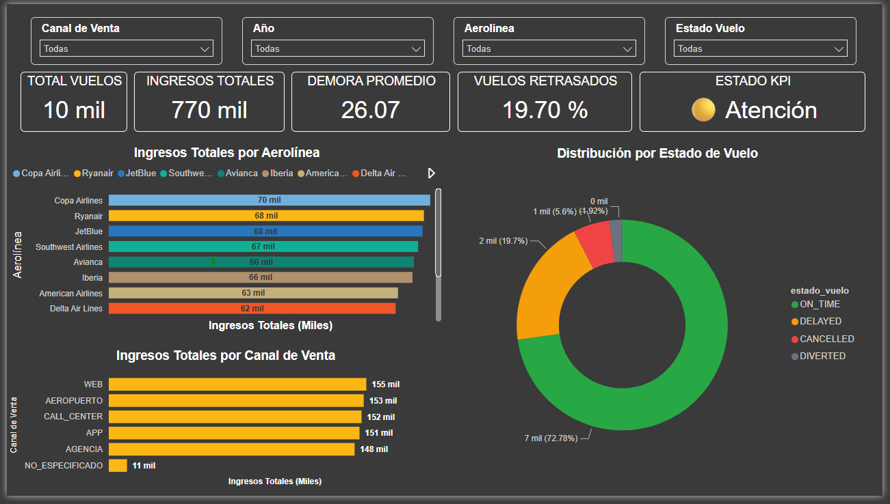
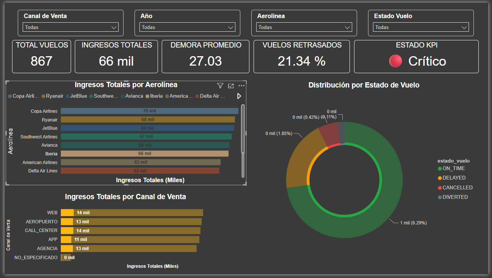
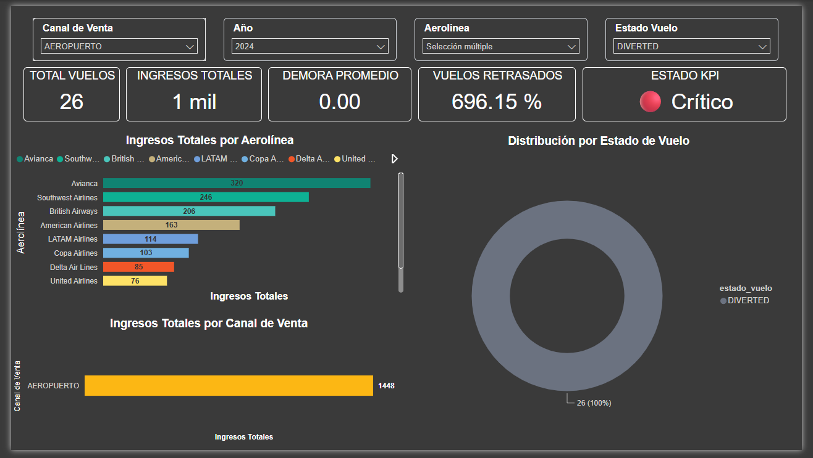
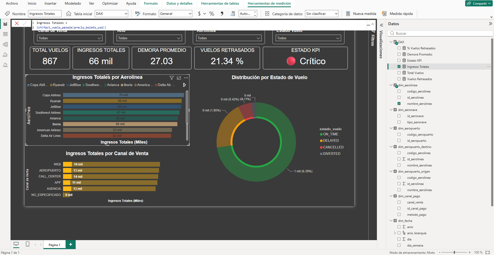

# Práctica 2: Dashboard y KPIs en Power BI

**Universidad de San Carlos de Guatemala**  
**Facultad de Ingeniería — Escuela de Ciencias y Sistemas**  
**Seminario de Sistemas 2 — 2do Semestre 2026**  
**Grupo 16**

| Nombre | Carnet |
| :--- | :--- |
| César Rolando Hernández Palacios | 202000806 |
| Keneth Willard Lopez Ovalle | 202100106 |

---

## 1. Descripción del Proyecto

Esta práctica consiste en la creación de un modelo tabular y un dashboard interactivo en **Power BI**, utilizando como fuente de datos el Data Warehouse `VuelosDW` en **SQL Server** generado en la Práctica 1.

El objetivo es analizar el rendimiento comercial y operativo de 10,000 registros de vuelos mediante indicadores clave (KPIs), permitiendo evaluar ingresos, volumen de pasajeros, puntualidad y causas de demora a través de visualizaciones interactivas y filtros dinámicos.

---

## 2. Modelo de Datos y Relaciones

El modelo se estructuró bajo un **esquema estrella**, importando los datos directamente en Power BI:

- **Tabla de Hechos:**
  - `fact_vuelo_pasaje`: Contiene los registros de vuelos, pasajes vendidos, precios en USD, tiempos de vuelo y minutos de demora.
- **Tablas de Dimensiones:**
  - `dim_aerolinea`: Información de las aerolíneas comerciales.
  - `dim_aeropuerto`: Aeropuertos de origen y destino para el análisis de rutas.
  - `dim_pasajero`: Datos demográficos de los pasajeros (edad, género y nacionalidad).
  - `dim_aeronave`: Modelos y tipos de aviones.
  - `dim_canal_pago`: Canales de venta (Web, App, etc.) y métodos de pago.
  - `dim_fecha`: Fechas de vuelo y reserva.

### Jerarquía de Fechas
En la dimensión `dim_fecha` se configuró la jerarquía **`anio Jerarquía`**, que permite navegar los datos en cuatro niveles:  
**Año $\longrightarrow$ Trimestre $\longrightarrow$ Mes $\longrightarrow$ Día**

---

## 3. Medidas DAX Implementadas

Las métricas del negocio se crearon con fórmulas DAX dentro de la tabla `DAX`:

- **Total Vuelos:** Cuenta el número total de pasajes y vuelos registrados (10,000 en total).
  ```dax
  Total Vuelos = COUNTROWS(fact_vuelo_pasaje)
  ```
- **Ingresos Totales:** Suma la facturación total en dólares.
  ```dax
  Ingresos Totales = SUM(fact_vuelo_pasaje[precio_boleto_usd])
  ```
- **Demora Promedio:** Promedio en minutos de retraso de los vuelos operados.
  ```dax
  Demora Promedio = AVERAGE(fact_vuelo_pasaje[demora_min])
  ```
- **Vuelos Retrasados:** Cuenta únicamente los vuelos con estado `DELAYED`.
  ```dax
  Vuelos Retrasados = CALCULATE([Total Vuelos], fact_vuelo_pasaje[estado_vuelo] = "DELAYED")
  ```
- **% Vuelos Retrasados:** Porcentaje de vuelos que sufrieron retraso respecto al total.
  ```dax
  % Vuelos Retrasados = DIVIDE([Vuelos Retrasados], [Total Vuelos], 0)
  ```

---

## 4. Indicador KPI con Semáforo

El indicador principal monitorea la **tasa de vuelos retrasados**, evaluando la calidad y puntualidad del servicio aéreo con tres niveles de alerta:

| Rango de Retrasos | Estado | Significado |
| :--- | :---: | :--- |
| **Menor a 19%** | 🟢 **Bueno** | Operación óptima y puntual. |
| **Entre 19% y 20%** | 🟡 **Atención** | Nivel de alerta preventiva por incremento de demoras. |
| **Mayor a 20%** | 🔴 **Crítico** | Retrasos excesivos que requieren atención inmediata. |

### Medida DAX del Semáforo:
```dax
Estado KPI = 
SWITCH(
    TRUE(),
    [% Vuelos Retrasados] < 0.19, "🟢 Bueno",
    [% Vuelos Retrasados] <= 0.20, "🟡 Atención",
    "🔴 Crítico"
)
```

---

## 5. Visualizaciones del Dashboard

El dashboard cuenta con elementos interactivos vinculados entre sí:

1. **Tarjetas Superiores:** Muestran los valores clave globales (`Total Vuelos`, `Ingresos Totales`, `Demora Promedio`, `% Vuelos Retrasados` y `Estado KPI`).
2. **Gráfico de Barras — Ingresos por Aerolínea:** Clasifica las aerolíneas de mayor a menor según su facturación.
3. **Gráfico Donut — Distribución por Estado de Vuelo:** Muestra la proporción de vuelos a tiempo (`ON_TIME`), demorados (`DELAYED`), cancelados (`CANCELLED`) y desviados (`DIVERTED`).
4. **Gráfico de Barras — Ingresos por Canal de Venta:** Compara las ventas por canal (`APP`, `WEB`, `AEROPUERTO`, `AGENCIA`, `CALL_CENTER`).
5. **Filtros Desplegables:** Permiten segmentar los datos por **Año**, **Aerolínea**, **Estado de Vuelo** y **Canal de Venta**.

---

## 6. Capturas del Dashboard

A continuación se presentan las evidencias del funcionamiento del dashboard interactivo:

### 6.1 Vista General del Dashboard
Muestra el estado inicial del tablero con el consolidado de las 10,000 operaciones y las métricas generales.



---

### 6.2 Filtrado Interactivo desde el Gráfico de Barras
Muestra el comportamiento del dashboard al seleccionar una barra específica, filtrando en tiempo real las tarjetas y el gráfico donut.



---

### 6.3 Filtrado mediante Selectores Desplegables y Cambio de Semáforo
Muestra la respuesta del dashboard al aplicar filtros desde los selectores superiores, evidenciando la actualización dinámica del semáforo de puntualidad.



---

### 6.4 Visualización del Indicador KPI de Ingresos Totales
Muestra el detalle del indicador de desempeño (KPI) implementado en el dashboard, reflejando la facturación total y el cumplimiento financiero.



---

## 7. Conclusiones

1. **Integración con la Práctica 1:** Se logró conectar Power BI directamente a la base de datos `VuelosDW`, manteniendo la consistencia de los datos limpios y transformados previamente.
2. **Análisis Dinámico con DAX:** Las medidas calculadas y el KPI semafórico permiten evaluar la operación de forma rápida sin necesidad de consultar tablas extensas.
3. **Interactividad:** El uso de selectores y filtrado cruzado facilita identificar qué canales y aerolíneas presentan mayor volumen de ingresos o problemas de demora.
