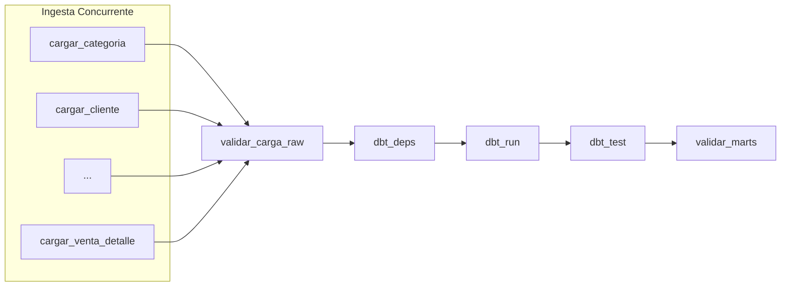

# Proyecto 1 — Pipeline ELT SG-Food

Pipeline de Extracción, Carga y Transformación (ELT) para SG-Food utilizando Python, Apache Airflow, dbt Core y PostgreSQL como Data Warehouse.

- **Curso:** Seminario de Sistemas 2 — USAC, Facultad de Ingeniería
- **Grupo:** 16

## Integrantes

| Integrante | Carnet | Rol |
|------------|--------|-----|
| Keneth Willard Lopez Ovalle | `202100106` | A — Ingesta y orquestación: infraestructura, Python, Airflow |
| César Rolando Hernández Palacios | `202000806` | B — Transformación y modelado: dbt, modelo dimensional, validaciones |

## Descripción del pipeline

```
BD transaccional (oltp_sgfood) ──┐
                                 ├─► Python (sgfood_ingesta) ─► raw ─► dbt staging ─► dbt intermediate ─► dbt marts
5 archivos CSV ──────────────────┘
                 Airflow (sgfood_elt): carga → validación de carga → dbt run → dbt test → validaciones finales
```

1. **Extracción y carga:** Python lee las 7 tablas de la base transaccional y los 5 archivos CSV, y las carga tal cual, como texto, en el schema `raw`.
2. **Transformación:** dbt convierte tipos y construye el modelo dimensional en `staging` y `marts`.
3. **Orquestación:** un DAG de Airflow ejecuta todo en orden, con reintentos, validaciones y control de errores.

## Estado del proyecto

| Componente | Estado | Dónde está documentado |
|------------|--------|------------------------|
| Entorno con Docker Compose | Terminado | [Manual de implementación](#manual-de-implementación), secciones 1 a 5 |
| Datos oficiales y contrato de `raw` | Terminado | Sección 6 y [docs/contrato_raw.md](docs/contrato_raw.md) |
| Extracción y carga con Python | Terminado | Sección 7 |
| DAG de Airflow | Terminado | Sección 8 |
| Esqueleto del proyecto dbt | Terminado | Sección 9 y [dbt_project/README.md](dbt_project/README.md) |
| Modelo dimensional y modelos dbt | **Pendiente — Rol B** | [Modelo del Data Warehouse](#modelo-del-data-warehouse) |
| Pruebas y documentación dbt | **Pendiente — Rol B** | [Estructura del proyecto dbt](#estructura-del-proyecto-dbt) |
| Consultas analíticas y de validación | **Pendiente — Rol B** | [Consultas analíticas y validación](#consultas-analíticas-y-validación) |
| Justificación de diseño del modelo | **Pendiente — Rol B** | [Justificación de diseño](#justificación-de-diseño) |

El Rol B tiene su punto de partida en [docs/guia_rol_b.md](docs/guia_rol_b.md).

---

## Manual de implementación

Guía paso a paso para desplegar y verificar el entorno base del proyecto desde un clon limpio.

### 1. Requisitos previos

- **Docker Desktop** (Engine 20.10+ y Docker Compose v2.0+).
- **Git**.
- **Python 3.10+** (opcional, necesario únicamente para ejecutar las pruebas automatizadas de desarrollo desde el host).

### 2. Configuración de variables de entorno

Copie la plantilla de variables de entorno `.env.example` a `.env`:

```bash
cd Proyecto1
cp .env.example .env
```

En sistemas Windows (PowerShell):

```powershell
Copy-Item .env.example .env
```

Edite `.env` y ajuste las contraseñas y puertos del host según sus necesidades. Las variables principales son:

| Variable | Descripción | Valor por defecto |
|---|---|---|
| `DW_DB` | Nombre de la base de datos del Data Warehouse | `sgfood_dw` |
| `DW_USER` | Usuario del Data Warehouse | `dw_user` |
| `DW_PASSWORD` | Contraseña del usuario del DW | `cambiar_dw_pass` |
| `DW_PORT` | Puerto expuesto en el host para el DW | `5433` |
| `SRC_DB` | Nombre de la base de datos transaccional fuente | `sgfood_src` |
| `SRC_USER` | Usuario de la base de datos fuente | `src_user` |
| `SRC_PASSWORD` | Contraseña del usuario de la fuente | `cambiar_src_pass` |
| `SRC_PORT` | Puerto expuesto en el host para la fuente | `5434` |
| `AIRFLOW_DB_USER` | Usuario de la base de metadatos de Airflow | `airflow` |
| `AIRFLOW_DB_PASSWORD` | Contraseña de metadatos de Airflow | `cambiar_airflow_db_pass` |
| `AIRFLOW_ADMIN_USER` | Usuario administrador de la interfaz de Airflow | `admin` |
| `AIRFLOW_ADMIN_PASSWORD` | Contraseña del usuario administrador de Airflow | `cambiar_admin_pass` |
| `AIRFLOW_PORT` | Puerto expuesto en el host para Airflow UI / API | `8080` |
| `AIRFLOW_UID` | Identificador numérico de usuario en Linux | `50000` |

> **Nota de seguridad:** El archivo `.env` está expresamente excluido de Git y nunca debe versionarse.

### 3. Arranque del entorno

Construya las imágenes personalizadas e inicie todos los servicios en segundo plano:

```bash
docker compose up -d
```

Este comando:
1. Levanta las instancias PostgreSQL para el Data Warehouse (`dw`), la base fuente (`src`) y la base de metadatos (`airflow-db`).
2. El contenedor `dw` inicializa automáticamente los schemas `raw`, `staging` y `marts` a partir de `sql/ddl/01_schemas.sql`, y crea las 12 tablas vacías del schema `raw` a partir de `sql/ddl/02_raw_tables.sql`.
3. El contenedor `src` ejecuta el script oficial `data/sgfood_oltp.sql` montado en `/docker-entrypoint-initdb.d/01_oltp.sql:ro`, creando el schema `oltp_sgfood` y poblando sus 7 tablas transaccionales.
4. Inicia `airflow-init` para aplicar las migraciones de base de datos y crear el usuario administrador.
5. Una vez completado `airflow-init`, arranca el servidor web (`airflow-apiserver`), el programador (`airflow-scheduler`) y el procesador de DAGs (`airflow-dag-processor`).

### 4. Verificación del estado de los servicios

Compruebe que todos los servicios de larga duración estén en estado saludable (`healthy`):

```bash
docker compose ps
```

Todos los servicios deben reportar estado `healthy` o `running`, y `airflow-init` debe figurar como `Exited (0)`.

### 5. Acceso a los servicios

#### Data Warehouse (DW)
- **Host:** `localhost`
- **Puerto:** Valor configurado en `DW_PORT` (por defecto `5433`)
- **Base de datos:** `sgfood_dw`
- **Usuario:** `dw_user`
- **Schemas iniciales:** `raw` (12 tablas vacías creadas), `staging`, `marts`

Comprobación rápida con cliente `psql`:
```bash
psql -h localhost -p 5433 -U dw_user -d sgfood_dw
```

#### Base transaccional fuente (SRC)
- **Host:** `localhost`
- **Puerto:** Valor configurado en `SRC_PORT` (por defecto `5434`)
- **Base de datos:** `sgfood_src`
- **Usuario:** `src_user`
- **Schema poblado:** `oltp_sgfood` (7 tablas con 4.763 registros)

Consulta de validación con `psql`:
```bash
psql -h localhost -p 5434 -U src_user -d sgfood_src -c "SELECT table_name FROM information_schema.tables WHERE table_schema = 'oltp_sgfood';"
```

#### Interfaz Web y API de Apache Airflow
- **URL Web UI:** `http://localhost:8080` (o el puerto configurado en `AIRFLOW_PORT`)
- **Autenticación Web:** Gestionada por FAB (`FabAuthManager`). El formulario de login solicita el usuario (`AIRFLOW_ADMIN_USER`) y contraseña (`AIRFLOW_ADMIN_PASSWORD`) configurados en `.env`.
- **Autenticación REST API (Airflow 3):** Para consumir los endpoints de la API (por ejemplo `/api/v2/dags`), obtenga primero un token JWT mediante `POST /auth/token` enviando `{"username": "<usuario>", "password": "<contraseña>"}` con cabecera `Content-Type: application/json`. Luego envíe el token devuelto en la cabecera `Authorization: Bearer <access_token>`.
- **Endpoint de salud:** `http://localhost:8080/api/v2/monitor/health` (o el puerto configurado en `AIRFLOW_PORT`)
- **Execution API interna:** Los workers y el scheduler se comunican con el api-server a través de `http://airflow-apiserver:8080/execution/` autenticados mediante `AIRFLOW_JWT_SECRET`.

### 6. Datos oficiales y Contrato de la capa Raw

Los datos de origen del proyecto residen en `data/` y se versionan de forma binaria/literal byte a byte mediante `.gitattributes` (`data/* -text`):

1. **Base transaccional PostgreSQL (`sgfood_oltp.sql`):** 7 tablas en `oltp_sgfood` con un total de 4.763 registros (`sucursal`: 6, `categoria`: 8, `marca`: 10, `producto`: 80, `cliente`: 250, `venta`: 1.200, `venta_detalle`: 3.209).
2. **Archivos planos CSV:** 5 archivos de fuentes externas con un total de 4.101 registros (`inventario_bodega.csv`: 3.840, `proveedores_precios.csv`: 103, `devoluciones.csv`: 80, `metas_ventas.csv`: 48, `promociones.csv`: 30).
3. **Casos de calidad opcionales (`casos_calidad_opcionales.csv`):** 10 registros con anomalías sintéticas. Según la decisión D8 de steering, **no forman parte de la ingesta principal** y su utilización para auditorías de calidad queda bajo criterio de dbt (Rol B).

#### Contrato y Especificación Técnica
- **Contrato de datos v1:** [docs/contrato_raw.md](docs/contrato_raw.md) detalla granularidad, reglas de representación (`NULL`, formatos numéricos y fechas ISO), columnas de auditoría (`_loaded_at`, `_source`) y el diccionario de campos.
- **Configuración centralizada:** [python/config/fuentes.yml](python/config/fuentes.yml) actúa como la única fuente de verdad consumible por código para la definición de fuentes, tablas y columnas.
- **DDL de tablas raw:** [sql/ddl/02_raw_tables.sql](sql/ddl/02_raw_tables.sql) crea las 12 tablas en `raw` tipadas como `TEXT` con columnas de auditoría, sin claves ni restricciones que impidan la auditoría en dbt.

### 7. Ingesta Técnica de Datos (sgfood_ingesta)

El paquete `Proyecto1/python/sgfood_ingesta/` implementa la extracción y carga técnica de las 12 fuentes de datos hacia el schema `raw` del Data Warehouse `sgfood_dw`, garantizando fidelidad e idempotencia.

#### Estructura del paquete

```
Proyecto1/python/sgfood_ingesta/
├── __init__.py      # Exporta la interfaz pública (listar_fuentes, cargar_fuente, cargar_todas)
├── __main__.py      # Punto de entrada para invocación con python -m sgfood_ingesta
├── cli.py           # CLI con argparse, configuración de logging y códigos de salida (0, 1, 2)
├── config.py        # Carga inmutable y validación estricta de python/config/fuentes.yml
├── conexiones.py    # Gestión segura de parámetros y conexiones psycopg (enmascara credenciales)
├── extraccion.py    # Extracción streaming con psycopg.sql (Postgres) y csv stdlib (utf-8-sig)
├── carga.py         # Carga transaccional al DW: TRUNCATE + COPY FROM STDIN + verificación de conteos
└── errores.py       # Jerarquía de excepciones de dominio (heredan de ErrorIngesta)
```

#### Flujo de carga por tabla

1. **Resolución:** Lee la especificación de la tabla desde `fuentes.yml` sin nombres de negocio escritos a mano en el código.
2. **Extracción Streaming:**
   - **PostgreSQL:** Construye una consulta parametrizada con `psycopg.sql.Identifier`, proyectando cada columna con `::text` sobre la base fuente en modo solo lectura (`read_only=True`).
   - **Archivos CSV:** Lee línea por línea en streaming usando el módulo estándar `csv` con codificación `utf-8-sig`. Valida el encabezado contra el contrato y detecta inconsistencias en número de columnas con reporte exacto de línea.
3. **Limpieza técnica aplicada:**
   - La **única transformación** realizada en Python es la conversión de cadenas vacías `""` a `None` (SQL `NULL`).
   - Se preservan espacios en blanco y no se efectúan conversiones de tipos en Python (todas las columnas de negocio residen como `TEXT` en `raw`, delegando auditorías y conversiones a dbt en la capa `staging`).
   - No se utiliza `pandas` (eliminado de los requisitos para máxima velocidad y ligereza).
4. **Carga Transaccional en Data Warehouse:**
   - Se ejecuta dentro de un bloque de transacción en `sgfood_dw` con `autocommit=False`.
   - Se vacía la tabla con `TRUNCATE TABLE raw.<tabla>`.
   - Se cargan las filas vía `COPY raw.<tabla> (...) FROM STDIN`. La biblioteca `psycopg` 3 (`write_row`) serializa de forma nativa los valores `None` a `NULL` (`\N`).
   - Se agregan las columnas de auditoría: `_loaded_at` (marca de tiempo compartida en UTC) y `_source` (ruta u origen exacto declarado).
   - Se ejecuta una verificación antes de confirmar: `SELECT count(*) FROM raw.<tabla>`. Si el total coincide exactamente con las filas leídas, se hace `COMMIT`; si difiere, se lanza `ConteoInconsistente` y se revierte la transacción (`ROLLBACK`).
5. **Manejo de fallos y aislamiento:**
   - Si ocurre un fallo en una tabla, la transacción se revierte por completo preservando los datos previos de esa tabla.
   - En una carga completa de las 12 tablas, si una tabla posterior falla, las tablas ya confirmadas con anterioridad permanecen persistidas en el DW.

#### Comandos de ejecución

Desde el host (a través de los contenedores Docker):

```bash
# Carga completa de las 12 tablas con timestamp auditado compartido (8.864 filas en total)
docker compose exec airflow-scheduler python -m sgfood_ingesta

# Carga de una tabla individual
docker compose exec airflow-scheduler python -m sgfood_ingesta --tabla devoluciones

# Listado de fuentes configuradas
docker compose exec airflow-scheduler python -m sgfood_ingesta --listar

# Ejecución desacoplada en un contenedor efímero independiente
docker compose run --rm airflow-scheduler python -m sgfood_ingesta
```

#### Códigos de salida

| Código | Significado | Comportamiento |
|:---:|---|---|
| `0` | Éxito | Todas las cargas solicitadas se completaron y confirmaron. |
| `1` | Fallo en carga | Error durante la extracción, discrepancia de conteo o archivo inexistente. La tabla afectada se revierte. |
| `2` | Configuración / argumentos inválidos | Argumentos erróneos o tabla inexistente en `fuentes.yml`. |

### 8. Orquestación del Pipeline ELT (DAG sgfood_elt)

El DAG `sgfood_elt` (`airflow/dags/sgfood_elt.py`) automatiza el ciclo completo del pipeline ELT:



- **Programación:** Diaria (`@daily`), en pausa al crearse (`is_paused_upon_creation=True`), `catchup=False`.
- **Concurrencia:** `max_active_runs=1` (evita colisiones de carga simultánea) y `max_active_tasks=4`.

#### Tabla de tareas, reintentos y tiempos límite

| Tarea / Grupo | Tipo | Reintentos | Retardo reintento | Tiempo límite | Propósito |
|---|---|:---:|:---:|:---:|---|
| `carga_raw.cargar_<tabla>` (x12) | `@task` (Python) | 2 | 1 min | 10 min | Ingesta de cada fuente a `raw` con `_loaded_at` compartido. |
| `validar_carga_raw` | `@task` (Python) | 0 | - | 5 min | Verifica que conteo fuente == conteo raw para las 12 tablas. Falla de inmediato ante discrepancias. |
| `dbt_deps` | `BashOperator` | 2 | 1 min | 10 min | Descarga paquetes dbt si existe `packages.yml`. |
| `dbt_run` | `BashOperator` | 1 | 1 min | 20 min | Compila y ejecuta modelos de staging, intermediate y marts. |
| `dbt_test` | `BashOperator` | 0 | - | 20 min | Ejecuta pruebas de calidad dbt (unicidad, no-nulos, relaciones). |
| `validar_marts` | `@task` (Python) | 0 | - | 10 min | Ejecuta archivos SQL de validación de negocio en orden alfabético. Falla si alguna consulta devuelve filas. |

#### Parámetros configurables (`params`)

El DAG admite parámetros en tiempo de ejecución o disparo manual:
- `dbt_project_dir`: Ruta del proyecto dbt (por defecto `/opt/airflow/dbt_project`).
- `dbt_profiles_dir`: Ruta del perfil dbt (por defecto `/opt/airflow/dbt_project`).
- `validaciones_dir`: Carpeta de consultas SQL de validación de marts (por defecto `/opt/airflow/sql/validaciones/dag`).

#### Cómo activarlo y dispararlo

```bash
# Activar (despausar) el DAG
docker compose exec airflow-scheduler airflow dags unpause -y sgfood_elt

# Disparar ejecución con parámetros predeterminados
docker compose exec airflow-scheduler airflow dags trigger sgfood_elt

# Disparar con parámetros personalizados (JSON)
docker compose exec airflow-scheduler airflow dags trigger sgfood_elt --conf '{"dbt_project_dir": "/opt/airflow/dbt_project"}'
```

#### Cómo leer e investigar una ejecución fallida

1. **Desde la interfaz web de Airflow (UI):**
   - Acceda a `http://localhost:8080` con usuario y contraseña de `.env` (`AIRFLOW_ADMIN_USER` / `AIRFLOW_ADMIN_PASSWORD`).
   - Ingrese al DAG `sgfood_elt` y seleccione la vista **Grid** o **Graph**.
   - Identifique la tarea en estado rojo (`failed`). Haga clic en ella y presione **Logs** para ver el stack trace completo.
2. **Desde la línea de comandos (CLI):**
   ```bash
   # Listar últimas ejecuciones del DAG
   docker compose exec airflow-scheduler airflow dags list-runs -d sgfood_elt --limit 5

   # Consultar el log de una tarea fallida específica
   docker compose exec airflow-scheduler airflow tasks logs sgfood_elt <task_id> <dag_run_id>
   ```
3. **Causas típicas de fallo:**
   - En `carga_raw.*`: Base fuente inaccesible o CSV faltante.
   - En `validar_carga_raw`: Discrepancia en conteos entre origen y destino.
   - En `dbt_run`: Error de sintaxis SQL o tabla de origen faltante.
   - En `dbt_test`: Registros duplicados o valores nulos que violan las reglas dbt.
   - En `validar_marts`: Una consulta en `sql/validaciones/dag/` arrojó filas (inconsistencia de negocio).

#### Convención de validaciones finales (`sql/validaciones/dag/`)

- Las consultas deben guardarse en `Proyecto1/sql/validaciones/dag/`.
- Formato: archivos `.sql` con prefijo numérico indicando orden de ejecución (ej. `01_integridad.sql`, `02_totales.sql`).
- Semántica: **Toda consulta debe devolver 0 filas si el Data Warehouse es consistente**. Si devuelve una o más filas, la tarea `validar_marts` falla inmediatamente y registra las filas anómalas en el log.

#### Capturas de pantalla requeridas para la entrega / reporte

Para la entrega del proyecto, el integrante debe tomar las siguientes capturas desde la UI de Airflow (`http://localhost:8080`):
1. **Grafo completo del DAG (`Graph View`):** Mostrando la estructura completa desde `carga_raw` hasta `validar_marts`.
2. **Ejecución exitosa (`Grid View` o `Graph View` en verde):** Mostrando todas las tareas en estado `success` (verde oscuro) para una corrida completa del pipeline.


### 9. Proyecto de Transformación dbt (dbt_project)

El esqueleto inicial en `Proyecto1/dbt_project/` permite que el **Rol B** construya modelos de staging, intermediate y marts conectando directamente al DW vía PostgreSQL adapter:

- **Configuración central:** `dbt_project.yml` define materializaciones por carpeta (staging como vista, marts como tabla).
- **Conexión:** `profiles.yml` lee variables `DW_*` mediante `env_var`.
- **Macro de Schemas:** `macros/generate_schema_name.sql` garantiza que dbt escriba exactamente en los schemas `staging` y `marts`.
- **Fuentes:** `models/staging/_fuentes.yml` declara las 12 tablas de `raw`.
- **Ejemplo de Staging:** `models/staging/stg_oltp__sucursal.sql` demuestra el consumo con `source()`, casteo desde `TEXT` y pruebas en `_staging.yml`.

> Consulte la [Guía de Arranque para Rol B](docs/guia_rol_b.md) para detalles completos de ejecución local, desarrollo de nuevos modelos y convenciones.

### 10. Ejecución de pruebas automatizadas

El proyecto cuenta con un arnés completo de pruebas automatizadas en `tests/entorno/`, `tests/contrato/`, `tests/ingesta/` y `tests/dag/` utilizando `pytest`:

1. Instale las dependencias de prueba:
   ```bash
   pip install -r tests/requirements-dev.txt
   ```

2. Pruebas unitarias y de configuración (rápidas, sin Docker):
   ```bash
   pytest tests/ -m "not integracion and not lenta"
   ```

3. Suite completa de integración (con contenedores activos):
   ```bash
   pytest tests/entorno tests/contrato tests/ingesta tests/dag
   ```

4. Prueba lenta de ciclo limpio de reinicio (`down -v` / `up -d`):
   ```bash
   pytest tests/entorno/test_reinicio.py -m lenta
   ```

### 11. Reinicio a estado limpio

Para restablecer el entorno borrando volúmenes y datos persistidos:

```bash
docker compose down -v
docker compose up -d
```

> [!IMPORTANT]
> **Comportamiento de inicialización de volúmenes:** Los scripts ubicados en `/docker-entrypoint-initdb.d/` tanto en `dw` (`01_schemas.sql`, `02_raw_tables.sql`) como en `src` (`01_oltp.sql`) se ejecutan **únicamente cuando sus volúmenes nombrados (`dw_data` y `src_data`) están completamente vacíos**. Si se agregan o modifican scripts DDL con un entorno ya levantado, es obligatorio ejecutar `docker compose down -v` para recrear las bases de datos desde cero, o bien aplicar los scripts manualmente con `psql`.

### 12. Problemas frecuentes y resolución

- **Puerto del host ocupado (Bind failed / port is already allocated):**
  Si puertos como 5433, 5434 u 8080 están ocupados por otros servicios locales en el host, cambie los valores correspondientes en su archivo `.env` local (por ejemplo `DW_PORT=5443`, `SRC_PORT=5444`, `AIRFLOW_PORT=8089`). No modifique `docker-compose.yml`.
- **Los schemas no aparecen en el DW:**
  Los scripts de `/docker-entrypoint-initdb.d/` solo se ejecutan cuando el volumen de base de datos está vacío. Si se crearon antes de montar el script, ejecute un reinicio limpio con `docker compose down -v` y vuelva a iniciar.
- **Variable requerida faltante:**
  Si falta alguna variable obligatoria en `.env`, `docker compose config` o `docker compose up` fallará indicando el nombre exacto de la variable que debe definirse.

---

## Modelo del Data Warehouse

> **Pendiente — Rol B.** Esta sección debe describir el modelo dimensional: tablas de hechos, dimensiones, granularidad, claves y relaciones, con su diagrama.

Lo que ya existe en el Data Warehouse `sgfood_dw`:

| Schema | Contenido actual | Lo crea |
|--------|------------------|---------|
| `raw` | 12 tablas con los datos oficiales, todas las columnas de negocio como texto | DDL (`sql/ddl/`) y carga con Python |
| `staging` | Un modelo de ejemplo, `stg_oltp__sucursal` | dbt |
| `marts` | Vacío | dbt |

## Estructura del proyecto dbt

> **Pendiente — Rol B.** Esta sección debe describir los modelos por capa, las materializaciones elegidas, las pruebas de calidad y la documentación generada con `dbt docs`.

El punto de partida está en la sección 9 y en [dbt_project/README.md](dbt_project/README.md).

## Consultas analíticas y validación

> **Pendiente — Rol B.** Esta sección debe presentar las consultas analíticas, las consultas de validación y sus resultados.

Validaciones que ya ejecuta el pipeline:

| Validación | Qué comprueba | Dónde |
|------------|---------------|-------|
| Conteo por tabla durante la carga | Filas cargadas en `raw` iguales a las leídas de la fuente; si no coinciden, la carga se revierte | `sgfood_ingesta` |
| `validar_carga_raw` | Filas de cada fuente iguales a las de su tabla en `raw`, para las 12 tablas | Tarea del DAG |
| `dbt_test` | Pruebas definidas en el proyecto dbt | Tarea del DAG |
| `validar_marts` | Cada consulta de `sql/validaciones/dag/` devuelve cero filas | Tarea del DAG |

## Justificación de diseño

> **Pendiente — Rol B** para el modelo dimensional y las decisiones de dbt.

Decisiones de la ingesta y la orquestación:

| Decisión | Motivo |
|----------|--------|
| ELT en lugar de ETL | Python solo extrae y carga; las reglas de negocio viven en dbt, donde quedan versionadas, probadas y documentadas |
| `raw` con todas las columnas como texto | Un valor inválido llega a `raw` y lo detecta una prueba dbt, en lugar de detener la carga |
| Truncado y recarga en una transacción por tabla | La carga es idempotente y, si falla, la tabla conserva los datos anteriores |
| Ingesta guiada por `fuentes.yml` | Agregar una fuente no requiere tocar código ni el DAG |
| Una tarea de Airflow por fuente | Reintento y registro por tabla |
| `dbt run` y `dbt test` como tareas separadas | Un fallo de modelo y uno de calidad de datos quedan distinguidos |
| dbt en un entorno virtual aislado | Evita conflictos de dependencias con Airflow |
| Validaciones finales como archivos SQL | Se agregan validaciones sin modificar el DAG |

## Evidencia de ejecución

Los archivos están en [evidencia/](evidencia/).

| Archivo | Contenido |
|---------|-----------|
| `carga_completa.txt` | Registro de una carga completa a `raw` |
| `conteo_tablas_raw.txt` | Filas por tabla de `raw` y total |
| `dag_tareas_y_dependencias.txt` | Tareas del DAG y sus dependencias |
| `dag_estados_tareas.txt` | Estado de cada tarea en una ejecución completa |
| `dag_log_dbt_run.txt`, `dag_log_dbt_test.txt`, `dag_log_validar_marts.txt` | Registros de las tareas de dbt y de validación |
| `dbt_run_ejecucion_real.txt` | Ejecución de dbt sobre el esqueleto del proyecto |

> **Pendiente:** capturas de la interfaz de Airflow con el grafo del DAG y una ejecución exitosa, y la evidencia del Rol B.

