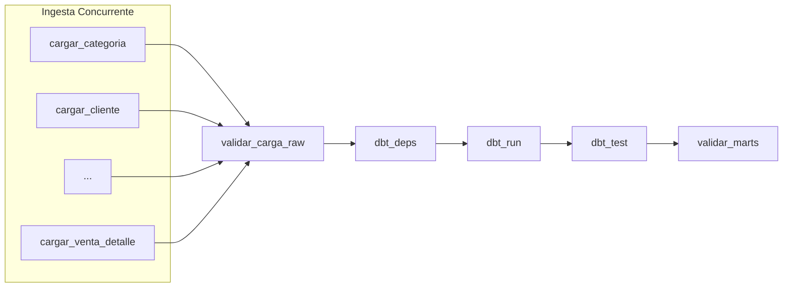
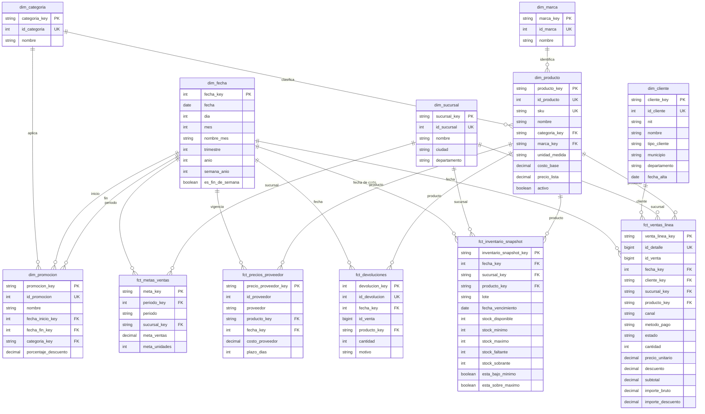
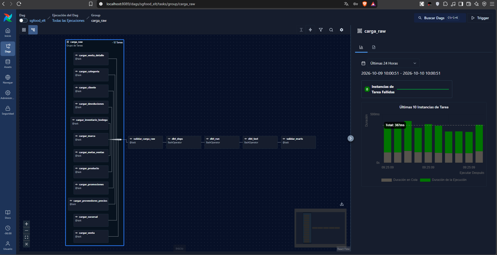
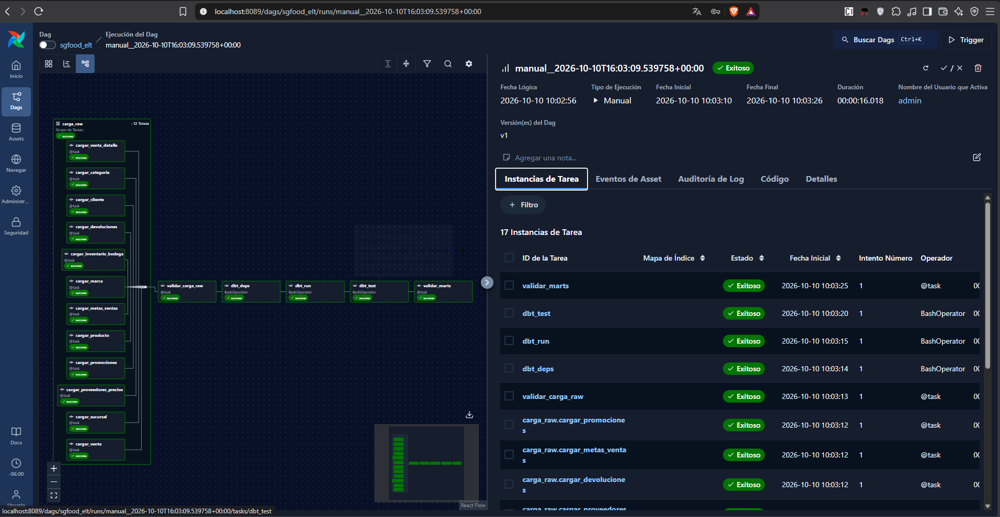
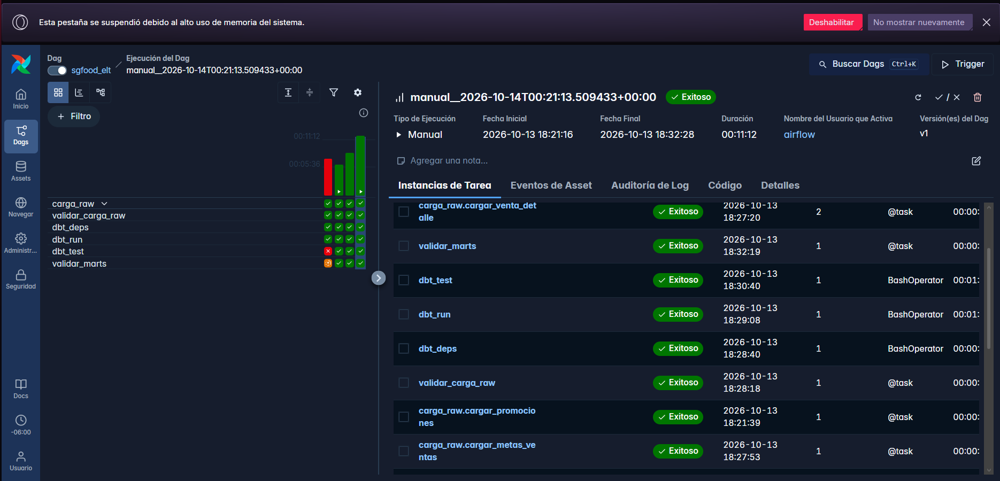
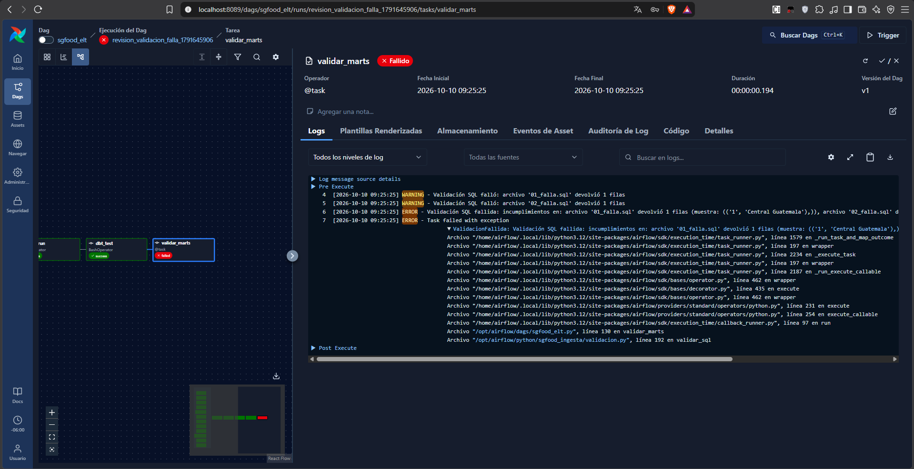

# Proyecto 1 — Pipeline ELT SG-Food

Pipeline de Extracción, Carga y Transformación (ELT) para SG-Food utilizando Python, Apache Airflow, dbt Core y PostgreSQL como Data Warehouse.

- **Curso:** Seminario de Sistemas 2 — USAC, Facultad de Ingeniería
- **Grupo:** 16

## Integrantes

| Integrante | Carnet | Rol |
|------------|--------|-----|
| Keneth Willard Lopez Ovalle | `202100106` | A — Ingesta y orquestación: infraestructura, Python, Airflow |
| César Rolando Hernández Palacios | `202000806` | B — Transformación y modelado: dbt, modelo dimensional, validaciones |

## Descripción del pipeline

```
BD transaccional (oltp_sgfood) ──┐
                                 ├─► Python (sgfood_ingesta) ─► raw ─► dbt staging ─► dbt intermediate ─► dbt marts
5 archivos CSV ──────────────────┘
                 Airflow (sgfood_elt): carga → validación de carga → dbt run → dbt test → validaciones finales
```

1. **Extracción y carga:** Python lee las 7 tablas de la base transaccional y los 5 archivos CSV, y las carga tal cual, como texto, en el schema `raw`.
2. **Transformación:** dbt convierte tipos y construye el modelo dimensional en `staging` y `marts`.
3. **Orquestación:** un DAG de Airflow ejecuta todo en orden, con reintentos, validaciones y control de errores.

## Estado del proyecto

| Componente | Estado | Dónde está documentado |
|------------|--------|------------------------|
| Entorno con Docker Compose | Terminado | [Manual de implementación](#manual-de-implementación), secciones 1 a 5 |
| Datos oficiales y contrato de `raw` | Terminado | Sección 6 y [docs/contrato_raw.md](docs/contrato_raw.md) |
| Extracción y carga con Python | Terminado | Sección 7 |
| DAG de Airflow | Terminado | Sección 8 |
| Esqueleto del proyecto dbt | Terminado | Sección 9 y [dbt_project/README.md](dbt_project/README.md) |
| Diseño dimensional | **Definido — Rol B** | [Modelo del Data Warehouse](#modelo-del-data-warehouse) |
| Modelos de staging dbt | **Implementados — Rol B** | [Estructura del proyecto dbt](#estructura-del-proyecto-dbt) |
| Modelos intermediate dbt | **Implementados — Rol B** | [Estructura del proyecto dbt](#estructura-del-proyecto-dbt) |
| Modelos marts dbt | **Implementados — Rol B** | [Estructura del proyecto dbt](#estructura-del-proyecto-dbt) |
| Pruebas y documentación dbt | **Implementadas — Rol B** | [Estructura del proyecto dbt](#estructura-del-proyecto-dbt) |
| Consultas analíticas y de validación | **Implementadas — Rol B** | [Consultas analíticas y validación](#consultas-analíticas-y-validación) |
| Justificación de diseño del modelo | **Definida — Rol B** | [Justificación de diseño](#justificación-de-diseño) |
| Ajustes de cierre (claves, pruebas, restricciones, evidencia) | Terminado | [docs/cambios_ajustes_cierre.md](docs/cambios_ajustes_cierre.md) |

El Rol B tiene su punto de partida en [docs/guia_rol_b.md](docs/guia_rol_b.md).

---

## Manual de implementación

Guía paso a paso para desplegar y verificar el entorno base del proyecto desde un clon limpio.

### 1. Requisitos previos

- **Docker Desktop** (Engine 20.10+ y Docker Compose v2.0+).
- **Git**.
- **Python 3.10+** (opcional, necesario únicamente para ejecutar las pruebas automatizadas de desarrollo desde el host).

### 2. Configuración de variables de entorno

Copie la plantilla de variables de entorno `.env.example` a `.env`:

```bash
cd Proyecto1
cp .env.example .env
```

En sistemas Windows (PowerShell):

```powershell
Copy-Item .env.example .env
```

Edite `.env` y ajuste las contraseñas y puertos del host según sus necesidades. Las variables principales son:

| Variable | Descripción | Valor por defecto |
|---|---|---|
| `DW_DB` | Nombre de la base de datos del Data Warehouse | `sgfood_dw` |
| `DW_USER` | Usuario del Data Warehouse | `dw_user` |
| `DW_PASSWORD` | Contraseña del usuario del DW | `cambiar_dw_pass` |
| `DW_PORT` | Puerto expuesto en el host para el DW | `5433` |
| `SRC_DB` | Nombre de la base de datos transaccional fuente | `sgfood_src` |
| `SRC_USER` | Usuario de la base de datos fuente | `src_user` |
| `SRC_PASSWORD` | Contraseña del usuario de la fuente | `cambiar_src_pass` |
| `SRC_PORT` | Puerto expuesto en el host para la fuente | `5434` |
| `AIRFLOW_DB_USER` | Usuario de la base de metadatos de Airflow | `airflow` |
| `AIRFLOW_DB_PASSWORD` | Contraseña de metadatos de Airflow | `cambiar_airflow_db_pass` |
| `AIRFLOW_ADMIN_USER` | Usuario administrador de la interfaz de Airflow | `admin` |
| `AIRFLOW_ADMIN_PASSWORD` | Contraseña del usuario administrador de Airflow | `cambiar_admin_pass` |
| `AIRFLOW_PORT` | Puerto expuesto en el host para Airflow UI / API | `8080` |
| `AIRFLOW_UID` | Identificador numérico de usuario en Linux | `50000` |

> **Nota de seguridad:** El archivo `.env` está expresamente excluido de Git y nunca debe versionarse.

### 3. Arranque del entorno

Construya las imágenes personalizadas e inicie todos los servicios en segundo plano:

```bash
docker compose up -d
```

Este comando:
1. Levanta las instancias PostgreSQL para el Data Warehouse (`dw`), la base fuente (`src`) y la base de metadatos (`airflow-db`).
2. El contenedor `dw` inicializa automáticamente los schemas `raw`, `staging` y `marts` a partir de `sql/ddl/01_schemas.sql`, y crea las 12 tablas vacías del schema `raw` a partir de `sql/ddl/02_raw_tables.sql`.
3. El contenedor `src` ejecuta el script oficial `data/sgfood_oltp.sql` montado en `/docker-entrypoint-initdb.d/01_oltp.sql:ro`, creando el schema `oltp_sgfood` y poblando sus 7 tablas transaccionales.
4. Inicia `airflow-init` para aplicar las migraciones de base de datos y crear el usuario administrador.
5. Una vez completado `airflow-init`, arranca el servidor web (`airflow-apiserver`), el programador (`airflow-scheduler`) y el procesador de DAGs (`airflow-dag-processor`).

### 4. Verificación del estado de los servicios

Compruebe que todos los servicios de larga duración estén en estado saludable (`healthy`):

```bash
docker compose ps
```

Todos los servicios deben reportar estado `healthy` o `running`, y `airflow-init` debe figurar como `Exited (0)`.

### 5. Acceso a los servicios

#### Data Warehouse (DW)
- **Host:** `localhost`
- **Puerto:** Valor configurado en `DW_PORT` (por defecto `5433`)
- **Base de datos:** `sgfood_dw`
- **Usuario:** `dw_user`
- **Schemas iniciales:** `raw` (12 tablas vacías creadas), `staging`, `marts`

Comprobación rápida con cliente `psql`:
```bash
psql -h localhost -p 5433 -U dw_user -d sgfood_dw
```

#### Base transaccional fuente (SRC)
- **Host:** `localhost`
- **Puerto:** Valor configurado en `SRC_PORT` (por defecto `5434`)
- **Base de datos:** `sgfood_src`
- **Usuario:** `src_user`
- **Schema poblado:** `oltp_sgfood` (7 tablas con 4.763 registros)

Consulta de validación con `psql`:
```bash
psql -h localhost -p 5434 -U src_user -d sgfood_src -c "SELECT table_name FROM information_schema.tables WHERE table_schema = 'oltp_sgfood';"
```

#### Interfaz Web y API de Apache Airflow
- **URL Web UI:** `http://localhost:8080` (o el puerto configurado en `AIRFLOW_PORT`)
- **Autenticación Web:** Gestionada por FAB (`FabAuthManager`). El formulario de login solicita el usuario (`AIRFLOW_ADMIN_USER`) y contraseña (`AIRFLOW_ADMIN_PASSWORD`) configurados en `.env`.
- **Autenticación REST API (Airflow 3):** Para consumir los endpoints de la API (por ejemplo `/api/v2/dags`), obtenga primero un token JWT mediante `POST /auth/token` enviando `{"username": "<usuario>", "password": "<contraseña>"}` con cabecera `Content-Type: application/json`. Luego envíe el token devuelto en la cabecera `Authorization: Bearer <access_token>`.
- **Endpoint de salud:** `http://localhost:8080/api/v2/monitor/health` (o el puerto configurado en `AIRFLOW_PORT`)
- **Execution API interna:** Los workers y el scheduler se comunican con el api-server a través de `http://airflow-apiserver:8080/execution/` autenticados mediante `AIRFLOW_JWT_SECRET`.

#### pgAdmin (opcional)

pgAdmin 9.18.0 no forma parte del pipeline y no arranca con `docker compose up`. Para usarlo, defina `PGADMIN_EMAIL`, `PGADMIN_PASSWORD` y, si lo necesita, `PGADMIN_PORT` en `.env` (los valores de ejemplo están en `.env.example`) y ejecute:

```bash
docker compose --profile herramientas up -d pgadmin
```

Se abre en `http://localhost:8081` (o el puerto de `PGADMIN_PORT`). Sin `PGADMIN_PASSWORD`, pgAdmin no inicia. Se registra el servidor con host `dw`, puerto `5432` y las credenciales `DW_*`.

### 6. Datos oficiales y Contrato de la capa Raw

Los datos de origen del proyecto residen en `data/` y se versionan de forma binaria/literal byte a byte mediante `.gitattributes` (`data/* -text`):

1. **Base transaccional PostgreSQL (`sgfood_oltp.sql`):** 7 tablas en `oltp_sgfood` con un total de 4.763 registros (`sucursal`: 6, `categoria`: 8, `marca`: 10, `producto`: 80, `cliente`: 250, `venta`: 1.200, `venta_detalle`: 3.209).
2. **Archivos planos CSV:** 5 archivos de fuentes externas con un total de 4.101 registros (`inventario_bodega.csv`: 3.840, `proveedores_precios.csv`: 103, `devoluciones.csv`: 80, `metas_ventas.csv`: 48, `promociones.csv`: 30).
3. **Casos de calidad opcionales (`casos_calidad_opcionales.csv`):** 10 registros con anomalías sintéticas. Según la decisión D8 de steering, **no forman parte de la ingesta principal**: no se cargan en `raw`. Se usan solo para demostrar las pruebas de calidad de dbt: [sql/calidad/cargar_casos_calidad.py](sql/calidad/cargar_casos_calidad.py) los aplica sobre una copia de `raw` (`raw_calidad`) y las pruebas se ejecutan contra esa copia, sin tocar `staging` ni `marts` (ver [Casos de calidad](#casos-de-calidad)).

#### Contrato y Especificación Técnica
- **Contrato de datos v1:** [docs/contrato_raw.md](docs/contrato_raw.md) detalla granularidad, reglas de representación (`NULL`, formatos numéricos y fechas ISO), columnas de auditoría (`_loaded_at`, `_source`) y el diccionario de campos.
- **Configuración centralizada:** [python/config/fuentes.yml](python/config/fuentes.yml) actúa como la única fuente de verdad consumible por código para la definición de fuentes, tablas y columnas.
- **DDL de tablas raw:** [sql/ddl/02_raw_tables.sql](sql/ddl/02_raw_tables.sql) crea las 12 tablas en `raw` tipadas como `TEXT` con columnas de auditoría, sin claves ni restricciones que impidan la auditoría en dbt.

### 7. Ingesta Técnica de Datos (sgfood_ingesta)

El paquete `Proyecto1/python/sgfood_ingesta/` implementa la extracción y carga técnica de las 12 fuentes de datos hacia el schema `raw` del Data Warehouse `sgfood_dw`, garantizando fidelidad e idempotencia.

#### Estructura del paquete

```
Proyecto1/python/sgfood_ingesta/
├── __init__.py      # Exporta la interfaz pública (listar_fuentes, cargar_fuente, cargar_todas)
├── __main__.py      # Punto de entrada para invocación con python -m sgfood_ingesta
├── cli.py           # CLI con argparse, configuración de logging y códigos de salida (0, 1, 2)
├── config.py        # Carga inmutable y validación estricta de python/config/fuentes.yml
├── conexiones.py    # Gestión segura de parámetros y conexiones psycopg (enmascara credenciales)
├── extraccion.py    # Extracción streaming con psycopg.sql (Postgres) y csv stdlib (utf-8-sig)
├── carga.py         # Carga transaccional al DW: TRUNCATE + COPY FROM STDIN + verificación de conteos
└── errores.py       # Jerarquía de excepciones de dominio (heredan de ErrorIngesta)
```

#### Flujo de carga por tabla

1. **Resolución:** Lee la especificación de la tabla desde `fuentes.yml` sin nombres de negocio escritos a mano en el código.
2. **Extracción Streaming:**
   - **PostgreSQL:** Construye una consulta parametrizada con `psycopg.sql.Identifier`, proyectando cada columna con `::text` sobre la base fuente en modo solo lectura (`read_only=True`).
   - **Archivos CSV:** Lee línea por línea en streaming usando el módulo estándar `csv` con codificación `utf-8-sig`. Valida el encabezado contra el contrato y detecta inconsistencias en número de columnas con reporte exacto de línea.
3. **Limpieza técnica aplicada:**
   - La **única transformación** realizada en Python es la conversión de cadenas vacías `""` a `None` (SQL `NULL`).
   - Se preservan espacios en blanco y no se efectúan conversiones de tipos en Python (todas las columnas de negocio residen como `TEXT` en `raw`, delegando auditorías y conversiones a dbt en la capa `staging`).
   - No se utiliza `pandas` (eliminado de los requisitos para máxima velocidad y ligereza).
4. **Carga Transaccional en Data Warehouse:**
   - Se ejecuta dentro de un bloque de transacción en `sgfood_dw` con `autocommit=False`.
   - Se vacía la tabla con `TRUNCATE TABLE raw.<tabla>`.
   - Se cargan las filas vía `COPY raw.<tabla> (...) FROM STDIN`. La biblioteca `psycopg` 3 (`write_row`) serializa de forma nativa los valores `None` a `NULL` (`\N`).
   - Se agregan las columnas de auditoría: `_loaded_at` (marca de tiempo compartida en UTC) y `_source` (ruta u origen exacto declarado).
   - Se ejecuta una verificación antes de confirmar: `SELECT count(*) FROM raw.<tabla>`. Si el total coincide exactamente con las filas leídas, se hace `COMMIT`; si difiere, se lanza `ConteoInconsistente` y se revierte la transacción (`ROLLBACK`).
5. **Manejo de fallos y aislamiento:**
   - Si ocurre un fallo en una tabla, la transacción se revierte por completo preservando los datos previos de esa tabla.
   - En una carga completa de las 12 tablas, si una tabla posterior falla, las tablas ya confirmadas con anterioridad permanecen persistidas en el DW.

#### Comandos de ejecución

Desde el host (a través de los contenedores Docker):

```bash
# Carga completa de las 12 tablas con timestamp auditado compartido (8.864 filas en total)
docker compose exec airflow-scheduler python -m sgfood_ingesta

# Carga de una tabla individual
docker compose exec airflow-scheduler python -m sgfood_ingesta --tabla devoluciones

# Listado de fuentes configuradas
docker compose exec airflow-scheduler python -m sgfood_ingesta --listar

# Ejecución desacoplada en un contenedor efímero independiente
docker compose run --rm airflow-scheduler python -m sgfood_ingesta
```

#### Códigos de salida

| Código | Significado | Comportamiento |
|:---:|---|---|
| `0` | Éxito | Todas las cargas solicitadas se completaron y confirmaron. |
| `1` | Fallo en carga | Error durante la extracción, discrepancia de conteo o archivo inexistente. La tabla afectada se revierte. |
| `2` | Configuración / argumentos inválidos | Argumentos erróneos o tabla inexistente en `fuentes.yml`. |

### 8. Orquestación del Pipeline ELT (DAG sgfood_elt)

El DAG `sgfood_elt` (`airflow/dags/sgfood_elt.py`) automatiza el ciclo completo del pipeline ELT:



- **Programación:** Diaria (`@daily`), en pausa al crearse (`is_paused_upon_creation=True`), `catchup=False`.
- **Concurrencia:** `max_active_runs=1` (evita colisiones de carga simultánea) y `max_active_tasks=4`.

#### Tabla de tareas, reintentos y tiempos límite

| Tarea / Grupo | Tipo | Reintentos | Retardo reintento | Tiempo límite | Propósito |
|---|---|:---:|:---:|:---:|---|
| `carga_raw.cargar_<tabla>` (x12) | `@task` (Python) | 2 | 1 min | 10 min | Ingesta de cada fuente a `raw` con `_loaded_at` compartido. |
| `validar_carga_raw` | `@task` (Python) | 0 | - | 5 min | Verifica que conteo fuente == conteo raw para las 12 tablas. Falla de inmediato ante discrepancias. |
| `dbt_deps` | `BashOperator` | 2 | 1 min | 10 min | Descarga paquetes dbt si existe `packages.yml`. |
| `dbt_run` | `BashOperator` | 1 | 1 min | 20 min | Compila y ejecuta modelos de staging, intermediate y marts. |
| `dbt_test` | `BashOperator` | 0 | - | 20 min | Ejecuta pruebas de calidad dbt (unicidad, no-nulos, relaciones). |
| `validar_marts` | `@task` (Python) | 0 | - | 10 min | Ejecuta archivos SQL de validación de negocio en orden alfabético. Falla si alguna consulta devuelve filas. |

#### Parámetros configurables (`params`)

El DAG admite parámetros en tiempo de ejecución o disparo manual:
- `dbt_project_dir`: Ruta del proyecto dbt (por defecto `/opt/airflow/dbt_project`).
- `dbt_profiles_dir`: Ruta del perfil dbt (por defecto `/opt/airflow/dbt_project`).
- `validaciones_dir`: Carpeta de consultas SQL de validación de marts (por defecto `/opt/airflow/sql/validaciones/dag`).

#### Cómo activarlo y dispararlo

```bash
# Activar (despausar) el DAG
docker compose exec airflow-scheduler airflow dags unpause -y sgfood_elt

# Disparar ejecución con parámetros predeterminados
docker compose exec airflow-scheduler airflow dags trigger sgfood_elt

# Disparar con parámetros personalizados (JSON)
docker compose exec airflow-scheduler airflow dags trigger sgfood_elt --conf '{"dbt_project_dir": "/opt/airflow/dbt_project"}'
```

#### Cómo leer e investigar una ejecución fallida

1. **Desde la interfaz web de Airflow (UI):**
   - Acceda a `http://localhost:8080` con usuario y contraseña de `.env` (`AIRFLOW_ADMIN_USER` / `AIRFLOW_ADMIN_PASSWORD`).
   - Ingrese al DAG `sgfood_elt` y seleccione la vista **Grid** o **Graph**.
   - Identifique la tarea en estado rojo (`failed`). Haga clic en ella y presione **Logs** para ver el stack trace completo.
2. **Desde la línea de comandos (CLI):**
   ```bash
   # Listar últimas ejecuciones del DAG
   docker compose exec airflow-scheduler airflow dags list-runs -d sgfood_elt --limit 5

   # Consultar el log de una tarea fallida específica
   docker compose exec airflow-scheduler airflow tasks logs sgfood_elt <task_id> <dag_run_id>
   ```
3. **Causas típicas de fallo:**
   - En `carga_raw.*`: Base fuente inaccesible o CSV faltante.
   - En `validar_carga_raw`: Discrepancia en conteos entre origen y destino.
   - En `dbt_run`: Error de sintaxis SQL o tabla de origen faltante.
   - En `dbt_test`: Registros duplicados o valores nulos que violan las reglas dbt.
   - En `validar_marts`: Una consulta en `sql/validaciones/dag/` arrojó filas (inconsistencia de negocio).

#### Convención de validaciones finales (`sql/validaciones/dag/`)

- Las consultas deben guardarse en `Proyecto1/sql/validaciones/dag/`.
- Formato: archivos `.sql` con prefijo numérico indicando orden de ejecución (ej. `01_integridad.sql`, `02_totales.sql`).
- Semántica: **Toda consulta debe devolver 0 filas si el Data Warehouse es consistente**. Si devuelve una o más filas, la tarea `validar_marts` falla inmediatamente y registra las filas anómalas en el log.

#### Capturas de pantalla requeridas para la entrega / reporte

Para la entrega del proyecto, el integrante debe tomar las siguientes capturas desde la UI de Airflow (`http://localhost:8080`):
1. **Grafo completo del DAG (`Graph View`):** Mostrando la estructura completa desde `carga_raw` hasta `validar_marts`.
2. **Ejecución exitosa (`Grid View` o `Graph View` en verde):** Mostrando todas las tareas en estado `success` (verde oscuro) para una corrida completa del pipeline.


### 9. Proyecto de Transformación dbt (dbt_project)

El proyecto `Proyecto1/dbt_project/` conecta directamente al DW con el adaptador de PostgreSQL. El Rol A dejó el esqueleto y el Rol B construyó las tres capas de modelos.

- **Configuración central:** `dbt_project.yml` define materializaciones por carpeta (staging e intermediate como vista, marts como tabla).
- **Conexión:** `profiles.yml` lee variables `DW_*` mediante `env_var`.
- **Macros:** `generate_schema_name` (escribe exactamente en `staging` y `marts`), `convertir_seguro` (conversiones de tipo tolerantes), `clave_sustituta` (claves estables) y `restricciones` (claves primarias y foráneas físicas).
- **Fuentes:** `models/staging/_fuentes.yml` declara las 12 tablas de `raw`.
- **Modelos:** 12 de `staging`, 5 de `intermediate` y 12 de `marts`; el detalle está en [Estructura del proyecto dbt](#estructura-del-proyecto-dbt).

> Consulte la [Guía para Rol B](docs/guia_rol_b.md) y [dbt_project/README.md](dbt_project/README.md) para la ejecución local, los macros y las convenciones.

### 10. Ejecución de pruebas automatizadas

El proyecto cuenta con un arnés completo de pruebas automatizadas en `tests/entorno/`, `tests/contrato/`, `tests/ingesta/`, `tests/dag/` y `tests/cierre/` utilizando `pytest`. Las pruebas de integración llaman a `docker compose`, así que se ejecutan desde el host, con `pytest`, `PyYAML` y `psycopg` instalados:

1. Instale las dependencias de prueba:
   ```bash
   pip install -r tests/requirements-dev.txt
   ```

2. Pruebas unitarias y de configuración (rápidas, sin Docker):
   ```bash
   pytest tests/ -m "not integracion and not lenta"
   ```

3. Suite completa de integración (con contenedores activos):
   ```bash
   pytest tests/entorno tests/contrato tests/ingesta tests/dag tests/cierre
   ```

   `tests/cierre/` verifica los ajustes de cierre contra el pipeline real: claves estables, hecho incremental, conversiones tolerantes, restricciones físicas, regla de ingresos, validaciones finales, casos de calidad y pgAdmin. Las pruebas que modifican la base fuente o `raw` restauran su estado y comprueban el total de 8.864 filas. Las que ejecutan dbt contra datos inválidos usan una copia de `raw` y schemas paralelos, sin tocar `staging` ni `marts`.

   > `tests/entorno/test_schemas.py::test_schemas_have_no_tables` exige que `staging` y `marts` estén vacíos: se ejecuta en un entorno recién creado, antes del primer `dbt run`.

4. Prueba lenta de ciclo limpio de reinicio (`down -v` / `up -d`):
   ```bash
   pytest tests/entorno/test_reinicio.py -m lenta
   ```

### 11. Reinicio a estado limpio

Para restablecer el entorno borrando volúmenes y datos persistidos:

```bash
docker compose down -v
docker compose up -d
```

> [!IMPORTANT]
> **Comportamiento de inicialización de volúmenes:** Los scripts ubicados en `/docker-entrypoint-initdb.d/` tanto en `dw` (`01_schemas.sql`, `02_raw_tables.sql`) como en `src` (`01_oltp.sql`) se ejecutan **únicamente cuando sus volúmenes nombrados (`dw_data` y `src_data`) están completamente vacíos**. Si se agregan o modifican scripts DDL con un entorno ya levantado, es obligatorio ejecutar `docker compose down -v` para recrear las bases de datos desde cero, o bien aplicar los scripts manualmente con `psql`.

### 12. Problemas frecuentes y resolución

- **Puerto del host ocupado (Bind failed / port is already allocated):**
  Si puertos como 5433, 5434 u 8080 están ocupados por otros servicios locales en el host, cambie los valores correspondientes en su archivo `.env` local (por ejemplo `DW_PORT=5443`, `SRC_PORT=5444`, `AIRFLOW_PORT=8089`). No modifique `docker-compose.yml`.
- **Los schemas no aparecen en el DW:**
  Los scripts de `/docker-entrypoint-initdb.d/` solo se ejecutan cuando el volumen de base de datos está vacío. Si se crearon antes de montar el script, ejecute un reinicio limpio con `docker compose down -v` y vuelva a iniciar.
- **pgAdmin no inicia o no responde:**
  pgAdmin es opcional y no arranca con `docker compose up`. Defina `PGADMIN_PASSWORD` en `.env` (hay un ejemplo en `.env.example`) y ejecute `docker compose --profile herramientas up -d pgadmin`. Si el puerto `8081` está ocupado, cambie `PGADMIN_PORT` en `.env`.
- **Variable requerida faltante:**
  Si falta alguna variable obligatoria en `.env`, `docker compose config` o `docker compose up` fallará indicando el nombre exacto de la variable que debe definirse.

---

## Modelo del Data Warehouse

El Data Warehouse utiliza un **modelo dimensional tipo constelación**. La estrella principal corresponde al proceso de ventas y las estrellas complementarias corresponden a inventario, devoluciones, metas y precios de proveedores. Todas comparten dimensiones conformadas, principalmente `dim_fecha`, `dim_producto` y `dim_sucursal`.

Se utiliza una constelación porque cada proceso tiene una granularidad diferente. Mantener una tabla de hechos para cada proceso evita duplicar ventas, inventario o metas al realizar consultas analíticas.



### Dimensiones conformadas

| Dimensión | Granularidad | Clave primaria | Propósito |
|-----------|--------------|----------------|-----------|
| `dim_fecha` | Una fila por fecha calendario | `fecha_key` | Analizar todos los procesos por día, mes, trimestre y año |
| `dim_sucursal` | Una fila por sucursal | `sucursal_key` | Analizar ventas, inventario y metas por ubicación |
| `dim_cliente` | Una fila por cliente | `cliente_key` | Analizar ventas por cliente y segmento |
| `dim_producto` | Una fila por producto | `producto_key` | Analizar ventas, inventario, devoluciones y precios |
| `dim_categoria` | Una fila por categoría | `categoria_key` | Clasificar productos y analizar promociones |
| `dim_marca` | Una fila por marca | `marca_key` | Analizar el desempeño por marca |
| `dim_promocion` | Una fila por campaña | `promocion_key` | Describir campañas y su vigencia |

Las claves sustitutas (`*_key`) se utilizan en los hechos. Las claves naturales (`id_*`) se conservan en las dimensiones para trazabilidad con la capa `raw`.

### Tablas de hechos

| Tabla | Granularidad | Medidas principales | Dimensiones relacionadas |
|-------|--------------|---------------------|--------------------------|
| `fct_ventas_linea` | Una fila por línea de detalle de venta | `cantidad`, `precio_unitario`, `descuento`, `subtotal`, `importe_bruto`, `importe_descuento` | Fecha, cliente, sucursal y producto |
| `fct_inventario_snapshot` | Una fila por fecha de corte, sucursal, producto y lote | `stock_disponible`, `stock_minimo`, `stock_maximo`, `stock_faltante`, `stock_sobrante` | Fecha, sucursal y producto |
| `fct_devoluciones` | Una fila por devolución registrada | `cantidad` | Fecha y producto; conserva `id_venta` como referencia degenerada |
| `fct_metas_ventas` | Una fila por periodo mensual y sucursal | `meta_ventas`, `meta_unidades` | Fecha/periodo y sucursal |
| `fct_precios_proveedor` | Una fila por proveedor, producto y fecha de vigencia | `costo_proveedor`, `plazo_dias` | Fecha y producto |

### Columnas de las dimensiones

#### `dim_fecha`

| Columna | Tipo conceptual | Descripción |
|---------|-----------------|-------------|
| `fecha_key` | `INTEGER` | Clave en formato `YYYYMMDD`; determinista |
| `fecha` | `DATE` | Fecha calendario |
| `dia` | `INTEGER` | Día del mes |
| `mes` | `INTEGER` | Número del mes |
| `nombre_mes` | `VARCHAR` | Nombre del mes |
| `trimestre` | `INTEGER` | Trimestre del año |
| `anio` | `INTEGER` | Año |
| `semana_anio` | `INTEGER` | Número de semana |
| `es_fin_de_semana` | `BOOLEAN` | Indica si la fecha corresponde a sábado o domingo |

#### `dim_sucursal`

| Columna | Tipo conceptual | Descripción |
|---------|-----------------|-------------|
| `sucursal_key` | `VARCHAR` | Clave sustituta: `MD5` de `id_sucursal` |
| `id_sucursal` | `INTEGER` | Clave natural de `raw.sucursal` |
| `nombre` | `VARCHAR` | Nombre comercial |
| `ciudad` | `VARCHAR` | Ciudad |
| `departamento` | `VARCHAR` | Departamento |

#### `dim_cliente`

| Columna | Tipo conceptual | Descripción |
|---------|-----------------|-------------|
| `cliente_key` | `VARCHAR` | Clave sustituta: `MD5` de `id_cliente` |
| `id_cliente` | `INTEGER` | Clave natural de `raw.cliente` |
| `nit` | `VARCHAR` | NIT ficticio del cliente |
| `nombre` | `VARCHAR` | Nombre del cliente |
| `tipo_cliente` | `VARCHAR` | Segmento o tipo de cliente |
| `municipio` | `VARCHAR` | Municipio |
| `departamento` | `VARCHAR` | Departamento |
| `fecha_alta` | `DATE` | Fecha de registro del cliente |

#### `dim_categoria`

| Columna | Tipo conceptual | Descripción |
|---------|-----------------|-------------|
| `categoria_key` | `VARCHAR` | Clave sustituta: `MD5` de `id_categoria` |
| `id_categoria` | `INTEGER` | Clave natural de `raw.categoria` |
| `nombre` | `VARCHAR` | Nombre de la categoría |

#### `dim_marca`

| Columna | Tipo conceptual | Descripción |
|---------|-----------------|-------------|
| `marca_key` | `VARCHAR` | Clave sustituta: `MD5` de `id_marca` |
| `id_marca` | `INTEGER` | Clave natural de `raw.marca` |
| `nombre` | `VARCHAR` | Nombre de la marca |

#### `dim_producto`

| Columna | Tipo conceptual | Descripción |
|---------|-----------------|-------------|
| `producto_key` | `VARCHAR` | Clave sustituta: `MD5` de `id_producto` |
| `id_producto` | `INTEGER` | Clave natural de `raw.producto` |
| `sku` | `VARCHAR` | Código único del producto |
| `nombre` | `VARCHAR` | Nombre del producto |
| `categoria_key` | `VARCHAR` | FK a `dim_categoria` |
| `marca_key` | `VARCHAR` | FK a `dim_marca` |
| `unidad_medida` | `VARCHAR` | Unidad de comercialización |
| `costo_base` | `NUMERIC(12,2)` | Costo de referencia |
| `precio_lista` | `NUMERIC(12,2)` | Precio de lista |
| `activo` | `BOOLEAN` | Indica si el producto está activo |

#### `dim_promocion`

| Columna | Tipo conceptual | Descripción |
|---------|-----------------|-------------|
| `promocion_key` | `VARCHAR` | Clave sustituta: `MD5` de `id_promocion` |
| `id_promocion` | `INTEGER` | Clave natural de `raw.promociones` |
| `nombre` | `VARCHAR` | Nombre de la campaña |
| `fecha_inicio_key` | `INTEGER` | FK a `dim_fecha` para el inicio |
| `fecha_fin_key` | `INTEGER` | FK a `dim_fecha` para el final |
| `categoria_key` | `VARCHAR` | FK a `dim_categoria` |
| `porcentaje_descuento` | `NUMERIC(5,4)` | Descuento expresado entre 0 y 1 |

### Columnas de las tablas de hechos

#### `fct_ventas_linea`

**Granularidad:** una fila por línea de detalle de venta.

| Columna | Tipo conceptual | Descripción |
|---------|-----------------|-------------|
| `venta_linea_key` | `VARCHAR` | `MD5` de `id_detalle` |
| `id_detalle` | `BIGINT` | Clave natural de `raw.venta_detalle` |
| `id_venta` | `BIGINT` | Identificador de la venta; dimensión degenerada |
| `fecha_key` | `INTEGER` | FK a `dim_fecha` |
| `cliente_key` | `VARCHAR` | FK a `dim_cliente` |
| `sucursal_key` | `VARCHAR` | FK a `dim_sucursal` |
| `producto_key` | `VARCHAR` | FK a `dim_producto` |
| `canal` | `VARCHAR` | Canal de venta |
| `metodo_pago` | `VARCHAR` | Método de pago |
| `estado` | `VARCHAR` | Estado de la venta |
| `cantidad` | `INTEGER` | Unidades vendidas |
| `precio_unitario` | `NUMERIC(12,2)` | Precio aplicado por unidad |
| `descuento` | `NUMERIC(5,4)` | Descuento aplicado entre 0 y 1 |
| `subtotal` | `NUMERIC(14,2)` | Importe neto registrado |
| `importe_bruto` | `NUMERIC(14,2)` | `cantidad * precio_unitario` |
| `importe_descuento` | `NUMERIC(14,2)` | `importe_bruto * descuento` |
| `_loaded_at` | `TIMESTAMPTZ` | Momento de carga en `raw`; columna de control del modelo incremental |

#### `fct_inventario_snapshot`

**Granularidad:** una fila por fecha de corte, sucursal, producto y lote.

| Columna | Tipo conceptual | Descripción |
|---------|-----------------|-------------|
| `inventario_snapshot_key` | `VARCHAR` | `MD5` de fecha de corte, sucursal, producto y lote |
| `fecha_key` | `INTEGER` | FK a `dim_fecha` |
| `sucursal_key` | `VARCHAR` | FK a `dim_sucursal` |
| `producto_key` | `VARCHAR` | FK a `dim_producto` |
| `lote` | `VARCHAR` | Identificador del lote |
| `fecha_vencimiento` | `DATE` | Fecha de vencimiento |
| `stock_disponible` | `INTEGER` | Existencia disponible |
| `stock_minimo` | `INTEGER` | Nivel mínimo permitido |
| `stock_maximo` | `INTEGER` | Nivel máximo permitido |
| `stock_faltante` | `INTEGER` | `GREATEST(stock_minimo - stock_disponible, 0)` |
| `stock_sobrante` | `INTEGER` | `GREATEST(stock_disponible - stock_maximo, 0)` |
| `esta_bajo_minimo` | `BOOLEAN` | Indica si el stock está por debajo del mínimo |
| `esta_sobre_maximo` | `BOOLEAN` | Indica si el stock supera el máximo |

#### `fct_devoluciones`

**Granularidad:** una fila por devolución registrada.

| Columna | Tipo conceptual | Descripción |
|---------|-----------------|-------------|
| `devolucion_key` | `INTEGER` | Identificador de la devolución; es la clave natural |
| `id_devolucion` | `INTEGER` | Clave natural de `raw.devoluciones` |
| `fecha_key` | `INTEGER` | FK a `dim_fecha` |
| `id_venta` | `BIGINT` | Venta asociada; referencia degenerada |
| `producto_key` | `VARCHAR` | FK a `dim_producto` |
| `cantidad` | `INTEGER` | Cantidad devuelta |
| `motivo` | `VARCHAR` | Motivo de la devolución |

#### `fct_metas_ventas`

**Granularidad:** una fila por periodo mensual y sucursal.

| Columna | Tipo conceptual | Descripción |
|---------|-----------------|-------------|
| `meta_key` | `VARCHAR` | `MD5` de periodo y sucursal |
| `periodo_key` | `INTEGER` | FK a `dim_fecha`, usando el primer día del mes |
| `periodo` | `VARCHAR(7)` | Periodo original en formato `YYYY-MM` |
| `sucursal_key` | `VARCHAR` | FK a `dim_sucursal` |
| `meta_ventas` | `NUMERIC(14,2)` | Meta monetaria |
| `meta_unidades` | `INTEGER` | Meta de unidades |

#### `fct_precios_proveedor`

**Granularidad:** una fila por proveedor, producto y fecha de vigencia.

| Columna | Tipo conceptual | Descripción |
|---------|-----------------|-------------|
| `precio_proveedor_key` | `VARCHAR` | `MD5` de proveedor, producto y fecha de vigencia |
| `id_proveedor` | `INTEGER` | Identificador natural del proveedor |
| `proveedor` | `VARCHAR` | Nombre del proveedor |
| `producto_key` | `VARCHAR` | FK a `dim_producto` |
| `fecha_key` | `INTEGER` | FK a `dim_fecha` |
| `costo_proveedor` | `NUMERIC(12,2)` | Costo ofrecido por el proveedor |
| `plazo_dias` | `INTEGER` | Tiempo de entrega en días |

La tabla de hechos principal es `fct_ventas_linea`, cuya clave natural es `id_detalle`. Los atributos `canal`, `metodo_pago` y `estado` se conservan como dimensiones degeneradas porque son atributos descriptivos de baja cardinalidad y no requieren dimensiones independientes.

Las promociones se modelan como `dim_promocion`. Debido a que la fuente no contiene una relación entre promoción y venta, no se agrega una FK de promoción a `fct_ventas_linea` sin una regla de asociación validada. Si se necesita analizar campañas por día, se podrá agregar posteriormente `bridge_promocion_fecha`.

### Relaciones principales

```text
fct_ventas_linea.fecha_key    -> dim_fecha.fecha_key
fct_ventas_linea.cliente_key  -> dim_cliente.cliente_key
fct_ventas_linea.sucursal_key -> dim_sucursal.sucursal_key
fct_ventas_linea.producto_key -> dim_producto.producto_key

fct_inventario_snapshot.fecha_key    -> dim_fecha.fecha_key
fct_inventario_snapshot.sucursal_key -> dim_sucursal.sucursal_key
fct_inventario_snapshot.producto_key -> dim_producto.producto_key

fct_devoluciones.fecha_key    -> dim_fecha.fecha_key
fct_devoluciones.producto_key -> dim_producto.producto_key

fct_metas_ventas.periodo_key  -> dim_fecha.fecha_key
fct_metas_ventas.sucursal_key -> dim_sucursal.sucursal_key

fct_precios_proveedor.fecha_key    -> dim_fecha.fecha_key
fct_precios_proveedor.producto_key -> dim_producto.producto_key

dim_producto.categoria_key  -> dim_categoria.categoria_key
dim_producto.marca_key      -> dim_marca.marca_key
dim_promocion.categoria_key -> dim_categoria.categoria_key
dim_promocion.fecha_inicio_key / fecha_fin_key -> dim_fecha.fecha_key
```

Todas estas relaciones existen como claves foráneas físicas en el schema `marts`, y cada tabla tiene su clave primaria. El DDL extraído de la base después de una ejecución real está en [sql/ddl/referencia/03_marts_referencia.sql](sql/ddl/referencia/03_marts_referencia.sql). Es solo documentación: dbt crea las tablas y el archivo no se ejecuta al iniciar el DW.

Lo que ya existe en el Data Warehouse `sgfood_dw`:

| Schema | Contenido actual | Lo crea |
|--------|------------------|---------|
| `raw` | 12 tablas con los datos oficiales, todas las columnas de negocio como texto | DDL (`sql/ddl/`) y carga con Python |
| `staging` | 12 vistas tipadas y limpiadas desde `raw`, con pruebas de calidad | dbt |
| `marts` | 12 tablas: 7 dimensiones y 5 hechos, con clave primaria y claves foráneas físicas | dbt |

## Estructura del proyecto dbt

```text
dbt_project/
├── dbt_project.yml, profiles.yml
├── macros/
│   ├── generate_schema_name.sql   # schemas exactos (staging, marts) y prefijo opcional para pruebas
│   ├── convertir_seguro.sql       # conversiones de TEXT tolerantes
│   ├── clave_sustituta.sql        # MD5 de la clave natural
│   └── restricciones.sql          # claves primarias y foráneas físicas (post_hook)
├── models/
│   ├── staging/       # 12 vistas, una por tabla de raw; _fuentes.yml y _staging.yml
│   ├── intermediate/  # 5 vistas con joins y lógica reutilizable, en el schema staging
│   └── marts/         # 7 dimensiones y 5 hechos; _marts.yml con descripciones
└── tests/             # 6 pruebas singulares de reglas de negocio
```

La capa `staging` son vistas en el schema `staging`: consumen las 12 fuentes declaradas en `_fuentes.yml`, convierten los valores de `TEXT` a tipos analíticos y no realizan joins. Los macros están explicados en [dbt_project/README.md](dbt_project/README.md).

### Transformaciones de staging

| Grupo | Modelos | Transformaciones |
|-------|---------|------------------|
| OLTP | `stg_oltp__sucursal`, `stg_oltp__categoria`, `stg_oltp__marca` | Conversión de identificadores a `INTEGER` y limpieza de nombres |
| OLTP | `stg_oltp__producto` | Conversión de identificadores, precios, costos y `activo` |
| OLTP | `stg_oltp__cliente` | Conversión de `id_cliente` y `fecha_alta`; limpieza de atributos |
| OLTP | `stg_oltp__venta` | Conversión de IDs y fecha; limpieza de canal, pago y estado |
| OLTP | `stg_oltp__venta_detalle` | Conversión de cantidades, precios, descuentos y subtotal |
| CSV | `stg_archivos__inventario_bodega` | Conversión de fechas, IDs y existencias; limpieza de lote |
| CSV | `stg_archivos__proveedores_precios` | Conversión de proveedor, producto, costo, plazo y vigencia |
| CSV | `stg_archivos__devoluciones` | Conversión de devolución, venta, producto, fecha y cantidad |
| CSV | `stg_archivos__metas_ventas` | Validación del periodo `YYYY-MM` y conversión de metas |
| CSV | `stg_archivos__promociones` | Conversión de IDs, fechas, categoría y descuento |

Todas las conversiones pasan por el macro `convertir_seguro`, que usa `pg_input_is_valid` de PostgreSQL 16, el mismo analizador del cast. Una fecha imposible (`2026-02-30`), un mes `13` o un decimal fuera de rango se convierten en `NULL` en lugar de detener `dbt run`, y las pruebas `not_null` de las columnas obligatorias los reportan. Se conservan como condiciones explícitas el formato ISO de las fechas y la exclusión de números negativos.

### Capa intermediate

La capa `intermediate` se materializa como vistas en el schema `staging`. Su objetivo es centralizar joins y cálculos reutilizables antes de construir las dimensiones y los hechos de `marts`.

| Modelo | Propósito |
|--------|-----------|
| `int_ventas_linea` | Une el detalle de venta con la cabecera (`LEFT JOIN`: una línea sin venta no se descarta, la reporta la prueba de relación de `staging`) y calcula `importe_bruto` e `importe_descuento` |
| `int_inventario_snapshot` | Calcula faltantes, sobrantes y alertas de inventario |
| `int_devoluciones` | Estandariza las devoluciones para el hecho correspondiente |
| `int_metas_ventas` | Convierte el periodo `YYYY-MM` a una fecha mensual |
| `int_precios_proveedor` | Prepara los precios de proveedores para el hecho correspondiente |

Los modelos `intermediate` utilizan `ref()` sobre staging y no consultan directamente `raw`.

### Capa marts

La capa `marts` se materializa como tablas en el schema `marts`. Contiene las dimensiones conformadas y los hechos definidos en el modelo dimensional.

| Tipo | Modelos |
|------|---------|
| Dimensiones | `dim_fecha`, `dim_sucursal`, `dim_cliente`, `dim_categoria`, `dim_marca`, `dim_producto`, `dim_promocion` |
| Hechos | `fct_ventas_linea`, `fct_inventario_snapshot`, `fct_devoluciones`, `fct_metas_ventas`, `fct_precios_proveedor` |

#### Claves estables

Las dimensiones generan su clave sustituta `*_key` como el `MD5` de la clave natural (macro `clave_sustituta`) y conservan la clave natural `id_*`. Así la misma entidad recibe la misma clave en cualquier ejecución, sin importar el orden ni cuántas filas existan: antes se numeraban con `ROW_NUMBER()`, y agregar un cliente con identificador menor desplazaba la clave de todos los demás. `dim_fecha` usa el entero `AAAAMMDD`, que ya es determinista. Los hechos se unen a las dimensiones por clave natural y toman la clave sustituta de la dimensión.

#### Hecho incremental

`fct_ventas_linea` se materializa como `incremental` con `id_detalle` como `unique_key`; las demás dimensiones y hechos son tablas. Con `unique_key`, dbt-postgres 1.11 usa la estrategia `delete+insert`: cuando una fila cambia en la fuente (por ejemplo una venta que pasa de `PENDIENTE` a `ANULADA`), la fila del hecho se reemplaza. El filtro compara `_loaded_at` con el máximo ya cargado.

La ingesta trunca y recarga `raw` en cada ejecución, así que todas las filas llegan con un `_loaded_at` nuevo y el incremental las reprocesa todas. El resultado es correcto; la ventaja de rendimiento aparecería con una ingesta incremental. Una línea eliminada en la fuente no se elimina del hecho; la fuente no elimina líneas.

#### Restricciones físicas

Cada tabla de `marts` tiene clave primaria y cada clave foránea de los hechos existe como restricción. Se crean con `post_hook` (macros `clave_primaria` y `clave_foranea`), que las eliminan y las vuelven a crear en cada ejecución: cuando dbt reconstruye una dimensión, sus claves foráneas se eliminan en cascada y los hechos, que se construyen después, las restablecen. Las claves foráneas admiten `NULL`; la prueba `not_null` reporta, por ejemplo, una venta cuyo cliente no se encontró.

#### Regla de ingresos

Los ingresos son los de las ventas con estado `COMPLETADA`. Una venta anulada o pendiente no es ingreso. [02_ventas_por_sucursal.sql](sql/validaciones/02_ventas_por_sucursal.sql) y [03_metas_vs_ventas.sql](sql/validaciones/03_metas_vs_ventas.sql) aplican esa regla, y la primera muestra aparte las ventas anuladas y pendientes que quedaron fuera.

Importe de `fct_ventas_linea` por estado en la última ejecución ([ingresos_por_estado.txt](evidencia/ingresos_por_estado.txt)):

| Estado | Ventas | Líneas | Importe |
|--------|--------|--------|---------|
| `COMPLETADA` | 1129 | 3014 | 780201.72 |
| `ANULADA` | 48 | 139 | 41769.16 |
| `PENDIENTE` | 23 | 56 | 16481.19 |

Los ingresos son los 780201.72 de las ventas completadas. La suma de `ingresos` de las seis sucursales en [validacion_02_ventas_por_sucursal.txt](evidencia/validacion_02_ventas_por_sucursal.txt) coincide con ese importe.

### Materialización y pruebas

La configuración en [dbt_project.yml](dbt_project/dbt_project.yml) define:

```yaml
staging:
  +schema: staging
  +materialized: view
intermediate:
  +schema: staging
  +materialized: view
marts:
  +schema: marts
  +materialized: table
```

Pruebas dbt:

| Dónde | Pruebas |
|-------|---------|
| `marts` | `unique` y `not_null` en toda clave sustituta; `relationships` en toda clave foránea de los hechos y de `dim_promocion`; `accepted_values` en `canal`, `metodo_pago`, `estado`, `tipo_cliente`, `motivo` y `activo` |
| `staging` | `not_null` en toda columna obligatoria del contrato raw; `relationships` de `venta_detalle.id_venta` hacia `venta`, y de `venta.id_cliente` y `venta.id_sucursal` hacia sus tablas; `unique` en identificadores |
| Singulares | `assert_ventas_subtotal_consistente`, `assert_ventas_cantidad_positiva`, `assert_ventas_descuento_en_rango`, `assert_inventario_vencimiento_posterior_al_corte`, `assert_metas_positivas` y `assert_devolucion_no_supera_venta` |

Las pruebas están en [_staging.yml](dbt_project/models/staging/_staging.yml), [_intermediate.yml](dbt_project/models/intermediate/_intermediate.yml), [_marts.yml](dbt_project/models/marts/_marts.yml) y [dbt_project/tests/](dbt_project/tests/). Cada modelo y cada columna de `marts` tiene descripción en `_marts.yml`.

### Casos de calidad

Los 10 casos de `casos_calidad_opcionales.csv` no se cargan en la corrida principal (decisión D8), porque alterarían las cifras reales. Para demostrar que las pruebas dbt los detectan, el script [cargar_casos_calidad.py](sql/calidad/cargar_casos_calidad.py) crea el schema `raw_calidad` como copia de `raw` y aplica cada caso a una fila distinta de la tabla que le corresponde. Las fuentes de dbt leen del schema que indica la variable `schema_raw` (por defecto `raw`) y la variable `prefijo_schema` envía los modelos a `cierre_staging` y `cierre_marts`, de modo que `staging` y `marts` no se tocan:

```bash
docker compose exec -T airflow-scheduler python /opt/airflow/sql/calidad/cargar_casos_calidad.py
docker compose exec -T airflow-scheduler /opt/dbt-venv/bin/dbt run  --project-dir /opt/airflow/dbt_project --profiles-dir /opt/airflow/dbt_project --vars '{schema_raw: raw_calidad, prefijo_schema: cierre_}'
docker compose exec -T airflow-scheduler /opt/dbt-venv/bin/dbt test --project-dir /opt/airflow/dbt_project --profiles-dir /opt/airflow/dbt_project --vars '{schema_raw: raw_calidad, prefijo_schema: cierre_}'
docker compose exec -T airflow-scheduler python /opt/airflow/sql/calidad/cargar_casos_calidad.py --limpiar
```

Resultado de la última ejecución ([casos_calidad_resultado.txt](evidencia/casos_calidad_resultado.txt)): `dbt run` termina sin errores sobre la copia y 13 de las 194 pruebas fallan. Los 10 casos del catálogo aplican a una tabla de `raw` (la entidad `inventario` corresponde a `inventario_bodega`) y cada uno hace fallar al menos una prueba:

| Caso | Prueba dbt que falla |
|------|----------------------|
| `cliente.id_cliente` vacío | `not_null_stg_oltp__cliente_id_cliente` y `not_null_dim_cliente_id_cliente` |
| `producto.precio_lista` negativo | `not_null_stg_oltp__producto_precio_lista` |
| `venta.id_cliente` huérfano | `relationships_stg_oltp__venta_id_cliente...` y `not_null_fct_ventas_linea_cliente_key` |
| `venta_detalle.cantidad` en cero | `assert_ventas_cantidad_positiva` |
| `venta_detalle.descuento` de 1.20 | `assert_ventas_descuento_en_rango` |
| `inventario.stock_disponible` negativo | `not_null_stg_archivos__inventario_bodega_stock_disponible` |
| `inventario.fecha_vencimiento` anterior al corte | `assert_inventario_vencimiento_posterior_al_corte` |
| `proveedores_precios.costo_proveedor` vacío | `not_null_stg_archivos__proveedores_precios_costo_proveedor` |
| `metas_ventas.meta_ventas` en cero | `assert_metas_positivas` |
| `devoluciones.cantidad` de 99 | `assert_devolucion_no_supera_venta` |

Los casos de valor negativo o vacío se detectan con `not_null` porque `staging` deja esos valores en `NULL`; los de rango (cantidad en cero, descuento mayor que 1, meta en cero, vencimiento anterior al corte, devolución mayor que lo vendido) los detectan las pruebas singulares. `assert_ventas_subtotal_consistente` también falla con los casos de cantidad y de descuento.

### Validación de la capa staging

Desde `Proyecto1/`, con Docker levantado y las fuentes cargadas en `raw`:

```powershell
docker compose exec airflow-scheduler `
  /opt/dbt-venv/bin/dbt debug `
  --project-dir /opt/airflow/dbt_project `
  --profiles-dir /opt/airflow/dbt_project

docker compose exec airflow-scheduler `
  /opt/dbt-venv/bin/dbt ls `
  --project-dir /opt/airflow/dbt_project `
  --profiles-dir /opt/airflow/dbt_project `
  --select path:models/staging

docker compose exec airflow-scheduler `
  /opt/dbt-venv/bin/dbt compile `
  --project-dir /opt/airflow/dbt_project `
  --profiles-dir /opt/airflow/dbt_project `
  --select path:models/staging

docker compose exec airflow-scheduler `
  /opt/dbt-venv/bin/dbt build `
  --project-dir /opt/airflow/dbt_project `
  --profiles-dir /opt/airflow/dbt_project `
  --select path:models/staging
```

`dbt build` ejecuta los modelos y sus pruebas. Un selector `path:` ejecuta solo los modelos de esa carpeta, no sus dependencias. La validación se considera exitosa cuando los 12 modelos compilan y las pruebas finalizan con estado `PASS`.

El punto de partida está en la sección 9 y en [dbt_project/README.md](dbt_project/README.md).

## Consultas analíticas y validación

Las consultas analíticas se encuentran en [sql/validaciones/](sql/validaciones/). Las consultas que deben detener el pipeline están en [sql/validaciones/dag/](sql/validaciones/dag/) y cumplen la convención de que **cero filas significa consistencia**.

| Archivo | Tipo | Propósito |
|---------|------|-----------|
| `01_conteos_marts.sql` | Analítica | Conteo de las 12 tablas de `marts` |
| `02_ventas_por_sucursal.sql` | Analítica | Ventas, unidades e ingresos de ventas `COMPLETADA` por sucursal, más las ventas anuladas y pendientes |
| `03_metas_vs_ventas.sql` | Analítica | Comparación de ventas reales (solo `COMPLETADA`) contra metas |
| `dag/01_integridad_referencial_marts.sql` | Control de pipeline | Detecta, en los cinco hechos, claves foráneas (incluidas las de fecha) sin dimensión relacionada o vacías |
| `dag/02_reglas_negocio_marts.sql` | Control de pipeline | Detecta medidas nulas, cantidades en cero, descuentos fuera de 0 a 1 y mínimos de stock mayores que el máximo |

Las pruebas singulares de dbt están en [dbt_project/tests/](dbt_project/tests/); por ejemplo, [assert_ventas_subtotal_consistente.sql](dbt_project/tests/assert_ventas_subtotal_consistente.sql) valida que el subtotal sea consistente con el importe bruto y el descuento.

Validaciones que ya ejecuta el pipeline:

| Validación | Qué comprueba | Dónde |
|------------|---------------|-------|
| Conteo por tabla durante la carga | Filas cargadas en `raw` iguales a las leídas de la fuente; si no coinciden, la carga se revierte | `sgfood_ingesta` |
| `validar_carga_raw` | Filas de cada fuente iguales a las de su tabla en `raw`, para las 12 tablas | Tarea del DAG |
| `dbt_test` | Pruebas definidas en el proyecto dbt | Tarea del DAG |
| `validar_marts` | Cada consulta de `sql/validaciones/dag/` devuelve cero filas | Tarea del DAG |

Para generar la documentación navegable de dbt:

```powershell
docker compose exec airflow-scheduler `
  /opt/dbt-venv/bin/dbt docs generate `
  --project-dir /opt/airflow/dbt_project `
  --profiles-dir /opt/airflow/dbt_project
```

## Justificación de diseño

El diseño separa los procesos de negocio por su granularidad. Una línea de venta no representa un inventario ni una meta mensual; por eso cada proceso tiene su propia tabla de hechos. Las dimensiones conformadas permiten comparar los procesos usando las mismas definiciones de fecha, producto y sucursal.

La granularidad se declara antes de definir las medidas para evitar doble conteo. Por ejemplo, `fct_ventas_linea` se mantiene al nivel de `venta_detalle`, mientras que `fct_metas_ventas` se mantiene al nivel de mes y sucursal. Esto permite comparar ventas agregadas contra metas sin almacenar la meta repetida en cada línea.

Decisiones de la ingesta y la orquestación:

| Decisión | Motivo |
|----------|--------|
| ELT en lugar de ETL | Python solo extrae y carga; las reglas de negocio viven en dbt, donde quedan versionadas, probadas y documentadas |
| `raw` con todas las columnas como texto | Un valor inválido llega a `raw` y lo detecta una prueba dbt, en lugar de detener la carga |
| Truncado y recarga en una transacción por tabla | La carga es idempotente y, si falla, la tabla conserva los datos anteriores |
| Ingesta guiada por `fuentes.yml` | Agregar una fuente no requiere tocar código ni el DAG |
| Una tarea de Airflow por fuente | Reintento y registro por tabla |
| `dbt run` y `dbt test` como tareas separadas | Un fallo de modelo y uno de calidad de datos quedan distinguidos |
| dbt en un entorno virtual aislado | Evita conflictos de dependencias con Airflow |
| Validaciones finales como archivos SQL | Se agregan validaciones sin modificar el DAG |
| Claves sustitutas como `MD5` de la clave natural | La misma entidad tiene la misma clave en cualquier ejecución; con `ROW_NUMBER()` una entidad nueva desplazaba las claves existentes |
| Conversiones con `pg_input_is_valid` | Usa el mismo analizador del cast: detecta fechas imposibles y desbordes sin reimplementar reglas con expresiones regulares |
| Hecho incremental con `unique_key` y filtro por `_loaded_at` | Sigue siendo incremental y una fila que cambia en la fuente se reemplaza |
| Restricciones físicas con `post_hook` | Resuelven claves primarias y foráneas sin declarar el tipo de cada columna de cada modelo, como obligarían los contratos de dbt |
| Ingresos solo de ventas `COMPLETADA` | Una venta anulada o pendiente no es ingreso |
| Casos de calidad sobre una copia de `raw` | Demuestran las pruebas sin alterar las cifras de la corrida principal |
| pgAdmin con perfil de Compose | Es opcional: no arranca con `docker compose up` |

## Evidencia de ejecución

Los archivos están en [evidencia/](evidencia/).

Se generaron en una ejecución del DAG `sgfood_elt` sobre un entorno recién creado (`docker compose down -v` y `docker compose up -d`): las 17 tareas terminaron en `success`.

| Archivo | Contenido |
|---------|-----------|
| `carga_completa.txt` | Registro de una carga completa a `raw` |
| `conteo_tablas_raw.txt` | Filas por tabla de `raw` y total |
| `dag_tareas_y_dependencias.txt` | Tareas del DAG y sus dependencias |
| `dag_estados_tareas.txt` | Estado de las 17 tareas de la ejecución limpia |
| `dag_log_dbt_run.txt`, `dag_log_dbt_test.txt`, `dag_log_validar_marts.txt` | Registros reales de las tareas del DAG: `dbt run` (29 modelos: 17 vistas, 11 tablas y 1 incremental), `dbt test` (194 pruebas, todas aprobadas) y las validaciones finales |
| `dbt_docs_generate.txt` | Generación del catálogo y la documentación dbt |
| `marts_conteos.txt` | Filas por tabla de `marts` |
| `marts_restricciones.txt` | Las 12 claves primarias y las 18 claves foráneas del schema `marts` |
| `ingresos_por_estado.txt` | Ventas, líneas e importe por estado de la venta |
| `casos_calidad_resultado.txt` | Pruebas dbt que fallan con cada caso de calidad |
| `validacion_01_conteos_marts.txt`, `validacion_02_ventas_por_sucursal.txt`, `validacion_03_metas_vs_ventas.txt` | Resultado de las consultas analíticas con la regla de ingresos |
| `validacion_dag_01.txt`, `validacion_dag_02.txt` | Validaciones finales del DAG; resultado: 0 filas |
| `dag_grafo.png` | Grafo del DAG `sgfood_elt` en la interfaz de Airflow |
| `dag_ejecucion_exitosa.png` | Ejecución completa con las 17 tareas en estado exitoso (2026-10-10) |
| `dag_ejecucion_actual.png` | Captura de la interfaz de Airflow agregada por el Rol B el 2026-10-13, previa a los ajustes de cierre |
| `dag_fallo_controlado.png` | Ejecución detenida por una validación final que no se cumple |

Las capturas de Airflow se conservan: el DAG sigue teniendo 17 tareas y el mismo resultado, y ninguna captura muestra el contenido de los modelos. Si se quiere una captura que corresponda a la ejecución limpia de `dag_estados_tareas.txt`, debe tomarla un integrante desde la interfaz de Airflow.

### Grafo del DAG

El grupo `carga_raw` contiene las 12 tareas de carga, una por fuente. Después se ejecutan, en orden, `validar_carga_raw`, `dbt_deps`, `dbt_run`, `dbt_test` y `validar_marts`.



### Validaciones actuales de los marts

Las validaciones finales que detienen el pipeline se encuentran en
[sql/validaciones/dag/](sql/validaciones/dag/). Cada consulta debe devolver cero
filas para considerar consistentes los datos:

- `01_integridad_referencial_marts.sql` verifica que las claves de fecha, cliente,
  sucursal y producto de los cinco hechos existan en sus dimensiones.
- `02_reglas_negocio_marts.sql` verifica lo que puede ocurrir con los datos
  tipados: medidas nulas, cantidades en cero, descuentos fuera de 0 a 1 y mínimos
  de stock mayores que el máximo. Los valores negativos no se buscan porque
  `staging` los deja en `NULL`.

La evidencia confirma que ambas consultas devolvieron `(0 rows)`:

- [validacion_dag_01.txt](evidencia/validacion_dag_01.txt)
- [validacion_dag_02.txt](evidencia/validacion_dag_02.txt)

### Ejecución exitosa

Ejecución manual del 2026-10-10 con los parámetros predeterminados: las 17 instancias de tarea terminaron en estado exitoso en 16 segundos.



### Ejecución con el proyecto dbt del Rol B

La siguiente imagen es la captura que agregó el Rol B el 2026-10-13, previa a los ajustes de cierre:



### Control de errores

Ejecución de prueba con una carpeta de validaciones cuyas consultas devuelven filas. La carga y las tareas de dbt terminan bien, `validar_marts` falla y la ejecución queda marcada como fallida. El registro nombra cada archivo de validación incumplido y muestra las filas devueltas.



La evidencia de dbt, de las consultas analíticas y de las validaciones finales de
[sql/validaciones/](sql/validaciones/) proviene de la ejecución limpia del DAG descrita
arriba. Los comandos reproducibles están documentados en
[dbt_project/README.md](dbt_project/README.md), y los cambios de los ajustes de cierre,
en [docs/cambios_ajustes_cierre.md](docs/cambios_ajustes_cierre.md).
