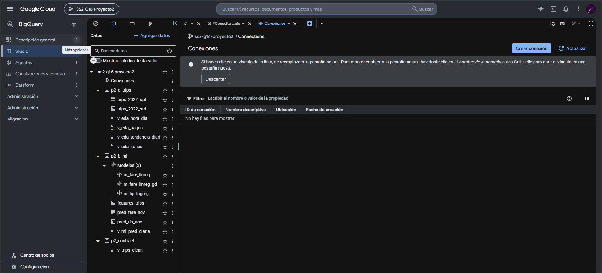
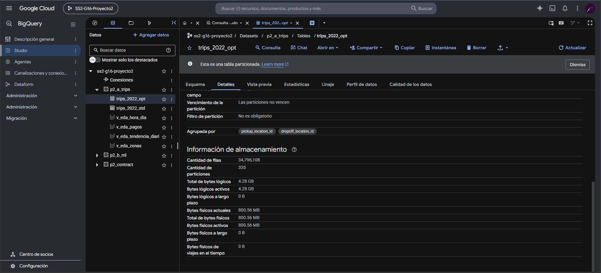
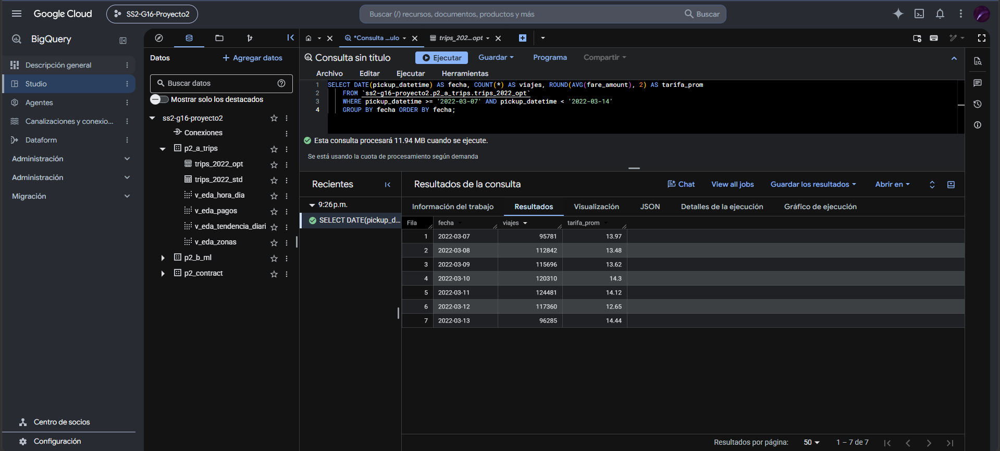

# Proyecto 2: Procesamiento y Análisis Exploratorio de Datos Masivos en BigQuery

**Seminario de Sistemas 2 — 2do Semestre 2026**  
**Facultad de Ingeniería, Escuela de Ciencias y Sistemas**  
**Universidad de San Carlos de Guatemala (USAC)**  
**Grupo 16**

---

## Integrantes y Especialización de Roles

| Nombre | Carnet | Rol | Responsabilidad Técnica Principal |
|---|---|---|---|
| **Keneth Willard Lopez Ovalle** | `202100106` | **Persona A** | Infraestructura GCP, Saneamiento, Contrato de Datos, Optimización (Particiones y Clustering), Comparación de Rendimiento, EDA Avanzado y Vistas Analíticas |
| **César Rolando Hernández Palacios** | `202000806` | **Persona B** | Modelado Predictivo con BigQuery ML, Evaluación de Modelos, Predicciones sobre Nuevos Datos y Tablero Ejecutivo en Looker Studio |

---

## 1. Resumen Ejecutivo y Arquitectura de la Solución

El presente proyecto aborda el procesamiento, depuración, optimización analítica y modelado predictivo sobre el dataset masivo de viajes comerciales de taxi amarillo de la ciudad de Nueva York del año 2022 (*New York City Taxi Trips 2022*), alojado públicamente en Google BigQuery.

Para garantizar un trabajo desacoplado, profesional y sin bloqueos entre ambos integrantes, se diseñó una **arquitectura por capas desacoplada mediante un contrato de datos versionado**:

```
bigquery-public-data.new_york_taxi_trips.tlc_yellow_trips_2022 (Fuente Pública)
        │
        ▼
p2_a_trips (Dataset Persona A)
├── trips_2022_std   (Copia derivada estándar sin optimizar - Línea Base)
├── trips_2022_opt   (Tabla optimizada: particionada por día + clustering)
└── v_eda_*          (4 vistas analíticas agregadas para el tablero)
        │
        ▼
p2_contract.v_trips_clean (Contrato de Datos Compartido - Capa Semántica Estable)
        │
        ▼
p2_b_ml (Dataset Persona B)
├── features_*       (Datasets de entrenamiento, evaluación y predicción)
├── m_*              (Modelos predictivos en BigQuery ML)
├── pred_*           (Tablas de resultados y proyecciones)
└── v_dash_*         (Vistas semánticas para visualización)
        │
        ▼
Looker Studio (Tablero Ejecutivo Interactivo)
```

### Entorno e Infraestructura en GCP
- **Proyecto GCP:** `ss2-g16-proyecto2`
- **Ubicación / Región:** `US` (Mandatorio: la fuente pública reside en `US` y BigQuery restringe las consultas entre distintas regiones geográficas).
- **Datasets Creados:**
  - `p2_a_trips` (Propietario: Persona A — Almacenamiento optimizado y vistas EDA).
  - `p2_contract` (Compartido — Contrato formal de lectura para Persona B).
  - `p2_b_ml` (Propietario: Persona B — Modelos BQML y predicciones).



---

## 2. Dataset Utilizado

### Fuente de Datos
- **Identificador de tabla:** `bigquery-public-data.new_york_taxi_trips.tlc_yellow_trips_2022`
- **Volumen bruto en la fuente:** **36,256,539 registros**
- **Tamaño físico:** **7,487,651,196 bytes (~7.49 GB)**
- **Particionamiento y clustering en la fuente:** Ninguno (tabla plana monolítica).
- **Esquema de origen:** 18 columnas transaccionales provistas por la New York City Taxi and Limousine Commission (TLC).

> [!NOTE]
> **Discrepancia sobre el volumen del enunciado:**  
> El enunciado del proyecto indica que el dataset contiene *"más de 100 millones de registros"*. Tras verificar y auditar exhaustivamente la tabla oficial de 2022 en Google BigQuery mediante consultas a `__TABLES__` e `INFORMATION_SCHEMA`, se constató que el año 2022 posee exactamente **36,256,539 filas**. La cifra superior a 100 millones corresponde a la acumulación histórica multianual del programa TLC o a años pre-pandemia (como 2018 o 2019). Se documenta formalmente esta cifra real verificada.

### Cobertura Temporal y Particularidad de Diciembre
- **Periodo cubierto:** 335 días calendarios continuos, comprendidos entre el **2022-01-01** y el **2022-12-01**.
- **Corte de la fuente (Diciembre):** La ingesta pública de Google BigQuery de 2022 incluye archivos mensuales del mes 1 al 11 (`data_file_month` 1 a 11). Diciembre no existe como archivo mensual completo; contiene únicamente **57 viajes** realizados el **2022-12-01**, los cuales vinieron empaquetados en la carga del mes 11. Este comportamiento atípico fue aislado y caracterizado para no sesgar las métricas mensuales.

---

## 3. Transformaciones y Saneamiento de Datos

### Reglas de Calidad y Filtros de Depuración
Para asegurar que el modelado predictivo y los análisis exploratorios no se vean contaminados por errores de sensores, taxímetros descalibrados o valores nulos imposibles, se implementó un pipeline estricto de saneamiento en el contrato `p2_contract.v_trips_clean` y en las tablas derivadas:

| Regla de Calidad | Condición SQL | Registros Infractores en la Fuente | Justificación Técnica |
|---|---|---:|---|
| **Rango de fecha válido** | `pickup_datetime >= '2022-01-01' AND pickup_datetime < '2023-01-01'` | 556 | Registros con marcas temporales erróneas (mínimo 2001-01-01, máximo 2023-04-18). |
| **Consistencia cronológica** | `dropoff_datetime > pickup_datetime` | 30,368 | Viajes donde la llegada es previa o simultánea a la salida. |
| **Duración máxima creíble** | `trip_duration_min <= 360` (6 horas) | 43,297 | Elimina anomalías de taxímetros encendidos durante días o semanas. |
| **Distancia positiva y plausible** | `trip_distance > 0 AND trip_distance <= 100` | 512,826 | 511,442 registros con distancia `<= 0` y 1,384 que exceden 100 millas en trayecto urbano. |
| **Tarifa base positiva** | `fare_amount > 0` | 241,621 | Descarta tarifas nulas, errores de cobro y registros negativos por reversión/anulación. |
| **Monto total positivo** | `total_amount > 0` | 234,038 | Descarta viajes con saldo negativo o nulo. |
| **Pasajeros plausibles** | `passenger_count IS NULL OR (passenger_count >= 1 AND passenger_count <= 6)` | 703,499 | Descarta viajes con 0 pasajeros o más de 6 (capacidad física de vehículos habilitados). |

### Preservación de Valores Nulos Legítimos
- **`passenger_count` nulo:** Se conservan deliberadamente **1,169,077 registros** con pasajero nulo (3.36 % del dataset saneado). El análisis demostró que este grupo no representa basura aleatoria, sino un bloque transaccional cerrado con comportamiento específico (código de pago 0, sin taxímetro ordinario). Descartarlos sesgaría el modelo de Machine Learning.

### Ingeniería de Características en el Contrato
1. **Identificador Determinista Único (`trip_id`):** Generado mediante `FARM_FINGERPRINT(CONCAT(vendor_id, pickup_datetime, dropoff_datetime, pickup_location_id, dropoff_location_id, trip_distance, total_amount))`. Produce un entero de 64 bits único y reproducible (34,796,108 valores únicos, 0 duplicados comprobados en `03_contrato_validaciones.txt`), habilitando particiones de split estables para Persona B.
2. **Conversión de Precisión Numérica:** Las columnas de moneda almacenadas como `NUMERIC` en la fuente pública (16 bytes por celda) se convirtieron a `FLOAT64` (8 bytes), formato mandatorio y nativo para los algoritmos de BigQuery ML.
3. **Variables Temporales Derivadas:** `pickup_date` (DATE), `pickup_hour` (INT64 de 0 a 23), `pickup_dow` (INT64 de 1 a 7, donde 1 = Domingo), `pickup_month` (INT64 de 1 a 12) y `trip_duration_min` (FLOAT64 en minutos).

### Resultado Neto del Proceso de Saneamiento
- **Registros crudos en la fuente:** 36,256,539
- **Registros depurados válidos:** **34,796,108**
- **Registros descartados por inconsistencias:** **1,460,431 (-4.03 %)**

---

## 4. Técnicas de Optimización Aplicadas

La tabla pública no posee particiones ni clustering, forzando a que cualquier consulta escanee columnas completas a través de los 36.26 millones de registros. Para eliminar costos innecesarios y acelerar las consultas analíticas y de entrenamiento, se implementaron dos técnicas de optimización física en BigQuery:

```
┌─────────────────────────────────────────────────────────────────────────────┐
│                          p2_a_trips.trips_2022_opt                          │
├─────────────────────────────────────────────────────────────────────────────┤
│  Particionamiento: PARTITION BY DATE(pickup_datetime)                       │
│  - 335 particiones diarias independientes (promedio ~13 MiB por partición) │
├─────────────────────────────────────────────────────────────────────────────┤
│  Clustering: CLUSTER BY pickup_location_id, dropoff_location_id            │
│  - Co-localización física de bloques por zonas de origen y destino          │
└─────────────────────────────────────────────────────────────────────────────┘
```

### 1. Particionamiento Diario por Fecha (`pickup_datetime`)
- **Estrategia:** Partición diaria `PARTITION BY DATE(pickup_datetime)`.
- **Efecto técnico:** Crea 335 particiones de almacenamiento independientes. Cuando una consulta filtra por un rango de fechas (ej. una semana, un mes o el split temporal de entrenamiento), BigQuery ejecuta poda de particiones (*partition pruning*), leyendo exclusivamente los bloques correspondientes a los días requeridos y omitiendo el resto del año.



### 2. Agrupamiento Físico (*Clustering*) por Ubicaciones
- **Estrategia:** `CLUSTER BY pickup_location_id, dropoff_location_id`.
- **Efecto técnico:** Ordena y agrupa físicamente las filas dentro de cada partición diaria según las zonas de origen y destino más transitadas (ej. JFK, Midtown, Upper East Side). Las consultas que filtran por corredor o zona geográfica leen únicamente los metadatos de los bloques co-localizados, reduciendo el I/O físico adicional.

### 3. Fase 2 del Contrato de Datos
Una vez construida y validada la tabla `p2_a_trips.trips_2022_opt`, se actualizó la vista `p2_contract.v_trips_clean` para que su cláusula `FROM` lea directamente de `trips_2022_opt` en lugar de la fuente pública. Esto transfirió automáticamente todas las ganancias de optimización a Persona B sin modificar el esquema contractual.

---

## 5. Comparación Formal de Rendimiento: Estándar vs. Optimizado

Para cuantificar el beneficio de la optimización, se ejecutaron cuatro consultas de negocio idénticas (Q1 a Q4) sobre tres orígenes de datos: la tabla pública sin optimizar (`public`), la copia derivada sin optimizar (`std`, línea base de control) y la copia optimizada (`opt`).

Todas las ejecuciones se evaluaron con caché desactivada (`--nouse_cache`), jobs identificados y métricas auditadas desde `INFORMATION_SCHEMA.JOBS_BY_USER` (evidencia: `Proyecto_2/evidencia/05_comparacion_rendimiento.txt`):

### Matriz Comparativa de Bytes Procesados y Recursos

| Consulta de Negocio | Filtro Aplicado | Bytes Procesados: Fuente Pública | Bytes Procesados: Estándar (`std`) | Bytes Procesados: Optimizada (`opt`) | Reducción `opt` vs. `std` | Reducción `opt` vs. Pública | Slot Milliseconds (`std` $\to$ `opt`) |
|---|---|---:|---:|---:|---:|---:|---:|
| **Q1: Demanda y tarifa semanal** | Rango de 7 días (`pickup_datetime`) | 870,156,936 B (870.16 MB) | 556,737,728 B (556.74 MB) | **12,524,080 B (12.52 MB)** | **-97.75 %** | **-98.56 %** | 22,832 ms $\to$ **304 ms** (-98.7 %) |
| **Q2: Demanda mensual aeropuerto JFK** | `pickup_location_id = '132'` en todo el año | 1,045,265,287 B (1.05 GB) | 724,820,124 B (724.82 MB) | **652,219,669 B (652.22 MB)** | **-10.02 %** | **-37.60 %** | 27,536 ms $\to$ **22,086 ms** (-19.8 %) |
| **Q3: Top destinos desde Midtown** | Mes de junio + `pickup_location_id = '161'` | 638,526,274 B (638.53 MB) | 612,835,889 B (612.84 MB) | **54,522,585 B (54.52 MB)** | **-91.10 %** | **-91.46 %** | 9,549 ms $\to$ **666 ms** (-93.0 %) |
| **Q4: Distribución por medio de pago** | Agregación global sin filtros (Control) | 688,874,241 B (688.87 MB) | 382,757,188 B (382.76 MB) | **382,757,188 B (382.76 MB)** | **0.00 %** | **-44.44 %** | 10,753 ms $\to$ 12,585 ms |

```
Comparativa de Bytes Procesados en Consultas con Filtro Temporal / Espacial
┌────────────────────────────────────────────────────────────────────────┐
│ Q1 (7 días):                                                           │
│ Estándar:   ████████████████████████████████████████ 556.7 MB          │
│ Optimizada: █ 12.5 MB  [-97.75%]                                       │
├────────────────────────────────────────────────────────────────────────┤
│ Q3 (Junio + Midtown):                                                  │
│ Estándar:   ████████████████████████████████████████ 612.8 MB          │
│ Optimizada: ███ 54.5 MB  [-91.10%]                                     │
└────────────────────────────────────────────────────────────────────────┘
```



### Análisis Técnico de los Resultados
1. **Poda Masiva por Partición (Q1):** Al consultar 7 días de marzo, BigQuery descartó 328 de las 335 particiones diarias, procesando únicamente 12.52 MB frente a 556.74 MB de la tabla estándar (**ahorro de 97.75 % en datos leídos y 98.67 % en tiempo de CPU/slots**).
2. **Efecto de Clustering Compuesto (Q3):** La combinación de partición mensual y filtro por zona '161' recortó los datos leídos de 612.84 MB a 54.52 MB (**ahorro de 91.10 %**). La partición redujo el volumen base a 60.10 MB y el clustering aportó una poda fina adicional del 9.28 %.
3. **Poda por Clustering en Aislamiento (Q2):** En una consulta anual sin rango de fechas restringido, el clustering aisló los bloques de JFK reduciendo el escaneo en 72.60 MB (-10.02 %). El impacto relativo es más moderado debido al tamaño reducido de cada partición diaria (~13 MiB), lo que deja menos bloques descartables por día.
4. **Beneficio del Esquema Limpio (`std` vs. `public`):** Incluso sin particiones, la tabla `std` procesó entre 4.02 % y 44.44 % menos datos que la tabla pública debido a la conversión de `NUMERIC` (16 bytes) a `FLOAT64` (8 bytes) y a la exclusión de filas inconsistentes.
5. **Impacto Directo para Persona B:** Una consulta habitual para entrenar un modelo con el split de entrenamiento (enero a septiembre) requería escanear **2.6 GB** en la fuente pública; sobre `trips_2022_opt` procesa tan solo **75 MB**, permitiendo múltiples iteraciones de Machine Learning a costo prácticamente nulo.

---

## 6. Hallazgos Relevantes del Análisis Exploratorio de Datos (EDA)

A partir de las ejecuciones estructuradas en BigQuery (evidencias `07_eda_descriptiva.txt`, `08_eda_categorica.txt`, `09_eda_temporal.txt` y `10_vistas_eda.txt`), se identificaron patrones clave organizados en 5 ejes cuantitativos:

### Eje 1: Economía del Negocio y Comportamiento de Tarifas
- **Volumen e Ingresos Totales:** Durante 2022 se realizaron **34,796,108 viajes** que generaron un ingreso bruto de **USD 747,517,061.02** (USD 509.65M en tarifas base y USD 95.23M en propinas registradas), cubriendo **123,830,611.15 millas**.
- **Distribución Asimétrica del Costo:** La mediana de costo total por viaje se sitúa en **USD 15.96** (media USD 21.48; p95 USD 61.85; p99 USD 79.62). La distancia mediana es de **1.91 millas** (media 3.56 mi; p95 15.25 mi).
- **Concentración en Trayectos Cortos:** El **68.92 % de los viajes recorre menos de 3 millas** (18.64 % menos de 1 milla y 50.28 % entre 1 y 3 millas). Únicamente el 1.10 % supera las 20 millas.
- **Efecto de Tarifa Degresiva:** El costo efectivo por milla decrece drásticamente a medida que aumenta la distancia debido al costo fijo inicial de banderazo: en viajes de menos de 1 milla se abona en promedio **8.77 USD/mi** (mediana 7.69 USD/mi), mientras que en trayectos largos ($\ge 20$ mi) la tarifa desciende a **2.76 USD/mi** (mediana 2.55 USD/mi).

### Eje 2: Medios de Pago y el Bloque Cerrado del Código 0
- **Penetración del Pago Electrónico:** La tarjeta de crédito es el método hegemónico con el **76.74 % de los viajes** (26,703,778 viajes; USD 587.68M), mientras que el efectivo representa el **19.46 %** (6,772,717 viajes; USD 123.41M).
- **Demostración Empírica de Propinas en Efectivo (Decisión E4):** En viajes pagados en efectivo, solo el **0.01 % (615 viajes)** registra propina en el sistema, frente al **96.38 % de viajes con propina en tarjeta**. Esto comprueba que las propinas en efectivo se entregan en mano sin digitalizarse.
- **Generosidad de la Propina Digital:** En pagos con tarjeta, la tasa mediana de propina sobre la tarifa es del **26.40 %** (media 26.66 %; p25 21.55 %; p75 31.00 %; p99 55.80 %). Solo el 3.62 % de los usuarios con tarjeta no deja propina.
- **Caracterización del Código 0:** 1,169,077 viajes (3.36 %) figuran con código `payment_type = '0'`. El cruce de datos demostró que **son exactamente las mismas 1,169,077 filas que poseen `passenger_count` nulo y `rate_code` nulo simultáneamente**. El 78.77 % proviene del proveedor VeriFone (`vendor_id = 2`) y el 100 % de los viajes de los proveedores 5 y 6 caen en este código. Registran trayectos más largos (4.62 mi y 20.33 min) y el 89.79 % deja propina, lo que sugiere registros generados por despacho digital o convenios corporativos (hipótesis).

### Eje 3: Geografía, Corredores Urbanos y Aeropuertos
- **Hegemonía Territorial de Manhattan:** Manhattan concentra el **89.50 % de todos los orígenes de la ciudad** (31,144,223 viajes, ticket promedio USD 18.19) y el 100 % del top 10 de zonas de destino (lideradas por Upper East Side North con 1.50M viajes y Upper East Side South con 1.43M).
- **JFK como Nodo Económico Crítico:** La zona de origen individual número 1 en volumen de toda Nueva York es **JFK Airport** (`location_id = 132`) con **1,651,005 viajes (4.74 % del total)** y la mayor facturación neta: **USD 101,348,368.08** (ticket promedio USD 61.39 y velocidad media 25.81 mph).
- **Tarifa Plana Reglamentada JFK:** La tarifa JFK (`rate_code = '2.0'`, 1,288,971 viajes) demostró operar como tarifa plana fija: el **99.99 % (1,288,845 viajes) registró una tarifa base exacta de USD 52.00**, y el 98.76 % de todos los viajes de USD 52 en el año fueron viajes con tarifa JFK.

### Eje 4: Dinámica Temporal, Estacionalidad y Días Atípicos
- **Hora Punta Vespertina:** La demanda crece de forma sostenida a lo largo del día y alcanza su pico a las **18:00 (2,477,600 viajes, 7.12 % del total)**, seguido de las 17:00 (6.76 %) y 19:00 (6.43 %). El valle más pronunciado ocurre a las 04:00 (187,054 viajes, 0.54 %).
- **Pico de Ingreso Económico:** Ocurre a las 17:00 con **USD 51,858,682.20**, superando a las 18:00 (USD 51.54M) aunque las 18:00 tienen más viajes; el ticket promedio es mayor a las 17:00 (hipótesis: recargos horarios y trayectos más largos).
- **Concentración Semanal en Jueves y Viernes:** El jueves acumula el mayor volumen anual (**5,327,628 viajes, 15.31 %**; USD 114.97M), mientras que el viernes registra el mayor promedio normalizado diario (**111,914.1 viajes/día**). El domingo presenta la menor actividad (4,223,302 viajes, 12.14 %).
- **Días Hábiles vs. Fines de Semana:** Los días hábiles (239 días) acaparan el **73.29 % de los viajes** (promedio 106,703.1 viajes/día). Los fines de semana (96 días) abarcan el **26.71 %** (promedio 96,813.3 viajes/día).
- **Matriz 24 × 7 y Horas Pico:** En 6 de los 7 días (lunes a sábado), la hora punta ocurre exactamente a las 18:00. El domingo es el único día cuyo pico se adelanta a las 17:00 (270,046 viajes). La franja horaria más congestionada del año es el **martes a las 18:00 (390,043 viajes, rank 1 global)**.
- **Vida Nocturna en Fines de Semana:** Las madrugadas de sábado y domingo (00:00 a 03:00) multiplican la actividad nocturna respecto a los días laborales (sábado 00:00: 228,224 viajes vs. lunes 00:00: 78,016 viajes).
- **Días con Datos Faltantes en la Fuente:** El día de menor volumen del año (sin contar el día parcial 2022-12-01) es el **domingo 2022-09-18 con 3,832 viajes**, y el sábado 2022-09-17 queda incompleto desde las 15:00 (56,859 viajes). No es demanda baja: desde las 15:00 del 17 hasta las 23:00 del 18 cada hora tiene entre el 2.56 % y el 7.71 % de la mediana de su franja (día de la semana, hora), y la tabla pública ya trae solo 59,501 y 4,229 viajes esos días, todos del archivo de septiembre (T5a, T8a, T8b y T8d de `09_eda_temporal.txt`; hipótesis: archivo de origen incompleto). La regla horaria que los detecta (una hora con menos del 10 % de la mediana de su franja) marca solo esos dos días; `v_eda_tendencia_diaria` los señala con `is_anomalous_day`.
- **Día Atípico de Enero:** El día normal de menor demanda del año es el **sábado 2022-01-29 con 33,007 viajes**, sin horas anómalas (T5a y T8a de `09_eda_temporal.txt`; hipótesis: coincide con la tormenta invernal nor'easter del 28 y 29 de enero de 2022; es contexto externo, no se deriva de los datos). En contraste, el récord máximo del año se produjo el **viernes 2022-04-01 con 130,333 viajes**.

### Eje 5: Velocidad de Circulación y Congestión Urbana
- **Velocidad Típica:** La velocidad media general en la ciudad es de **12.11 mph** (mediana 10.38 mph; p25 7.88 mph; p75 14.20 mph).
- **Inversión Horaria de Velocidad:** La velocidad media se desploma a **10.32 mph a las 16:00** (hipótesis: congestión de la hora pico), pero se duplica en la madrugada, alcanzando **21.38 mph a las 05:00**.
- **Mayor Fluidez en Fin de Semana:** Los fines de semana la velocidad media es un **14.1 % más rápida (13.32 mph vs. 11.67 mph en días hábiles)**. Esta mayor fluidez permite que los viajes de fin de semana recorran trayectos más largos (3.71 mi vs. 3.50 mi) en menor tiempo promedio (14.88 min vs. 16.12 min).

---

## 7. Catálogo de Vistas Analíticas Publicadas (`p2_a_trips`)

Para alimentar de forma directa el tablero interactivo de Looker Studio construido por Persona B, se publicaron cuatro vistas pre-calculadas en `ss2-g16-proyecto2.p2_a_trips` (script: `Proyecto_2/sql/a_06_vistas_eda.sql`):

| Vista Analítica | Filas | Costo de Consulta Completa (Dry Run) | Finalidad y Tipo de Visualización en el Tablero |
|---|---:|---:|---|
| `v_eda_tendencia_diaria` | 335 | 2.23 GB | Serie de tiempo diaria con `trips_ma7` y `revenue_ma7` (media móvil de 7 días), más `is_anomalous_day` (2022-09-17 y 2022-09-18, datos faltantes en la fuente) e `is_partial_day` (2022-12-01) para filtrarlos. Alimenta gráficos de líneas de demanda e ingresos. |
| `v_eda_hora_dia` | 168 | 1.67 GB | Matriz bidimensional de 24 horas por 7 días con volumen, porcentajes y rangos. Alimenta el mapa de calor (*heatmap*) de congestión. |
| `v_eda_zonas` | 263 | 1.45 GB | Una fila por `location_id` con actividad (259 con zona y 4 sin zona: 57, 105, 264 y 265), con nombres oficiales y boroughs de NYC; las zonas deduplicadas tienen una fila por `zone_id` (260 de 260, V3c en `10_vistas_eda.txt`). Alimenta mapas coropléticos y gráficos de barras de top zonas. |
| `v_eda_pagos` | 6 | 1.50 GB | Distribución de medios de pago, tasas medianas de propina y análisis del código 0. Alimenta gráficos de torta/anillo y dispersión de tarifas. |

---

## 8. Sección de Persona B: BigQuery ML y Tablero Looker Studio

*(Sección reservada para la documentación de Persona B — César Rolando Hernández Palacios)*

### 8.1 Modelos de Machine Learning en BigQuery ML

> [!NOTE]
> **Reasignación (decisión D8 del steering, 2026-10-25, pendiente de confirmación por Persona B):** Persona A construyó las features, los modelos, la evaluación y las predicciones en `p2_b_ml`. Persona B conserva el tablero de Looker Studio, la comparación "Rolling Forecast", las vistas `v_dash_*`, la sección 8.2 y las capturas.

Cada cifra de esta sección sale de una salida guardada:

| Paso | Script | Evidencia |
|---|---|---|
| Tabla de features | `sql/b_01_features.sql` | `evidencia/11_features.txt` |
| Entrenamiento | `sql/b_02_modelos.sql` | `evidencia/12_modelos.txt` |
| Evaluación | `sql/b_03_evaluacion.sql` | `evidencia/13_evaluacion.txt` |
| Predicciones | `sql/b_04_predicciones.sql` | `evidencia/14_predicciones.txt` |

#### Dataset de entrenamiento: `p2_b_ml.features_trips`

- **Origen:** `p2_contract.v_trips_clean`, con una muestra determinística `MOD(trip_id, 14) = 0` de 2,486,865 filas. Se quitan 50 filas con `fare_amount > 300` y 4,296 de los días anómalos; quedan **2,482,519 filas** (F0, F1 y V0 de `11_features.txt`).
- **Split temporal:** `train` = enero a septiembre (2,008,885 filas), `eval` = octubre (250,744) y `new` = noviembre más el 2022-12-01 (222,890), que son los "nuevos registros" (V1 de `11_features.txt`).
- **11 features, todas conocidas al inicio del viaje:** `pickup_hour` y `pickup_dow` (como texto, para que sean categóricas), `trip_distance`, `passenger_count_imp`, `passenger_missing`, `pickup_location_id`, `dropoff_location_id`, `pickup_borough`, `dropoff_borough`, `vendor_id` y `rate_code_imp`.
- **Imputación:** `passenger_count` nulo pasa a 1, con la marca `passenger_missing`, y `rate_code` nulo pasa a `'NA'`.
- **Etiquetas:**
  - `fare_amount` para la regresión.
  - `is_high_tip` (`tip_amount / fare_amount >= 0.25`, solo con tarjeta) para la clasificación. Es TRUE en el 60.01 % de los viajes con tarjeta (V6). No se usó `is_tipped` porque es TRUE en el 96.40 %: un modelo que siempre dice "sí" ya tendría 96 % de exactitud.

#### Modelos

| Modelo | Tipo y etiqueta | Optimizador | Split | Hiperparámetros | Por qué existe |
|---|---|---|---|---|---|
| **M-1** `m_fare_linreg` | `LINEAR_REG`, `fare_amount` | Por defecto (`AUTO_STRATEGY`). BigQuery eligió `NORMAL_EQUATION` y resolvió en 1 iteración | `RANDOM`, `data_split_eval_fraction = 0.2` sobre ene–sep | `l2_reg` 0 (sin regularización), `enable_global_explain` | Referencia de regresión sin ajustar hiperparámetros |
| **M-2** `m_fare_linreg_gd` | `LINEAR_REG`, `fare_amount` | `BATCH_GRADIENT_DESCENT` con `LINE_SEARCH` (tasa inicial 0.1) | Igual que M-1 | `max_iterations` 20 (las usó todas), `l2_reg` 1.0, `early_stop` con progreso mínimo de 0.01 | Variante de hiperparámetros: muestra la curva de iteraciones y pérdida, y la regularización L2 acota los pesos |
| **M-3** `m_tip_logreg` | `LOGISTIC_REG`, `is_high_tip` | Iterativo con `LINE_SEARCH` (tasa inicial 0.1) | `CUSTOM` con `data_split_col = 'is_eval'`: ene–sep entrena y octubre evalúa | `max_iterations` 20 (`early_stop` cortó en 5), `l2_reg` 0.1 | Familia de clasificación: ROC-AUC, precisión, recall y matriz de confusión |

Entrenamiento (V1 de `12_modelos.txt`):

- **M-1:** pérdida de entrenamiento (MSE) 13.05 y `eval_loss` 124.35 sobre el 20 % aleatorio.
- **M-2:** la pérdida baja de 85.13 a 15.79 en 20 iteraciones y `eval_loss` termina en 15.98.
- **M-3:** la log-loss baja de 0.6636 a 0.6111 y `eval_loss` (octubre) termina en 0.6212.

#### Control de data leakage

- **Solo features conocidas al inicio del viaje.** Quedan fuera de la tabla `trip_duration_min`, `total_amount`, `tip_amount` y `tolls_amount`, que solo se conocen al terminar. Ningún modelo recibe `trip_id`, `pickup_month`, `split_set`, `is_eval`, `payment_type` ni la etiqueta del otro modelo. `ML.FEATURE_INFO` confirma 11 features y 0 columnas excluidas en los tres modelos (V3 de `12_modelos.txt`).
  - Supuesto explícito: `trip_distance` se trata como la distancia estimada de la ruta, conocida al reservar. En el dato real es la distancia medida al terminar.
- **Etiqueta de propina solo con tarjeta.** En efectivo la propina casi nunca se registra (sección 6, eje 2). Con todos los pagos, el modelo aprendería "efectivo = sin propina", así que `payment_type` no es feature.
- **`pickup_month` excluido.** Se usa solo para el split. Los modelos entrenan con los meses 1 a 9, así que octubre y noviembre serían valores nunca vistos.
- **Split temporal más los dos mecanismos del enunciado.** Ningún modelo aprende del futuro: train es ene–sep, eval es octubre y new es noviembre.
  - M-1 y M-2 usan `data_split_method = 'RANDOM'` con `data_split_eval_fraction = 0.2` dentro de ene–sep.
  - M-3 usa `data_split_method = 'CUSTOM'` con la columna temporal `is_eval`.
  - Octubre no ajusta pesos en ningún modelo. En M-3 sí define `eval_loss` y el corte por `early_stop`, así que la evaluación se repitió sobre noviembre, que ningún modelo usó.
- **Días anómalos excluidos.** El 2022-09-17 y el 2022-09-18 tienen datos faltantes en la fuente, y se quitaron 4,296 filas de la muestra (V0 de `11_features.txt`).
- **Valores extremos excluidos.** Se quitaron 50 filas con `fare_amount > 300` (0.002 %). El umbral queda sobre el p99.99 de la muestra (216) y quita valores como 395,844.94 (F0).

#### Métricas sobre datos de retención

Regresión de `fare_amount` (E7a de `13_evaluacion.txt`; RMSE y MAE en USD):

| Conjunto | Modelo | RMSE | MAE | R² |
|---|---|---:|---:|---:|
| Octubre (250,744) | M-1 `m_fare_linreg` | 3.93 | 2.01 | 0.915 |
| Octubre | M-2 `m_fare_linreg_gd` | 4.32 | 2.56 | 0.898 |
| Octubre | Baseline tarifa por milla | 12.52 | 6.06 | 0.143 |
| Octubre | Baseline media de `train` | 13.54 | 8.70 | -0.003 |
| Noviembre (222,890) | M-1 `m_fare_linreg` | **15.27** | 2.04 | **-0.299** |
| Noviembre | M-2 `m_fare_linreg_gd` | 4.24 | 2.55 | 0.900 |
| Noviembre | Baseline tarifa por milla | 12.30 | 6.04 | 0.158 |
| Noviembre | Baseline media de `train` | 13.42 | 8.63 | -0.003 |

Clasificación de `is_high_tip` con umbral 0.5 (E7b de `13_evaluacion.txt`):

| Conjunto | Modelo | Exactitud | Precisión | Recall | F1 | log_loss | ROC-AUC |
|---|---|---:|---:|---:|---:|---:|---:|
| Octubre (194,093) | M-3 `m_tip_logreg` | 0.666 | 0.654 | 0.917 | 0.763 | 0.621 | 0.692 |
| Octubre | Baseline clase mayoritaria | 0.587 | 0.587 | 1.000 | 0.740 | 0.678 | 0.500 |
| Noviembre (172,626) | M-3 `m_tip_logreg` | 0.667 | 0.655 | 0.921 | 0.766 | 0.620 | 0.692 |
| Noviembre | Baseline clase mayoritaria | 0.590 | 0.590 | 1.000 | 0.742 | 0.677 | 0.500 |

- **Matriz de confusión de M-3 en octubre (E4a):** 104,522 verdaderos positivos, 24,709 verdaderos negativos, 55,396 falsos positivos y 9,466 falsos negativos.
- **Lectura:** M-3 supera al baseline por 7.85 puntos de exactitud en octubre y 7.72 en noviembre, pero su separación es moderada.
  - Sus probabilidades no pasan de 0.828 (E4c).
  - El 69 % de los viajes sin propina alta se clasifica como TRUE.
  - Hipótesis: la propina depende de factores que no se conocen al inicio del viaje.

#### Hallazgo: M-1 frente a M-2

En octubre M-1 rinde algo mejor que M-2. En noviembre colapsa: su RMSE pasa de 3.93 a 15.27 y su R² cae a -0.299, peor que predecir la media. M-2 se mantiene estable.

- **Observado:**
  - 14 filas de noviembre, de 222,890, concentran el 94.1 % del error cuadrático de M-1 (E6e).
  - Las tres peores predicciones son 5,854.20, 3,516.81 y -1,545.89, para tarifas reales de 17.00, 24.66 y 25.00. Sus zonas de origen tienen 0, 0 y 1 fila en `train`. M-2 predice 32.19, 21.68 y 23.09 para esas mismas filas (E6d).
  - Los pesos de M-1 llegan a 20,163 en valor absoluto, y 555 de 573 superan 1,000. En M-2 el máximo es 35.97 (E6a).
- **Probado en los datos:** hay colinealidad exacta en `train` (E6c).
  - Cada zona pertenece a un solo borough.
  - `passenger_missing` coincide fila a fila con `rate_code_imp = 'NA'`.
- **Hipótesis:**
  - La ecuación normal sin regularización reparte la colinealidad en pesos enormes que se compensan entre sí.
  - Una zona sin peso aprendido deja sin compensar el peso de su borough, y la predicción se dispara.
  - El mismo mecanismo explicaría el `eval_loss` de 124.35 en el entrenamiento.
  - La regularización L2 de M-2 mantiene los pesos acotados y evita esta falla.

#### Modelo seleccionado

**M-2 (`m_fare_linreg_gd`)** para la tarifa.

- Es estable en los dos meses: RMSE 4.32 y 4.24, R² 0.898 y 0.900.
- Baja el RMSE del mejor baseline un 65.5 % en ambos meses.
- M-1 tiene menor MAE, pero un modelo que puede predecir USD 5,854 para un viaje de USD 17 no es confiable en producción.

M-3 queda como el modelo de clasificación. Supera al baseline, pero su poder de separación es moderado.

#### Predicciones sobre nuevos registros (noviembre)

| Objeto | Filas | Contenido |
|---|---:|---|
| `p2_b_ml.pred_fare_nov` | 222,890 | Una fila por viaje: `trip_id`, `pickup_date`, `pickup_hour`, `pickup_borough`, `trip_distance`, `fare_actual`, `pred_fare_m1`, `pred_fare_m2`, `abs_err_m1` y `abs_err_m2` |
| `p2_b_ml.pred_tip_nov` | 172,626 | Viajes con tarjeta: `trip_id`, `pickup_date`, `pickup_hour`, `pickup_borough`, `is_high_tip_actual`, `prob_high_tip` y `pred_is_high_tip` |
| `p2_b_ml.v_ml_pred_diaria` | 31 | Serie diaria con viajes, totales real / M-1 / M-2, diferencia porcentual, MAE diario y media móvil de 7 días del total real y del de M-2. `is_partial_day` marca el 2022-12-01 (1 viaje de la muestra) |

Resultados (`14_predicciones.txt`):

- **Validación:** las métricas recalculadas desde las tablas coinciden con las de noviembre de `ML.EVALUATE` (P3b y P3c).
- **Totales:** en el mes, M-2 predice un total 3.41 % menor que el real y M-1 un 2.63 % menor (P5b).
- **Por día:** en los 30 días completos, M-2 va de -6.34 % a +5.19 % y subestima en 27 (P4a). Una tarifa promedio más alta en noviembre (15.15) que en ene–sep (14.46) es una causa compatible (hipótesis).
- **Efecto de las predicciones extremas de M-1:** distorsionan los agregados chicos.
  - Mueven el total de 3 días entre 1.2 y 4.8 puntos (P4c).
  - Dominan Staten Island (+1,016.3 %) y el Bronx (+61.58 %) (P4b).
  - En el total del mes su efecto neto es del 0.19 %.
- **Base del tablero:** `v_ml_pred_diaria` es la base de datos para la comparación "(Rolling Forecast)" del tablero. Cómo define el curso el "Rolling Forecast" sigue siendo una consulta abierta al auxiliar (Q1 del steering); Persona B decide la visualización final.

#### Costo

| Trabajo | Bytes facturados |
|---|---:|
| `CREATE MODEL` M-1 | 192,937,984 |
| `CREATE MODEL` M-2 | 192,937,984 |
| `CREATE MODEL` M-3 | 178,257,920 |
| **Total** | **564,133,888 (unos 0.56 GB)** |

- Fuente: V6 de `12_modelos.txt`.
- M-2 usó 3.8 veces los slot-ms de M-1 por sus 20 iteraciones, pero facturó los mismos bytes.
- No se calcula el costo en dólares: la tarifa por TB de la creación de modelos no está verificada en la página oficial de precios.
- Dry runs fuera del entrenamiento: los 15 bloques de evaluación suman 2,197,915,615 bytes (`13_evaluacion.txt`) y los 10 de predicción 565,482,592 (`14_predicciones.txt`). Esas cifras son estimaciones, no bytes facturados.

### 8.2 Tablero Interactivo Looker Studio
- **Enlace al Tablero:** [Enlace público al reporte interactivo en Looker Studio]
- **Visualizaciones Exploratorias:** Visualización de patrones temporales, mapa coroplético de zonas y distribución de propinas/pagos conectados a las vistas `v_eda_*`.
- **Visualizaciones Predictivas:** Gráficas de contraste entre valores reales y predicciones de los modelos ML.
- **Fuentes para conectar:**
  - `p2_a_trips.v_eda_*`: las 4 vistas de la sección 7.
  - `p2_b_ml.v_ml_pred_diaria`: la serie diaria de real frente a predicho.
  - `p2_b_ml.pred_fare_nov` y `p2_b_ml.pred_tip_nov`: las predicciones por viaje.
