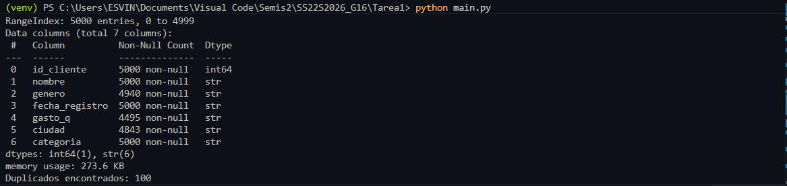
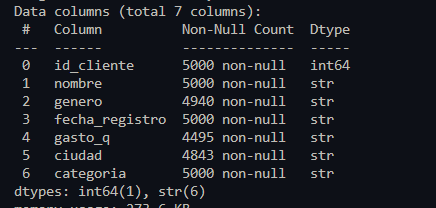
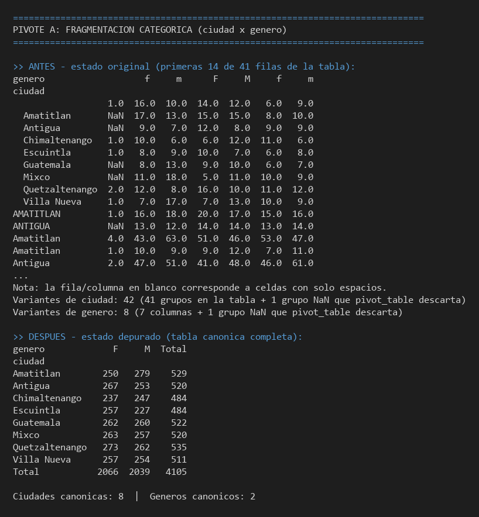
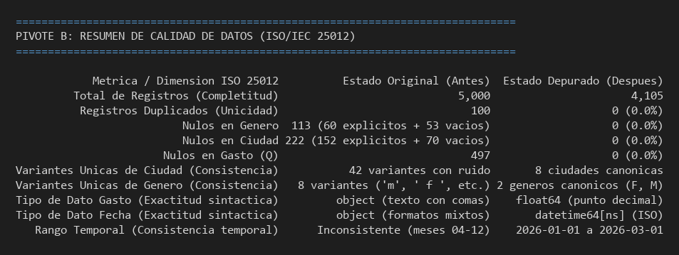
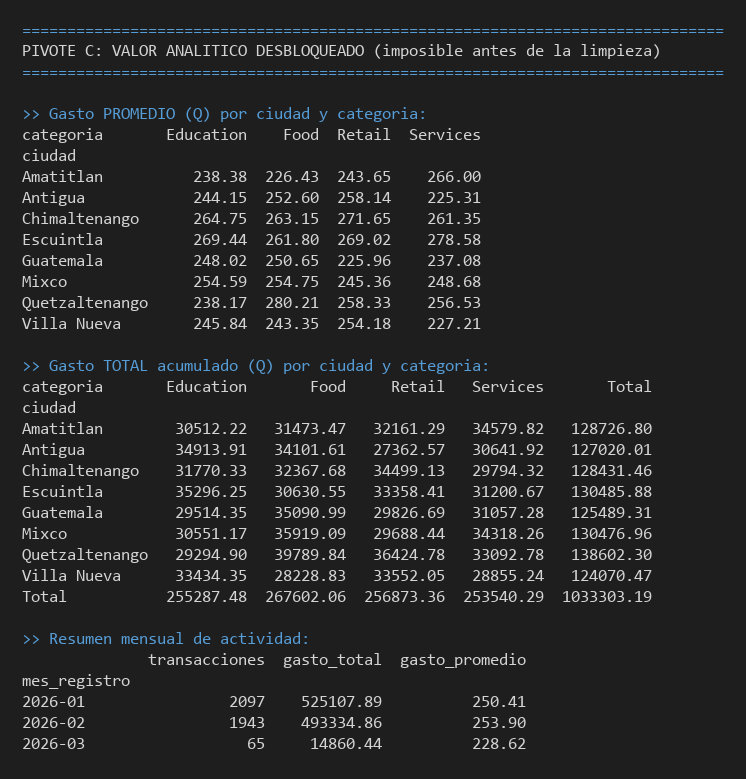

# Tarea 1: Limpieza y Análisis Inicial de Datos con Python y Pandas

**Seminario de Sistemas 2 — 2do Semestre 2026**  
**Facultad de Ingeniería, Universidad de San Carlos de Guatemala**  
**Grupo 16**

## Integrantes
| Nombre | Carnet |
|---|---|
| César Rolando Hernández Palacios | 202000806 |
| Keneth Willard Lopez Ovalle | 202100106 |

---

## 1. Dataset Utilizado

- **Nombre del dataset:** `dataset_sucio.csv`
- **Fuente:** Dataset transaccional con anomalías e inconsistencias proporcionado para el desarrollo de la Tarea 1.
- **Descripción breve:** Conjunto de datos compuesto inicialmente por **5,000 registros** de transacciones y clientes en Guatemala, conteniendo atributos identificadores, demográficos, geográficos, temporales y financieros.
- **Diccionario de Columnas:**
  | Columna | Tipo Original | Tipo Depurado | Descripción |
  |---|---|---|---|
  | `id_cliente` | `int64` | `int64` | Identificador único del cliente |
  | `nombre` | `object` | `object` (string) | Nombre y apellido del cliente |
  | `genero` | `object` | `object` (`'F'` / `'M'`) | Género normalizado del cliente |
  | `fecha_registro` | `object` | `datetime64[ns]` | Fecha de registro en el sistema |
  | `gasto_q` | `object` | `float64` | Monto total acumulado en Quetzales (Q) |
  | `ciudad` | `object` | `object` (string) | Ciudad de residencia (8 ciudades canónicas) |
  | `categoria` | `object` | `object` (string) | Categoría de compra/servicio |

---

## 2. Proceso de Limpieza Aplicado

El proceso de depuración se diseñó bajo los lineamientos del estándar de calidad de datos **ISO/IEC 25012**, atacando de manera sistemática los defectos de calidad en las siguientes fases:

### 2.1 Eliminación de Duplicados (Dimensión: Unicidad)
- Se detectaron **100 filas completamente duplicadas** (2.0% del total de registros).

  

- Se aplicó `drop_duplicates()`, reduciendo el dataset a **4,900 registros únicos**.

  

### 2.2 Tratamiento de Celdas Vacías y Espacios en Blanco (Dimensión: Completitud)
- **Detección de Nulos Reales:** Inicialmente `pandas.isnull()` reportaba solo 60 nulos en `genero` y 152 en `ciudad`. Sin embargo, existían celdas con solo espacios en blanco (`" "`), las cuales fueron normalizadas con `.str.strip()` y convertidas a `np.nan` antes de depurar.
- Conteo real de nulos identificado:
  - `genero`: **113 nulos** (60 `NaN` + 53 celdas de espacios)
  - `ciudad`: **222 nulos** (152 `NaN` + 70 celdas de espacios)
  - `gasto_q`: **497 nulos**
- Se procedió a la eliminación mediante `dropna()`, alcanzando un conjunto final depurado de **4,105 registros** con **0 valores nulos** y **0 celdas vacías**.

  

### 2.3 Estandarización de Valores y Formatos (Dimensión: Consistencia y Exactitud Sintáctica)
- **Normalización de Texto:** 
  - `nombre`: Aplicación de formato título (`str.title()`) y colapso de espacios múltiples intermedios mediante expresiones regulares (`r'\s+' -> ' '`).
  - `genero`: Transformación a mayúsculas estrictas (`'F'` y `'M'`).
  - `ciudad` y `categoria`: Eliminación de espacios perimetrales y conversión a formato título (`str.title()`).
- **Estandarización Numérica (`gasto_q`):**
  - Reemplazo de coma decimal por punto (`str.replace(',', '.')`) y conversión explícita a tipo numérico `float64`.
- **Estandarización Temporal (`fecha_registro`):**
  - Parseo a formato `datetime64[ns]` utilizando `dayfirst=True` para interpretar correctamente las fechas en formato `DD/MM/YYYY`.

---

## 3. Comparación de Estado Antes / Después

### 3.1 Estado Original (Antes de la Limpieza)
El dataset original presentaba 5,000 filas con inconsistencias de formato, tipos de datos como texto genérico (`object`), nulos explícitos y ocultos, y registros duplicados.

### 3.2 Estado Depurado (Después de la Limpieza)
El dataset final cuenta con **4,105 filas** libres de nulos, tipado optimizado (`datetime64[ns]`, `float64`, `int64`) y valores normalizados.

---

## 4. Exploración Mediante Tablas Pivote (Pandas)

Con el fin de evidenciar cuantitativamente el impacto de la limpieza y desbloquear valor analítico, se generaron tres tablas pivote comparativas:

### 4.1 Pivote A: Fragmentación Categórica (`ciudad` vs. `genero`)
En el estado original, la columna `ciudad` presentaba **42 variantes** debido a discrepancias en mayúsculas, minúsculas y espacios (ej. `"amatitlan"`, `"Amatitlan "`, `"AMATITLAN"`), mientras que `genero` presentaba **8 variantes** (`'m'`, `'f'`, `'M'`, `'F'`, `' m '`, etc.).

Tras la estandarización, la tabla pivote refleja una estructura limpia y homogénea consolidada en **8 ciudades canónicas** y **2 géneros**:

| Ciudad | F | M | Total |
|---|---|---|---|
| **Amatitlan** | 250 | 279 | 529 |
| **Antigua** | 267 | 253 | 520 |
| **Chimaltenango** | 237 | 247 | 484 |
| **Escuintla** | 257 | 227 | 484 |
| **Guatemala** | 262 | 260 | 522 |
| **Mixco** | 263 | 257 | 520 |
| **Quetzaltenango** | 273 | 262 | 535 |
| **Villa Nueva** | 257 | 254 | 511 |
| **Total General** | **2,066** | **2,039** | **4,105** |

**Salida real del pipeline** — a la izquierda el caos del estado original (`AMATITLAN`, `  Amatitlan` y `Amatitlan` como filas distintas; columnas `f`/`m`/`F`/`M` duplicadas), abajo la tabla canónica consolidada:

### 4.2 Pivote B: Resumen de Calidad de Datos (Métricas ISO/IEC 25012)
Matriz comparativa que sintetiza la evolución de la calidad de los datos en sus distintas dimensiones:

| Dimensión ISO 25012 / Métrica | Estado Original (Antes) | Estado Depurado (Después) |
|---|---|---|
| **Total de Registros (Completitud)** | 5,000 | 4,105 |
| **Registros Duplicados (Unicidad)** | 100 (2.0%) | 0 (0.0%) |
| **Nulos en Género (Completitud)** | 113 (60 NaN + 53 vacíos) | 0 (0.0%) |
| **Nulos en Ciudad (Completitud)** | 222 (152 NaN + 70 vacíos) | 0 (0.0%) |
| **Nulos en Gasto Q (Completitud)** | 497 (9.94%) | 0 (0.0%) |
| **Variantes de Ciudad (Consistencia)** | 42 variantes con ruido | 8 ciudades canónicas |
| **Variantes de Género (Consistencia)** | 8 variantes con espacios | 2 géneros canónicos (`F`, `M`) |
| **Tipo de Dato Gasto (Exactitud)** | `object` (texto con comas) | `float64` (punto decimal estándar) |
| **Tipo de Dato Fecha (Exactitud)** | `object` (formatos mixtos) | `datetime64[ns]` (ISO estandarizado) |
| **Rango Temporal Válido (Temporalidad)** | Inconsistente (meses invertidos 04-12) | 2026-01-01 a 2026-03-01 (100% verificado) |

### 4.3 Pivote C: Valor Analítico Desbloqueado (Gasto por Ciudad y Categoría)
En el dataset original era imposible realizar operaciones matemáticas agregadas debido a que `gasto_q` y `fecha_registro` estaban almacenados como texto. Una vez corregidos, se habilitaron los siguientes análisis:

#### Gasto Promedio (Q) por Ciudad y Categoría:
| Ciudad | Education | Food | Retail | Services |
|---|---|---|---|---|
| **Amatitlan** | Q238.38 | Q226.43 | Q243.65 | Q266.00 |
| **Antigua** | Q244.15 | Q252.60 | Q258.14 | Q225.31 |
| **Chimaltenango** | Q264.75 | Q263.15 | Q271.65 | Q261.35 |
| **Escuintla** | Q269.44 | Q261.80 | Q269.02 | Q278.58 |
| **Guatemala** | Q248.02 | Q250.65 | Q225.96 | Q237.08 |
| **Mixco** | Q254.59 | Q254.75 | Q245.36 | Q248.68 |
| **Quetzaltenango** | Q238.17 | Q280.21 | Q258.33 | Q256.53 |
| **Villa Nueva** | Q245.84 | Q243.35 | Q254.18 | Q227.21 |

#### Gasto Total Acumulado (Q) por Ciudad y Categoría:
| Ciudad | Education | Food | Retail | Services | Total Ciudad |
|---|---|---|---|---|---|
| **Amatitlan** | Q30,512.22 | Q31,473.47 | Q32,161.29 | Q34,579.82 | **Q128,726.80** |
| **Antigua** | Q34,913.91 | Q34,101.61 | Q27,362.57 | Q30,641.92 | **Q127,020.01** |
| **Chimaltenango** | Q31,770.33 | Q32,367.68 | Q34,499.13 | Q29,794.32 | **Q128,431.46** |
| **Escuintla** | Q35,296.25 | Q30,630.55 | Q33,358.41 | Q31,200.67 | **Q130,485.88** |
| **Guatemala** | Q29,514.35 | Q35,090.99 | Q29,826.69 | Q31,057.28 | **Q125,489.31** |
| **Mixco** | Q30,551.17 | Q35,919.09 | Q29,688.44 | Q34,318.26 | **Q130,476.96** |
| **Quetzaltenango** | Q29,294.90 | Q39,789.84 | Q36,424.78 | Q33,092.78 | **Q138,602.30** |
| **Villa Nueva** | Q33,434.35 | Q28,228.83 | Q33,552.05 | Q28,855.24 | **Q124,070.47** |

#### Resumen Mensual de Actividad:
| Mes | Transacciones | Gasto Total (Q) | Gasto Promedio (Q) |
|---|---|---|---|
| **2026-01 (Enero)** | 2,097 | Q525,107.89 | Q250.41 |
| **2026-02 (Febrero)** | 1,943 | Q493,334.86 | Q253.90 |
| **2026-03 (Marzo)** | 65 | Q14,860.44 | Q228.62 |
| **Total** | **4,105** | **Q1,033,303.19** | **Q251.72** |

---

## 5. Hallazgos Críticos de Calidad y Auditoría de Datos

Durante la auditoría profunda del flujo de datos se identificaron y solventaron dos fallas críticas:

### Hallazgo 1 (Bug A — Fechas Invertidas):
- **Problema:** En las fechas con formato `DD/MM/YYYY` (separadas por `/`), el uso de `dayfirst=False` provocaba que pandas interpretara el primer número como mes. Por ejemplo, `12/02/2026` (12 de febrero) se convertía en `2026-12-02` (2 de diciembre), afectando a 412 filas con meses del 04 al 12 inexistentes en el origen.
- **Evidencia:** Al descomponer las cadenas en slash, el segundo campo solo toma valores `01`, `02`, `03` (meses de enero a marzo), mientras que el primer campo abarca del `01` al `31` (días del mes).
- **Solución:** Configurar `pd.to_datetime(..., format='mixed', dayfirst=True)` y agregar validación mediante aserción `assert df['fecha_registro'].dt.month.between(1, 3).all()`.

### Hallazgo 2 (Bug B — Espacios en Blanco No Detectados):
- **Problema:** Múltiples registros contenían celdas con solo espacios (`" "`). Al aplicar `dropna()` antes de `.str.strip()`, pandas no reconocía estas celdas como nulas y sobrevivían como cadenas vacías (`""`) en el archivo final.
- **Evidencia:** 53 celdas en `genero` y 70 celdas en `ciudad` contenían únicamente espacios en blanco.
- **Solución:** Realizar el recorte de espacios perimetrales y conversión explícita de cadenas vacías a `np.nan` previo a la invocación de `dropna()`, garantizando la eliminación de los 112 registros vacíos reales.

---

## 6. Interpretación de Resultados y Evaluación de Estrategias

1. **Impacto de la Depuración:**  
   El dataset original de 5,000 filas se redujo inicialmente a 4,900 filas al remover 100 duplicados (2.0%). Posteriormente, la eliminación de valores nulos reales redujo el dataset a **4,105 registros** (reducción del 16.2% respecto a las 4,900 filas únicas).
2. **Evaluación de `dropna()` frente a Imputación:**  
   La estrategia de eliminación completa (`dropna()`) fue seleccionada para garantizar un dataset depurado con **100% de completitud y certeza transaccional**, libre de valores artificiales.  
   No obstante, desde una perspectiva de ingeniería de datos, se destaca que en escenarios productivos donde no sea permisible perder el 16.2% del volumen de datos, se recomienda implementar técnicas de imputación:
   - **Variables Cuantitativas (`gasto_q`):** Imputación por mediana segmentada según ciudad y categoría de compra para mitigar sesgos por valores atípicos.
   - **Variables Cualitativas (`ciudad`, `genero`):** Creación de una categoría explícita `"No especificado"` para conservar el historial transaccional del cliente.

---

## 7. Entregables en la Carpeta `Tarea1/`

- **[`tarea1.ipynb`](tarea1.ipynb):** Notebook interactivo de Jupyter con todas las transformaciones, celdas markdown descriptivas y celdas de código ejecutadas con salidas y visualizaciones.
- **[`main.py`](main.py):** Script reproducible en Python con el flujo completo de limpieza, validaciones, generación de tablas pivote y exportación dual.
- **[`limpio.csv`](limpio.csv):** Dataset depurado final exportado en formato CSV (4,105 filas $\times$ 7 columnas).
- **[`limpio.parquet`](limpio.parquet):** Dataset depurado final exportado en formato Parquet columnar optimizado con PyArrow.
- **[`README.md`](README.md):** Documentación completa del proyecto con tablas, capturas de pantalla y análisis ISO 25012.
- **`img/`:** Directorio con las capturas de pantalla de la ejecución.