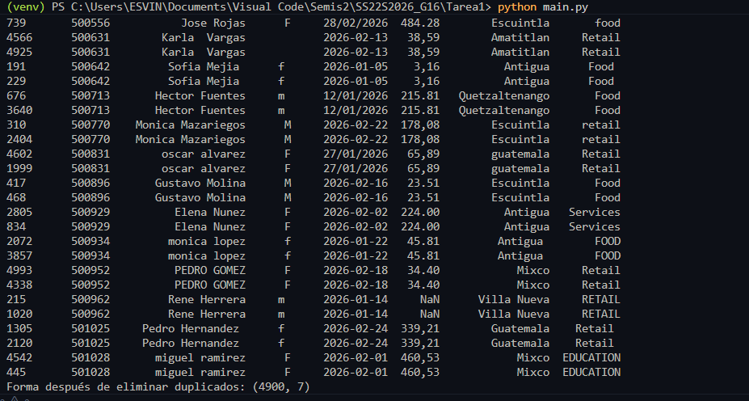
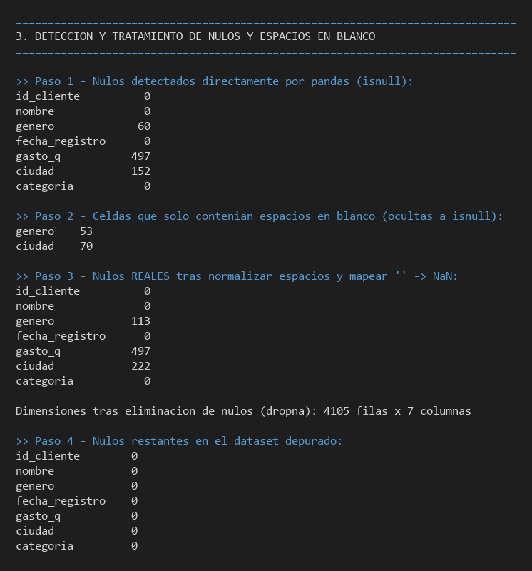
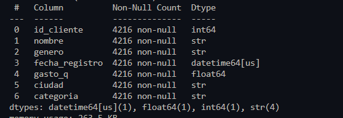

# Tarea 1 - Limpieza y análisis inicial de datos con Python y Pandas  

**Seminario de Sistemas 2 - 2do Semestre 2026**
**Grupo 16**

## Integrantes
| Nombre | Carnet |
|---|---|
| César Rolando Hernández Palacios | 202000806 |
| Keneth Willard Lopez Ovalle | 202100106 |

---


## 1. Dataset utilizado

- **Nombre del dataset:** dataset_sucio.csv
- **Fuente:** [Kaggle / CSV proporcionado por el curso]
- **Descripción breve:** Dataset con 5000 registros de clientes, incluyendo id, nombre, género, fecha de registro, gasto en quetzales, ciudad y categoría.
- **Columnas principales:**
  | Columna | Tipo | Descripción |
  |---|---|---|
  | id_cliente | entero | Identificador único del cliente |
  | nombre | texto | Nombre completo del cliente |
  | genero | texto | Género del cliente (M/F) |
  | fecha_registro | fecha | Fecha en que el cliente se registró |
  | gasto_q | numérico | Gasto total en quetzales |
  | ciudad | texto | Ciudad de residencia |
  | categoria | texto | Categoría de compra/servicio |

## 2. Proceso de limpieza aplicado

### 2.1 Eliminación de duplicados
- Se encontraron **100 filas duplicadas** de 5000 registros originales.

  

- Se eliminaron con `drop_duplicates()`, quedando 4900 registros.

  

### 2.2 Tratamiento de celdas vacías
- Nulos encontrados: `genero` (60), `gasto_q` (497), `ciudad` (152).

  

### 2.3 Estandarización de valores y formatos
- `genero`, `ciudad`, `categoria`: normalización de mayúsculas/minúsculas y eliminación de espacios extra.
- `nombre`: formato título y espacios múltiples corregidos.
- `fecha_registro`: unificación de formatos mixtos (`YYYY-MM-DD` y `DD/MM/YYYY`) a un solo tipo `datetime`.
- `gasto_q`: unificación de separador decimal (coma → punto) antes de convertir a numérico.

## 3. Comparación antes / después

### 3.1 Estado original

  

### 3.2 Estado depurado (después)
  


## 4. Interpretación de resultados

El dataset original contenía 5000 registros con 7 columnas. Durante el proceso de limpieza se 
identificaron 100 filas completamente duplicadas (2% del total), las cuales fueron eliminadas, 
dejando 4900 registros únicos.

Posteriormente se detectaron valores nulos en tres columnas: `genero` (60 registros, 1.2%), 
`gasto_q` (497 registros, 10.1%) y `ciudad` (152 registros, 3.1%). Se optó por eliminar todas las 
filas que contenían al menos un valor nulo en cualquiera de estas columnas, resultando en un 
dataset final de 4216 registros.

Esto representa una reducción del 14.9% respecto al dataset sin duplicados (4900 → 4216), 
concentrada principalmente en los nulos de `gasto_q`, que era la columna con mayor proporción de 
datos faltantes. Si bien esta estrategia garantiza que el dataset final no contiene ningún valor 
faltante, implica una pérdida considerable de información — en un contexto real, podría ser 
preferible evaluar una estrategia de imputación (por ejemplo, mediana para `gasto_q` y una 
categoría "No especificado" para variables categóricas) para conservar más registros, especialmente 
si los datos faltantes no son completamente aleatorios.

```